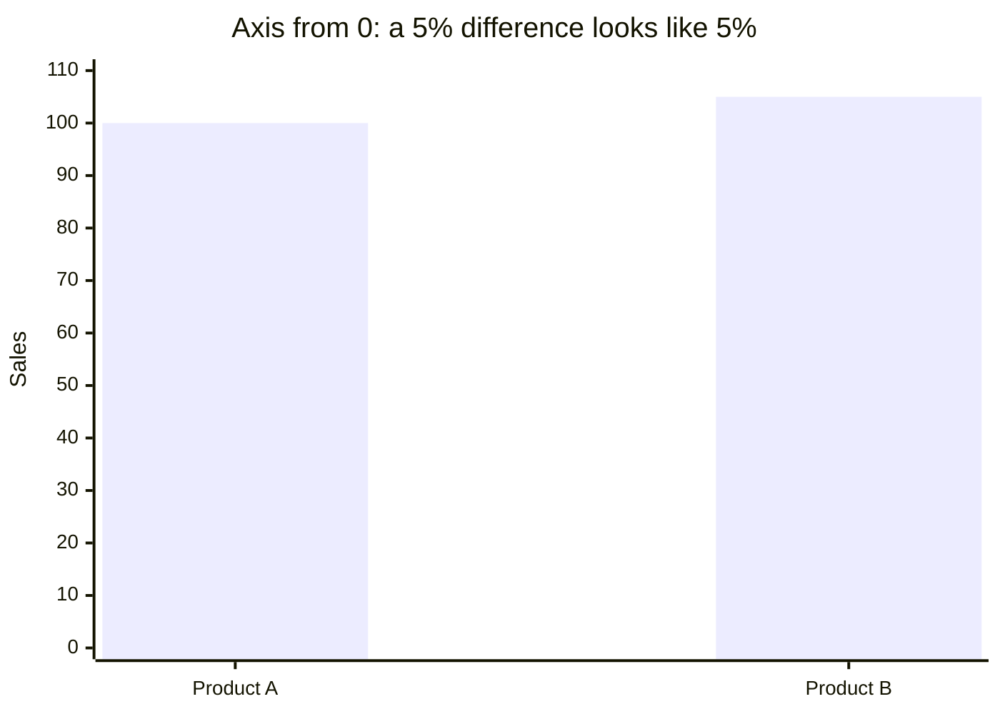

# Data Visualization Errors

> A chart is an *argument*, not a decoration. Most visualization errors are not "ugly design". They are cases where the **visual impression** disagrees with the **underlying numbers**.

**Contents**

1. [Why visualization errors matter](#1-why-visualization-errors-matter)
2. [The core principle: perception vs. data](#2-the-core-principle-perception-vs-data)
3. [Errors in tables](#3-errors-in-tables)
4. [Axis errors](#4-axis-errors) (truncated y-axis, dual axes, log scales, uneven intervals)
5. [Pie chart errors](#5-pie-chart-errors) (3D pies, too many slices, ...)
6. [Other chart-type errors](#6-other-chart-type-errors)
7. [Color errors](#7-color-errors)
8. [Data and context errors](#8-data-and-context-errors) (cherry-picking, Simpson's paradox, missing labels)
9. [Quick reference table](#9-quick-reference-table)
10. [Pre-publish checklist](#10-pre-publish-checklist)
11. [Further reading](#11-further-reading)

---

## 1. Why visualization errors matter

| Cause | Meaning |
|---|---|
| **Accidental** | Author does not know the perceptual or statistical pitfalls (defaults of Excel/PowerPoint often *produce* the errors). |
| **Deliberate** | Author wants to push a conclusion (marketing, politics, "chartjunk" to impress). |

Either way, the **reader** is misled. As an analyst your job is to make the *honest* reading also the *easy* reading.

---

## 2. The core principle: perception vs. data

Edward Tufte's **Lie Factor** measures how much a graphic exaggerates an effect:

$$
\text{Lie Factor} = \frac{\text{size of effect shown in graphic}}{\text{size of effect in data}}
$$

where

$$
\text{size of effect} = \frac{|\text{second value} - \text{first value}|}{\text{first value}}
$$

- Lie Factor $\approx 1$: honest.
- Lie Factor $> 1.05$ or $< 0.95$: visibly distorted (Tufte's rule of thumb).

**Worked example.** Sales go from 100 to 105 (+5 %). The bar chart's y-axis starts at 98, so the bar heights are 2 and 7 units, i.e. the second bar looks 250 % taller:

$$
\text{Lie Factor} = \frac{(7-2)/2}{(105-100)/100} = \frac{2.5}{0.05} = 50
$$

A 5 % change is drawn as if it were a 250 % change.

Related ideas:

- **Cleveland & McGill's perceptual ranking**: humans judge *position on a common scale* most accurately, then length, then angle/slope, then area, then volume, then color saturation. Choose the encoding that matches how precise the reader needs to be. Many errors below (pie, 3D, bubble) are *using a weaker channel than necessary*.
- **Data-ink ratio** (Tufte): maximise the share of ink that carries data, remove decoration.

---

## 3. Errors in tables

Tables are good for **looking up exact values**; they are bad for seeing patterns. Common mistakes:

### 3.1 List of table errors

| # | Error | Why it hurts | Fix |
|---|---|---|---|
| 1 | **Too many columns/rows** ("data dump") | Reader cannot find what matters | Show only what supports the message; move the rest to an appendix |
| 2 | **Text numbers left-aligned or centered** | Digits of different magnitude don't line up, so size comparison is impossible | **Right-align numbers** (or align on the decimal point); left-align text |
| 3 | **Inconsistent decimal places** (`12`, `12.5`, `12.375`) | False sense of precision, hard to compare | Same number of decimals per column, chosen by meaningful precision |
| 4 | **Excess precision** (`3.14159265` for a survey percentage) | Implies accuracy you do not have | Round to meaningful significant digits |
| 5 | **Missing units / currency / time period** | Number is uninterpretable (₹ or $? thousands or millions?) | Put units in the header: `Revenue (₹ crore)` |
| 6 | **Heavy gridlines and borders on every cell** | Ink competes with numbers | Use whitespace; light horizontal rules only |
| 7 | **No ordering logic** | Reader scans randomly | Sort by the key metric, or logically (time, rank, alphabetical for lookup) |
| 8 | **Mixed scales in one column** (some in %, some in absolute) | Invalid comparison | One unit per column |
| 9 | **Missing totals / percentages not summing to 100** | Looks like an error or hidden category | Show totals; note rounding ("may not sum to 100 due to rounding") |
| 10 | **Unclear missing values** (blank vs `0` vs `NA`) | `0` and "not measured" mean different things | Use explicit `N/A`, `–`, and define each in a footnote |
| 11 | **Merged/spanning headers that break sorting or reading** | Ambiguous what a header applies to | Keep a single clear header row; group with spacing |
| 12 | **Heat-map colouring with no legend** or clashing colours | Colour has no readable meaning | Add legend; use one sequential hue |
| 13 | **Using a table when a chart is better** (or vice versa) | Wrong tool for the task | Table → lookup; chart → pattern/trend/comparison |

### 3.2 Before / After example

**Bad** (mixed alignment, mixed decimals, no units):

| Region | Sales | Growth |
|:---:|:---|:---:|
| North | 1250000 | 5.123456 |
| South | 98000.5 | 12 |
| East | 450,000 | 0.5% |
| West | 7.5L | N/A |

**Better** (right-aligned, consistent units/format, sorted by sales):

| Region | Sales (₹ lakh) | YoY growth (%) |
|:---|---:|---:|
| North | 12.5 | 5.1 |
| West | 7.5 | – |
| East | 4.5 | 0.5 |
| South | 1.0 | 12.0 |

Sorted by sales (descending). – = data not available.

> **Rule of thumb:** a good table can be read column-by-column *without* drawing a mental ruler across the page.

---

## 4. Axis errors

### 4.1 Truncated y-axis (non-zero baseline)

**What it is:** the vertical axis starts at a value above 0 (e.g. at 98 instead of 0).

**Why it is a problem (for bar charts):** a bar chart encodes value as **length**. The reader compares *bar lengths as ratios*. If the baseline is not zero, the ratio of lengths ≠ ratio of values, so differences are exaggerated.

*(Above: axis from 0. The two bars look nearly identical, which matches the 5 % difference.)*

| Axis starts at | Bar A (100) looks | Bar B (105) looks | Visual ratio B/A | True ratio B/A |
|---|---|---|---|---|
| 0 | 100 units tall | 105 units tall | 1.05 | 1.05 |
| 98 | 2 units tall | 7 units tall | **3.5** | 1.05 |

**Variations of the same trick**

- Axis "break" hidden or not marked.
- Axis maximum cut so the bars are clipped.
- Different charts on one slide use *different* y-ranges so they cannot be compared.
- Truncating on a chart with a very **wide** range to flatten a trend (the opposite lie: stretching the axis so a real rise looks flat).

**When a non-zero baseline is acceptable**

| Chart type | Zero baseline required? | Reason |
|---|---|---|
| Bar / column | **Yes** | Length encodes value |
| Area chart | **Yes** | Filled area encodes value |
| Line chart | Not necessarily | Position and slope encode change; zero may be meaningless (e.g. body temperature 36–40 °C, an index at 1000s) |
| Dot plot / scatter | Not necessarily | Position only |

Even for line charts, **show the axis clearly labelled**, and avoid choosing a range that makes noise look like a trend. If the range is truncated, say so ("y-axis starts at 36 °C").

### 4.2 Stretched or squashed aspect ratio

The slope of a line depends on the aspect ratio of the plot. Same data, tall-narrow plot = "dramatic spike", wide-short plot = "flat". Guideline (Cleveland's *banking to 45°*): choose the aspect ratio so the average slope segments sit near 45°.

### 4.3 Dual y-axes

Two different scales on left and right axes in one chart.

| Problem | Example |
|---|---|
| Crossing point of lines is **arbitrary**, controlled by the author's choice of scales | "Ice-cream sales overtake drowning deaths in July!" |
| Suggests a relationship (correlation / causation) that is only an artefact of scaling | Two unrelated series made to move together by tuning ranges |
| Reader must constantly look at the legend to know which axis a line belongs to | Cognitive load |

**Alternatives:** two stacked small-multiple charts sharing the x-axis; index both series to 100 at a base date; plot one against the other in a scatter plot.

### 4.4 Unlabelled or misleading log scale

A log axis is legitimate for data spanning orders of magnitude or for comparing **growth rates**. Errors:

- Not saying the axis is log; readers see a straight line and assume linear growth.
- Using log scale for bar charts (baseline 0 is impossible on a log axis).
- Gridlines not at powers of 10, so the spacing is unreadable.

### 4.5 Uneven or inconsistent intervals

- X-axis with years `2010, 2011, 2012, 2015, 2020` **equally spaced**, so the trend gets compressed or stretched.
- Mixing yearly data and monthly data in one line without noting it.
- Non-uniform histogram bin widths drawn with equal-width bars (should plot **density**, not count, in that case).

### 4.6 Missing axis labels, units, and titles

A chart without "what is measured, in what unit, over what period" is not a finding, it is a picture.

### 4.7 Axis ordering

- Categories in alphabetical order when a **value order** (descending) reveals the ranking.
- Reversed axis (high at bottom) without notice. A famous example: Florida's "Stand Your Ground" gun-deaths chart (2014) used an inverted y-axis, so a rise in deaths *looked like* a drop.

---

## 5. Pie chart errors

A pie chart encodes values as **angles / arc length / area**, which humans judge poorly. It is only appropriate for **part-to-whole** with **few** categories.

### 5.1 3D pie charts

| Distortion | Why |
|---|---|
| **Perspective** makes slices at the front look larger than identical slices at the back | Foreshortening: front slice is drawn with more area |
| **Tilt/rotation** changes apparent size of the same slice | Same data, different picture depending on angle |
| **Extruded side wall** adds fake area | Slice thickness is not data |
| **Exploded slices** break the "whole" and shift focus arbitrarily | Hard to compare |

In a 3D pie chart, the *drawn area* of a slice is no longer proportional to its value: Lie Factor ≠ 1 by construction. **3D adds zero information and subtracts accuracy.**

### 5.2 Other pie-chart errors

| Error | Explanation | Better option |
|---|---|---|
| **Too many slices** (more than ~5) | Tiny wedges are unreadable, colours get reused | Sorted horizontal bar chart; group the tail as "Other" |
| **Slices that do not sum to 100 %** | Overlapping categories (e.g. a survey with multi-select answers) | Use a bar chart; each bar is its own percentage |
| **Many similar-sized slices** | 21 % vs 19 % cannot be told apart by angle | Bar chart with labels |
| **Pies used for comparisons across groups** (several pies side-by-side) | Reader must compare angles across pies | Grouped / stacked bars, or 100 % stacked bar |
| **Pies for time series** | Pie has no axis for time | Line or column chart |
| **No data labels** and a legend far from the pie | Eye keeps jumping back-and-forth | Direct labels on slices |
| **Unsorted slices** | No ordering cue | Start at 12 o'clock, descending clockwise |
| **Donut chart with the value in the centre only** | Arc length is even harder to read than angle | Bar chart |
| **Part-to-whole where the "whole" is undefined** | What do 100 % represent? | State the denominator ("n = 1,200 respondents") |

> **When a pie is fine:** 2–3 slices, one slice is clearly dominant or the point is "about half / about a quarter" (e.g. "62 % vs 38 %"), labelled directly.

---

## 6. Other chart-type errors

### 6.1 3D bar / column / line charts

Same issues as 3D pies: the back bars are hidden, the height is read against a floor that is not aligned with the axis gridlines, and perspective changes the apparent size.

### 6.2 Area and size encodings (bubbles, pictograms)

If you double a circle's **radius** to show "twice the value", its **area** grows 4×. For a 3D icon, the **volume** grows 8×.

$$
A = \pi r^2 \;\;\Rightarrow\;\; \text{to represent value } v \text{ use } r \propto \sqrt{v}
$$

Pictograms (e.g. money bags scaled in both height and width) commit this error constantly.

### 6.3 Stacked bar / stacked area charts with many series

Only the **bottom** series sits on a common baseline. All the others float, so comparing them across bars is hard.

- Use stacked charts only when the *total* is the main point and there are few segments.
- Otherwise use grouped bars or small multiples.

### 6.4 Overplotting in scatter plots

Thousands of points drawn on top of each other hide the density. Fix with transparency (alpha), hexbin / 2D density plots, jitter, or sampling.

### 6.5 Wrong chart for the data type

| Data | Wrong chart | Right chart |
|---|---|---|
| Time series | Pie, unordered bars | Line, column (for few periods) |
| Distribution of one variable | Bar of means (hides spread) | Histogram, box plot, violin |
| Relationship between two numeric variables | Two separate bar charts | Scatter plot |
| Categorical comparison | Line chart connecting categories (implies order/continuity) | Bar chart |
| Part-to-whole over time | Many pies | 100 % stacked area or bars |

### 6.6 Bar charts of means without uncertainty

"Dynamite plots" (a bar for the mean + a tiny error whisker) hide sample size and distribution. Show the points, the interval (confidence interval, not just SD), or the distribution.

### 6.7 Chartjunk

Decorative gradients, background images, shadows, "ducks" (Tufte) where the graphic form dominates the data. Remove anything that is not data or necessary context.

---

## 7. Color errors

| Error | Problem | Fix |
|---|---|---|
| **Rainbow (jet) colormap** for continuous data | Not perceptually uniform: bright bands look like boundaries that are not in the data; not ordered for grayscale or colour-blind readers | Perceptually uniform sequential maps (`viridis`, `cividis`) |
| **Red-green encoding** | ~8 % of men have red-green colour deficiency | Use blue/orange; add shape/labels as redundant encoding |
| **Too many categorical colors** (> 6-8) | Cannot be matched with the legend | Fewer categories, direct labels, small multiples |
| **Using color with no meaning** (each bar a different color in a single series) | Suggests a distinction that is not there | One color; highlight just the point of interest |
| **Sequential palette for diverging data** (or vice-versa) | The neutral midpoint (e.g. 0, average) is not visible | Diverging palette centred at the meaningful midpoint |
| **Low contrast** (light grey on white) | Unreadable in print/projectors | Check contrast ratio |
| **Culturally loaded colors** (red = bad, but red = good in some markets) | Misread | Choose with the audience in mind |

---

## 8. Data and context errors

These are not about the drawing itself but about *what data was chosen to draw*.

### 8.1 Cherry-picking the time window

Start/end dates chosen to show a rise (or fall) that vanishes with a longer window. Always ask: **"What does the chart look like 5 years earlier/later?"**

### 8.2 Absolute vs. relative (and denominators)

- Counts instead of **rates**: "city A has more crimes than city B", but A has ten times the population. Use per-capita.
- Percent change from a tiny base ("sales up 300 %" from 1 to 4 units).
- Percentages without stating **n**.

### 8.3 Aggregation hiding structure: Simpson's paradox

A trend appearing in every subgroup can reverse when groups are combined.

| | Treatment A | Treatment B |
|---|---|---|
| Small stones | 93 % (81/87) | 87 % (234/270) |
| Large stones | 73 % (192/263) | 69 % (55/80) |
| **Overall** | 78 % (273/350) | **83 %** (289/350) |

A wins in each subgroup but B wins overall (the classic kidney-stone data), because the groups are not equally sized. Plotting only the aggregate would mislead.

### 8.4 Correlation presented as causation

Two lines rising together (ice-cream vs. drownings, cheese consumption vs. deaths by bedsheet tangling) imply a causal story. Look for confounders, and avoid titles like "X drives Y" unless an experiment or causal design supports it. See *Spurious Correlations* by Tyler Vigen for humorous examples.

### 8.5 Misleading maps

- **Choropleths** of raw counts: large, sparsely populated regions dominate visually. Use rates or cartograms.
- Map projection distortion (Mercator inflates areas near the poles).

### 8.6 Ignoring uncertainty and missing data

- No error bars / confidence intervals, so small differences look like facts.
- Missing values silently plotted as 0, or lines connecting across gaps.
- Forecasts drawn the same way as actuals (use dashed lines/shading, label "forecast").

### 8.7 Missing context

- No source, date, or sample information.
- No benchmark (is 4 % good or bad?).
- Title says nothing; best practice is an **insight title** ("Churn doubled after the price change") instead of a topic title ("Churn by month").

---

## 9. Quick reference table

| Error | Category | Main consequence | Quick fix |
|---|---|---|---|
| Left-aligned numbers in table | Table | Cannot compare magnitudes | Right-align / decimal align |
| Inconsistent decimals | Table | False precision | Fixed decimals per column |
| Truncated y-axis on bars | Axis | Exaggerated differences (Lie Factor ≫ 1) | Start at 0 |
| Dual y-axes | Axis | Fake correlation | Small multiples / index to 100 |
| Unlabelled log scale | Axis | Growth mis-read as linear | Label it; gridlines at powers of 10 |
| Uneven x-axis spacing | Axis | Distorted trend | Proportional time axis |
| Inverted axis | Axis | Direction mis-read | Do not invert without a clear flag |
| 3D pie | Pie | Area ≠ value | 2D pie or bar |
| > 5 slices | Pie | Unreadable | Sorted bar chart |
| Slices not summing to 100 % | Pie | Logical error | Bar chart per category |
| Bubble radius ∝ value | Size | Area exaggerated by $v^2$ | Area ∝ value |
| Rainbow colormap | Color | Fake boundaries | Viridis / sequential |
| Red-green only | Color | Inaccessible | Colour-blind-safe palette |
| Cherry-picked window | Data | Wrong trend | Show the full context |
| Counts instead of rates | Data | Misleading ranking | Normalise |
| Aggregate only | Data | Simpson's paradox | Disaggregate |
| Correlation as causation | Data | False causal claim | Careful title, confounders |
| No source / units / n | Context | Unverifiable | Annotate |

---

## 10. Pre-publish checklist

- [ ] **Message**: can I state the one takeaway in a sentence? Is it in the title?
- [ ] **Chart type** matches the data and the task (comparison, trend, distribution, part-to-whole, relationship)?
- [ ] **Bar/area charts start at zero**; any truncated axis is explicitly flagged?
- [ ] **Single y-axis** (or a very good reason for two)?
- [ ] Axes **labelled with units**; time axis proportionally spaced; scale type (linear/log) stated?
- [ ] **No 3D**, no decorative effects?
- [ ] Pie only for few parts that sum to 100 %, otherwise a sorted bar chart?
- [ ] Area/size encodings scale by **area**, not radius?
- [ ] Colours colour-blind safe, meaningful, and limited in number?
- [ ] Values are **rates/normalised** where the groups differ in size?
- [ ] **Uncertainty** (CI, sample size n) and **missing data** shown?
- [ ] **Source, date and definitions** stated?
- [ ] Table numbers right-aligned, consistent decimals, units in the header?
- [ ] Test: show it to someone for 5 seconds; does their takeaway equal the data's takeaway?

---

## 11. Further reading

- Edward Tufte, *The Visual Display of Quantitative Information*: Lie Factor, data-ink ratio, chartjunk.
- Alberto Cairo, *How Charts Lie* (2019).
- Darrell Huff, *How to Lie with Statistics* (1954).
- Cleveland & McGill (1984), *Graphical Perception*: ranking of visual encodings.
- Claus Wilke, *Fundamentals of Data Visualization* (free online).
- Stephen Few, *Show Me the Numbers* (tables and graphs).
- Tyler Vigen, *Spurious Correlations* (website).
- Reddit r/dataisugly: a good source of real-world bad examples.

---

### Summary

> **A good visualization makes the true pattern easy to see. A bad one makes a false pattern easy to see, or the true one hard.** Check the *baseline*, the *scale*, the *encoding*, the *denominator*, and the *context*, in that order.
