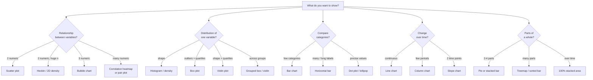

# Choosing the Right Chart

> **Start from the question, not the chart.** Every chart type is good at answering one family of questions. Pick the question first (compare? trend? distribution? relationship? composition?), then the chart.

**Contents**

1. [The method: question → data → chart](#1-the-method-question--data--chart)
2. [Decision flowchart](#2-decision-flowchart)
3. [Relationship: scatter plot and friends](#3-relationship-scatter-plot-and-friends)
4. [Distribution and outliers: histogram, box plot, violin](#4-distribution-and-outliers-histogram-box-plot-violin)
5. [Comparison: bar, dot, lollipop](#5-comparison-bar-dot-lollipop)
6. [Trend over time: line, area, slope](#6-trend-over-time-line-area-slope)
7. [Composition (part-to-whole)](#7-composition-part-to-whole)
8. [Deviation, target and change](#8-deviation-target-and-change)
9. [Flow, process and hierarchy](#9-flow-process-and-hierarchy)
10. [Geographic data](#10-geographic-data)
11. [Uncertainty and many groups](#11-uncertainty-and-many-groups)
12. [Master cheat sheet](#12-master-cheat-sheet)
13. [Code snippets](#13-code-snippets)

---

## 1. The method: question → data → chart

1. **What question am I answering?** (one sentence)
2. **What are my variables?** Number of variables (1, 2, 3+) and their types:
   - *Categorical* (nominal: region, product; ordinal: low/med/high)
   - *Numerical* (discrete counts, continuous measures)
   - *Temporal* (dates, a special ordered variable)
3. **What is the audience's task?** Look up exact values (table), compare, see a pattern, spot unusual points?
4. **Choose the encoding** that is read most accurately (position on a common scale > length > angle > area > colour; see [notes 01](01-data-visualization-errors.md#2-the-core-principle-perception-vs-data)).

The seven common analytical goals:

| Goal | Typical question | First-choice chart |
|---|---|---|
| **Relationship** | Do X and Y move together? | Scatter plot |
| **Distribution** | How are values spread? Any outliers? | Histogram, box plot |
| **Comparison** | Which category is bigger? | Bar chart |
| **Trend** | How did it change over time? | Line chart |
| **Composition** | What share does each part have? | Stacked bar / treemap (pie if few parts) |
| **Deviation / target** | Above or below a reference? | Diverging bar, bullet chart |
| **Flow / process** | How does quantity move between stages? | Sankey, funnel, waterfall |

---

## 2. Decision flowchart



---

## 3. Relationship: scatter plot and friends

### 3.1 Scatter plot: the chart for correlation

**Use when:** two *numeric* variables, one point per observation, and you want to see **direction, strength, shape and outliers** of the relationship.

| What you see | Meaning |
|---|---|
| Cloud slopes upward | Positive correlation |
| Cloud slopes downward | Negative correlation |
| Shapeless blob | No linear relationship |
| Curve (U shape, exponential) | **Non-linear** relationship; Pearson $r$ may be near 0 |
| Distinct clusters | Hidden subgroups (colour by category to confirm) |
| Isolated far-away points | Outliers / high-leverage points |

**Strength of linear association** is summarised by Pearson's correlation:

$$
r = \frac{\sum_{i}(x_i-\bar{x})(y_i-\bar{y})}{\sqrt{\sum_i (x_i-\bar{x})^2}\;\sqrt{\sum_i (y_i-\bar{y})^2}}, \qquad -1 \le r \le 1
$$

| $\lvert r \rvert$ | Rough interpretation |
|---|---|
| 0.0 – 0.2 | Very weak / none |
| 0.2 – 0.5 | Weak to moderate |
| 0.5 – 0.8 | Moderate to strong |
| 0.8 – 1.0 | Very strong |

> **Why plot it, not just compute $r$?** *Anscombe's quartet*: four datasets with nearly identical mean, variance, $r \approx 0.816$ and regression line, but totally different scatter plots (linear, curved, one outlier, one leverage point). Always look at the scatter first.

**Examples:** advertising spend vs. sales; study hours vs. exam score; house size vs. price.

**Good practice**

- Put the *explanatory* variable on x, the *response* on y.
- Add a trend line (linear or LOESS) and optionally a confidence band.
- Use transparency or hexbin for large $n$ to avoid overplotting.
- Colour or shape for a **third categorical** variable; size for a third numeric variable (bubble chart).
- Remember: **correlation ≠ causation**.

**Avoid when:** one of the variables is categorical (use box plot/bar), or the data is a time series where order matters (use line chart; a *connected scatter* is the exception).

### 3.2 Related relationship charts

| Chart | Use when | Notes |
|---|---|---|
| **Bubble chart** | 3 numeric variables (x, y, size) | Size must scale by **area**, not radius |
| **Hexbin / 2D density** | Very many points (10⁴+) | Shows density instead of individual points |
| **Correlation heatmap** | Many numeric variables, want all pairwise $r$ | Use diverging colour centred at 0; annotate the numbers |
| **Pair plot (scatter matrix)** | Exploratory analysis of 3-8 variables | Diagonal = histograms/density |
| **Connected scatter** | Two variables evolving over time | Label the time points; hard to read if long |

---

## 4. Distribution and outliers: histogram, box plot, violin

### 4.1 Box plot: the chart for outliers and spread

**Use when:** you want a compact summary of **median, spread, skew and outliers**, especially when **comparing several groups** side by side.

**Anatomy** (the *five-number summary* plus outlier rule):

```text
                         outliers
                            o   o
                 
        ┌─────────────┬──────────┐
  ├─────┤     Q1      │ median   │  Q3  ├──────┤
        └─────────────┴──────────┘
  ^                                          ^
  lower whisker                      upper whisker
  (smallest value ≥ Q1 − 1.5·IQR)   (largest value ≤ Q3 + 1.5·IQR)
```

| Part | Meaning |
|---|---|
| Line inside the box | **Median** (Q2) |
| Box edges | **Q1** (25th percentile) and **Q3** (75th percentile) |
| Box height | **IQR** $= Q_3 - Q_1$: the middle 50 % of the data |
| Whiskers | Furthest points *within* 1.5 × IQR of the box |
| Dots beyond whiskers | **Outliers** (Tukey's rule) |

**Tukey's fences** for flagging outliers:

$$
\text{lower fence} = Q_1 - 1.5\,\text{IQR}, \qquad \text{upper fence} = Q_3 + 1.5\,\text{IQR}
$$

Any value outside the fences is plotted individually as a potential outlier.

**Worked example.** Salaries (₹ thousand): 30, 32, 35, 36, 38, 40, 42, 45, 48, 150.

- $Q_1 \approx 35$, $Q_3 \approx 45$, so $\text{IQR} = 10$
- Upper fence $= 45 + 1.5 \times 10 = 60$
- 150 > 60, so **150 is flagged as an outlier**; the other points are inside the whiskers.

**What a box plot tells you at a glance**

| Visual feature | Interpretation |
|---|---|
| Median off-centre in the box | Skewed distribution |
| Long whisker on one side | Long tail on that side |
| Many dots on one side | Heavy-tailed / skewed data |
| Boxes at different heights (side by side) | Groups differ in location |
| Boxes of different heights | Groups differ in spread |

**Good practice**

- Use for **many groups** (compare 3 to 20 boxes in one picture).
- Overlay the raw points (strip/swarm plot) when $n$ is small (< 30-50).
- State what whiskers mean (1.5 × IQR vs min/max vs percentiles).

**The numbers behind the picture:** the box is the *five-number summary* and the fences are an outlier rule; see [descriptive-statistics/04](../descriptive-statistics/04-position-and-outliers.md#4-detecting-outliers) for how fences compare with z-scores (z-scores can *miss* outliers through masking) and [descriptive-statistics/03](../descriptive-statistics/03-skewness-and-kurtosis.md) for turning "off-centre median" into a skewness number.

**Limitations:** it hides the **shape** (a bimodal distribution can give the same box as a unimodal one), and "outlier" is a *rule*, not a verdict. An outlier may be an error, a data-entry mistake or the most interesting observation. Investigate before deleting.

#### How to read a box plot: worked example (SPSS output)

The plot below is a typical SPSS-style box plot of one variable (`VAR0001`), drawn **horizontally** with the value axis from 0 to 2. Values are eyeballed from the picture.

```text
value   0.0        0.5        1.0        1.5        2.0
         |----------|----------|----------|----------|
         ├──┬──────┬───────────┤                    
            │ Q1  M│  Q3       └─────────┤  o o oo o o o o      *
            └──────┘                                           (214)
         min  box (IQR)    whisker end     outliers (o)    extreme (*)
                           ≈ 1.17          ≈ 1.2 to 1.9    ≈ 2.0
```

| Element | Approx. value | Meaning |
|---|---|---|
| Left edge of box | ≈ 0.10 | **Q1**: 25 % of observations are below this |
| Thick line in box | ≈ 0.27 | **Median (Q2)**: 50 % below, 50 % above |
| Right edge of box | ≈ 0.55 | **Q3**: 75 % of observations are below this |
| Box width | ≈ 0.45 | **IQR** = Q3 − Q1: spread of the middle 50 % |
| Left whisker end | ≈ 0.0 | Smallest non-outlier value (here the minimum) |
| Right whisker end | ≈ 1.17 | Largest value *inside* the upper fence |
| Circles `o` (cases 207–217) | ≈ 1.2 – 1.9 | **Outliers**: beyond 1.5 × IQR from the box |
| Star `*` (case 214) | ≈ 2.0 | **Extreme outlier**: beyond 3 × IQR from the box |

The numbers beside the outlier symbols are **row (case) IDs**, so you can go back to the dataset and inspect those records.

**Verify the fences** (IQR ≈ 0.45):

| Fence | Formula | Value | Result |
|---|---|---|---|
| Upper (outlier) | $Q_3 + 1.5\,\text{IQR}$ | $0.55 + 0.68 \approx 1.23$ | Whisker stops just below it; points beyond are circles |
| Upper (extreme) | $Q_3 + 3\,\text{IQR}$ | $0.55 + 1.35 \approx 1.90$ | Only case 214 (≈ 2.0) exceeds it, hence the star |
| Lower (outlier) | $Q_1 - 1.5\,\text{IQR}$ | $0.10 - 0.68 < 0$ | Below the minimum, so no low outliers |

**What the plot says**

1. **Right-skewed**: the median is close to Q1 (not centred in the box), the right whisker is far longer than the left, and all outliers are on the right.
2. **Heavy upper tail**: about 11 flagged cases (207–217), so this is a tail, not one stray value.
3. **Most values are small** (middle 50 % between ≈ 0.1 and 0.55), while a few reach ≈ 2.0. Outliers pull the mean above the median, so report the **median** as the typical value.

**Reading routine for any box plot**

1. Read the **axis, units and orientation** (box plots can be horizontal or vertical).
2. Locate the **median** and see where it sits inside the box.
3. Judge **spread** from the box width (IQR) and **skew** from the median position and whisker lengths.
4. Check what the **whiskers** mean (1.5 × IQR is the default in SPSS, R and seaborn).
5. Look at **points beyond the whiskers**: error, rare-but-real case, or the interesting one? Investigate before removing.

### 4.2 Histogram: the chart for the shape of one variable

**Use when:** one numeric variable and you want to see **shape**: symmetric, skewed, bimodal, gaps, spread.

- Bar height = count (or density) in each **bin**.
- **Bin width matters**: too wide hides structure; too narrow gives noise. Try several.
- Don't confuse with a bar chart: bins are *adjacent* intervals of a continuous variable, so bars touch.
- With unequal bin widths, plot **density** (count ÷ width), not count.
- Read off **skewness** (which tail is longer), **modality** (number of peaks) and **kurtosis** (tail weight) visually, then confirm with numbers: [descriptive-statistics/03](../descriptive-statistics/03-skewness-and-kurtosis.md). The mean/median/mode ordering in each shape is in [descriptive-statistics/01](../descriptive-statistics/01-central-tendency.md#5-how-shape-decides-mean-vs-median-vs-mode). To match the histogram to a model curve, see [probability](../probability/03-continuous-distributions.md).

### 4.3 Other distribution charts

| Chart | Best for | Strength | Weakness |
|---|---|---|---|
| **Density (KDE) plot** | Smooth shape; overlay a few groups | Easy to overlay | Smoothing choice can mislead; tails extend beyond the data |
| **Violin plot** | Shape *and* quartiles by group | Shows bimodality that box plots hide | Less familiar to lay audiences |
| **Strip / swarm plot** | Small samples; show every point | Honest about $n$ | Gets crowded for large $n$ |
| **ECDF** | Comparing distributions precisely, percentiles | No binning decisions | Unfamiliar |
| **Q-Q plot** | Checking normality | Diagnostic | Technical audience only |
| **Ridgeline plot** | Distribution across many ordered groups (e.g. months) | Compact | Overlap can hide detail |

### 4.4 Which distribution chart?

| Your situation | Choose |
|---|---|
| One variable, want shape | Histogram |
| One variable, want median/outliers quickly | Box plot |
| Compare distributions of 3+ groups | Grouped box plot (or violin) |
| Suspect two peaks (bimodal) | Histogram or violin (not a box plot alone) |
| Very small $n$ | Strip / dot plot |
| Check normality assumption | Q-Q plot + histogram |

---

## 5. Comparison: bar, dot, lollipop

| Chart | Use when | Notes |
|---|---|---|
| **Vertical bar / column** | Compare a few categories; short labels | **Start at zero** |
| **Horizontal bar** | Many categories or long labels; rankings | Sort descending |
| **Grouped (clustered) bar** | Compare 2-3 sub-series across categories | Too many series becomes cluttered |
| **Lollipop / dot plot** | Many categories, values far from zero, less ink | Dot plot may use a non-zero baseline |
| **Bullet chart** | Actual vs. target with qualitative ranges | Compact KPI display |
| **Small multiples** | Same chart repeated per category/panel | Shared axes make panels comparable |

**Example:** sales by region (5 regions) → sorted horizontal bar; employee satisfaction across 40 departments → dot plot.

---

## 6. Trend over time: line, area, slope

| Chart | Use when | Notes |
|---|---|---|
| **Line chart** | Continuous time series; trend, seasonality, turning points | Not for unordered categories; limit to ~5 lines |
| **Column chart** | Few discrete periods (e.g. 4 quarters) | Zero baseline |
| **Area chart** | Cumulative magnitude over time (one or few series) | Zero baseline; stacked areas hide the middle series' shape |
| **Slope chart** | Compare **two time points** across many categories | Shows rank changes |
| **Sparkline** | Tiny trend next to a number/in a table | No axes; shows shape only |
| **Calendar heatmap** | Daily patterns (weekday/seasonal) | Good for activity data |
| **Candlestick / OHLC** | Financial prices | Specialised |
| **Cycle plot / seasonal plot** | Seasonality | Months overlaid across years |

Tips: use a **proportional** time axis, direct-label lines instead of a legend, and mark events (launch, policy change) with annotations.

---

## 7. Composition (part-to-whole)

| Chart | Use when | Notes |
|---|---|---|
| **Pie / donut** | 2-4 parts, one point: "about half" | Sort, label directly; avoid 3D |
| **Stacked bar** | Composition across a few groups | Only the bottom segment is easy to compare |
| **100 % stacked bar** | Compare *proportions* across groups | Loses the totals; mention n |
| **Stacked / 100 % area** | Composition **over time** | Few series |
| **Treemap** | Many parts, hierarchical (category > subcategory) | Area is hard to compare precisely |
| **Waffle chart** | Communicate a single percentage to lay audience (e.g. 37 of 100) | Not for precise reading |
| **Sunburst** | Multi-level hierarchy | Treemap is usually clearer |

---

## 8. Deviation, target and change

| Chart | Use when |
|---|---|
| **Diverging bar** | Positive vs. negative from a baseline (profit/loss, survey agree vs. disagree, variance to budget) |
| **Waterfall** | How an initial value becomes a final value via increments (profit bridge) |
| **Bullet chart** | Performance vs. target |
| **Gauge / speedometer** | Rarely; wastes space and is imprecise. Prefer a bullet chart |
| **Slope chart / dumbbell** | Before vs. after per category |

---

## 9. Flow, process and hierarchy

| Chart | Use when |
|---|---|
| **Funnel** | Conversion through ordered stages (visit → cart → purchase). Often better as a simple bar with % drop-off |
| **Sankey / alluvial** | Flows between categories (customer movement across segments, energy flow) |
| **Gantt** | Project schedule |
| **Network graph** | Relationships between entities |
| **Treemap / dendrogram** | Hierarchy / clustering |

---

## 10. Geographic data

| Chart | Use when | Caution |
|---|---|---|
| **Choropleth** | Rates/ratios by region | Use *rates*, not raw counts; large areas dominate |
| **Proportional symbol map** | Counts at locations | Overlap in dense areas |
| **Heat / density map** | Point-density hotspots | Smoothing choice changes the picture |
| **Cartogram** | Distort area by value (e.g. population) | Unfamiliar geography |

**Maps are only worth it when location itself matters.** If you only compare values by state, a sorted bar chart is usually clearer.

---

## 11. Uncertainty and many groups

- **Error bars / confidence-interval plot**, **fan chart** (forecast ranges), **shaded bands** on lines: show that estimates are not exact.
- **Small multiples**: repeat the same simple chart for each subgroup instead of cramming 12 lines in one plot. This is often *the* fix for cluttered charts.
- **Parallel coordinates / radar**: radar charts are rarely a good idea (area depends on axis order, hard to compare); prefer a dot plot or heatmap.
- **Heatmap (matrix)**: two categorical dimensions plus a numeric value (e.g. day × hour).

---

## 12. Master cheat sheet

| Situation / question | Variables | Best chart | Avoid |
|---|---|---|---|
| Are X and Y correlated? | 2 numeric | **Scatter plot** (+ trend line) | Two separate bar charts |
| Which points are unusual? | 1 numeric (by group) | **Box plot** (outliers beyond 1.5 IQR) | Mean-only bar chart |
| What does the distribution look like? | 1 numeric | **Histogram** / density | Pie chart |
| Compare spread across groups | 1 numeric + 1 categorical | **Grouped box plot / violin** | Bars of means with no spread |
| Many points, relationship | 2 numeric, large n | **Hexbin / 2D density** | Raw scatter (overplotting) |
| Add a third numeric variable | 3 numeric | **Bubble chart** | 3D scatter |
| All pairwise correlations | Many numeric | **Correlation heatmap / pair plot** | Dozens of separate scatters |
| Rank categories | 1 categorical + 1 numeric | **Sorted horizontal bar** | Pie, unsorted bars |
| Trend over time | 1 temporal + 1 numeric | **Line chart** | Pie, 3D |
| Before vs. after for many items | 1 categorical, 2 time points | **Slope chart / dumbbell** | Clustered bars |
| Share of a whole (few parts) | Parts sum to 100 % | **Pie / stacked bar** | Pie with 10+ slices |
| Share of a whole over time | Parts × time | **100 % stacked area** | Many pies |
| Actual vs. target | Value + target | **Bullet chart** | Gauge |
| Positive vs. negative change | Signed values | **Diverging bar** | Single-colour bars |
| Step-by-step build-up | Increments | **Waterfall** | Stacked bar |
| Conversion through stages | Ordered stages | **Funnel / bar** | Pie |
| Flow between categories | Source → target | **Sankey** | Spaghetti line plots |
| Regional rates | Geography + rate | **Choropleth** | Choropleth of raw counts |
| Many hierarchical parts | Category tree | **Treemap** | Pie |
| Hard to read: too many series | Many groups | **Small multiples** | One chart with 15 lines |
| Exact lookup | Few values | **Table** | Chart |

---

## 13. Code snippets

Python (`seaborn` / `matplotlib`). `df` is a DataFrame.

```python
import seaborn as sns
import matplotlib.pyplot as plt

# Correlation: scatter plot with trend line, coloured by a category
sns.lmplot(data=df, x="ad_spend", y="sales", hue="region", height=5)

# Outliers and spread across groups: box plot (+ raw points)
ax = sns.boxplot(data=df, x="department", y="salary", whis=1.5)
sns.stripplot(data=df, x="department", y="salary", color="black", alpha=0.4, size=3, ax=ax)

# Shape of one variable
sns.histplot(data=df, x="salary", bins=20, kde=True)

# Many pairwise relationships
sns.pairplot(df[["ad_spend", "sales", "price", "rating"]])

# Correlation matrix heatmap (diverging palette centred at 0)
sns.heatmap(df.corr(numeric_only=True), annot=True, cmap="coolwarm", center=0, vmin=-1, vmax=1)

plt.show()
```

Finding the outliers a box plot would flag:

```python
q1, q3 = df["salary"].quantile([0.25, 0.75])
iqr = q3 - q1
lower, upper = q1 - 1.5 * iqr, q3 + 1.5 * iqr
outliers = df[(df["salary"] < lower) | (df["salary"] > upper)]
```

---

### Summary

> **Scatter plot** → relationship between two numbers.
> **Box plot** → spread and outliers (especially across groups).
> **Histogram** → shape of one variable.
> **Bar** → compare categories. **Line** → trend. **Stacked bar / treemap** → composition.
> If you cannot say which *question* your chart answers, you picked the chart before the question.
