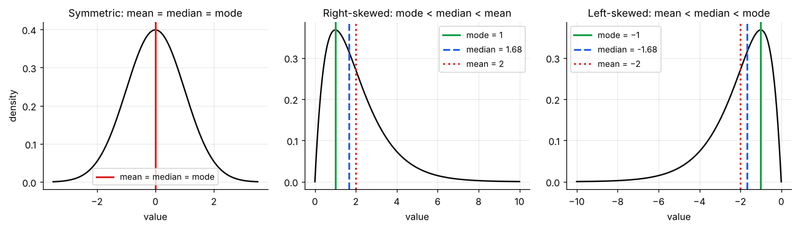
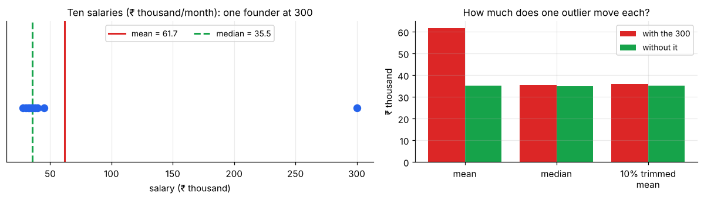

# Measures of Central Tendency

> **A measure of central tendency answers "what is a typical value?"** There is no single right answer. Mean, median and mode each define "typical" differently, and the right one depends on the *shape* of the data and on what you will do with the number.

**Contents**

1. [Running example](#1-running-example)
2. [Mean](#2-mean)
3. [Median](#3-median)
4. [Mode](#4-mode)
5. [How shape decides: mean vs median vs mode](#5-how-shape-decides-mean-vs-median-vs-mode)
6. [Other means: weighted, trimmed, geometric, harmonic](#6-other-means-weighted-trimmed-geometric-harmonic)
7. [Which one should I report?](#7-which-one-should-i-report)
8. [Connections to other notes](#8-connections-to-other-notes)
9. [Code snippets](#9-code-snippets)

---

## 1. Running example

Monthly salaries (₹ thousand) at a small company, nine employees and the founder:

**28, 30, 32, 33, 35, 36, 38, 40, 45, 300**

This dataset is used in all four descriptive-statistics notes. The founder's 300 is deliberately extreme, to show which statistics survive an outlier and which do not.

---

## 2. Mean

**Sample mean:** x̄ = (x₁ + x₂ + … + xₙ) / n = (Σ xᵢ) / n

- Uses **every** value, so it is the most informative measure when the data are well-behaved.
- It is the **balance point** of the data: the deviations above and below it cancel exactly, Σ(xᵢ − x̄) = 0.
- It is the value that **minimises the sum of squared errors**, Σ(xᵢ − c)². That is why it sits at the heart of variance, regression and the normal distribution.
- **Not robust:** one extreme value drags it.

**Example:** x̄ = (28 + 30 + … + 45 + 300)/10 = **61.7**. But 9 of the 10 people earn ≤ 45. The mean describes nobody.

*Link to probability:* x̄ is the sample version of the expected value E[X] (see [probability/01](../probability/01-random-variables-and-expectation.md#3-expectation-mean)).

---

## 3. Median

**Median:** the middle value after sorting. For odd n, it is the (n + 1)/2-th value; for even n, the average of the two middle values. Half the data lie below it and half above.

- **Robust:** changing the largest value from 300 to 3,000 does not move it at all.
- It **minimises the sum of absolute errors**, Σ|xᵢ − c|.
- It ignores the *size* of values (only the order), so it throws away some information.

**Example:** sorted data → middle two are 35 and 36 → median = **35.5**. That is a fair picture of a typical employee.

The median is the 50th percentile, i.e. where the CDF equals 0.5 (see [04 – Position & Outliers](04-position-and-outliers.md)).

---

## 4. Mode

**Mode:** the most frequent value, or for continuous data, the peak of the histogram or density.

- Works for **categorical** data, where mean and median are meaningless (most common product, most common complaint).
- A dataset can have **no mode**, **one mode**, or **several** (*bimodal*, *multimodal*). Two peaks usually mean two groups mixed together, a signal to split the data.
- For continuous data, estimate it from a histogram or kernel density. It depends on the bin width, so treat it as approximate.

**Example:** in the salary data every value appears once, so there is **no mode**. For {1, 2, 2, 3, 3, 3, 4} the mode is 3.

---

## 5. How shape decides: mean vs median vs mode



| Shape | Order | Why |
|---|---|---|
| Symmetric (e.g. normal) | mean = median = mode | Both tails balance |
| **Right-skewed** (long tail to the high side) | **mode < median < mean** | The mean is pulled toward the long tail most, the median less, the mode not at all |
| **Left-skewed** (long tail to the low side) | **mean < median < mode** | Mirror image |

**Practical rule:** compare the mean and median. If they are close, the data are roughly symmetric. If mean ≫ median, expect a right skew or high outliers (income, house prices, claim sizes, waiting times). This comparison is the quickest skewness check; see [03 – Skewness & Kurtosis](03-skewness-and-kurtosis.md).

### Effect of an outlier



| Statistic | With the 300 | Without it | Change |
|---|---|---|---|
| Mean | 61.7 | 35.2 | **+75%** |
| Median | 35.5 | 35.0 | +1.4% |
| 10% trimmed mean | 36.1 | 35.2 | +2.6% |

The **breakdown point** (the share of data that can be corrupted before the statistic can be made arbitrarily bad) is **0% for the mean** and **50% for the median**.

---

## 6. Other means: weighted, trimmed, geometric, harmonic

### Weighted mean

x̄_w = Σ wᵢxᵢ / Σ wᵢ. Use when values count unequally: course grades by credit weight, average price weighted by quantity sold.

*Example:* 100 units at ₹10 and 300 units at ₹20 → average price = (100×10 + 300×20)/400 = **₹17.50**, not 15.

### Trimmed mean

Drop a fixed percentage from each end (e.g. 10%), then average. A compromise between the mean (efficient) and the median (robust). Used in judged sports and robust statistics.

### Geometric mean

(x₁ · x₂ · … · xₙ)^(1/n). Use for **growth rates and ratios**, where effects multiply.

*Example:* annual returns of +20%, −10%, +30% are growth factors 1.2, 0.9, 1.3. Geometric mean = (1.2 × 0.9 × 1.3)^(1/3) = **1.1198**, so the true average growth is **11.98% per year**. The arithmetic mean (13.33%) overstates it. Whenever returns vary, **geometric mean ≤ arithmetic mean**.

*Link:* the geometric mean of log-normal data equals e^(mean of ln x), which is the log-normal's median ([probability/03](../probability/03-continuous-distributions.md#4-log-normal)).

### Harmonic mean

n / Σ(1/xᵢ). Use for **rates over equal distances or amounts**.

*Example:* you drive to a city at 60 km/h and return at 40 km/h. The average speed is not 50. It is 2/(1/60 + 1/40) = **48 km/h** (total distance ÷ total time). The harmonic mean also appears in the F1-score.

For positive, non-identical data: **harmonic ≤ geometric ≤ arithmetic**.

---

## 7. Which one should I report?

| Situation | Report | Reason |
|---|---|---|
| Symmetric, no outliers | **Mean** (with SD) | Most efficient; basis of most tests |
| Skewed (income, prices, times) | **Median** (with IQR) | Resistant to the tail |
| Categorical data | **Mode** | The only one defined |
| Growth rates, returns, ratios | **Geometric mean** | Multiplicative effects |
| Rates (speed, price per unit) | **Harmonic mean** | Averages the right quantity |
| Different group sizes/importance | **Weighted mean** | Honest averaging |
| Heavy outliers but want a "mean-like" value | **Trimmed mean** | Compromise |

**When in doubt, report both mean and median and state the gap.** A large gap is itself a finding.

---

## 8. Connections to other notes

- **Distribution view:** the population mean μ = E[X], and the median/mode come from the CDF and the peak of the PDF. → [probability/01](../probability/01-random-variables-and-expectation.md)
- **Spread:** the mean pairs with the standard deviation, the median with the IQR. → [02 – Spread](02-spread.md)
- **Shape:** mean-vs-median is the quickest skewness test. → [03 – Skewness & Kurtosis](03-skewness-and-kurtosis.md)
- **Charts:** box plots show the median; a histogram shows the mode and shape. → [data-visualization/02](../data-visualization/02-choosing-the-right-chart.md#4-distribution-and-outliers-histogram-box-plot-violin)
- **Inference:** x̄ is an *estimator* of μ whose own distribution (the sampling distribution) is what confidence intervals and t-tests are built on.

---

## 9. Code snippets

```python
import numpy as np
from scipy import stats

salary = np.array([28, 30, 32, 33, 35, 36, 38, 40, 45, 300])

np.mean(salary)                  # 61.7
np.median(salary)                # 35.5
stats.trim_mean(salary, 0.1)     # 36.125  (drop 10% from each end)
stats.mode([1, 2, 2, 3, 3, 3, 4]).mode   # 3

# Weighted mean
np.average([10, 20], weights=[100, 300])   # 17.5

# Geometric and harmonic means
stats.gmean([1.2, 0.9, 1.3])     # 1.1198 → 11.98% growth/year
stats.hmean([60, 40])            # 48.0 km/h

# pandas one-liner for a whole table
import pandas as pd
pd.Series(salary).describe()     # count, mean, std, min, quartiles, max
```
