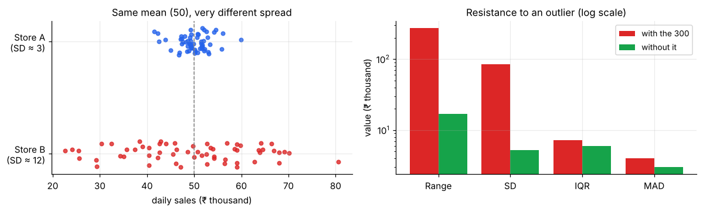

# Measures of Spread

> **Spread answers "how different are the values from each other?"** Two datasets can share a mean and still be totally different: a store that always sells ₹50k and a store that swings between ₹10k and ₹90k both "average ₹50k". The mean alone hides this.

**Contents**

1. [Why spread matters](#1-why-spread-matters)
2. [Range](#2-range)
3. [Variance and standard deviation](#3-variance-and-standard-deviation)
4. [Why divide by n − 1?](#4-why-divide-by-n--1)
5. [IQR and MAD (robust measures)](#5-iqr-and-mad-robust-measures)
6. [Coefficient of variation](#6-coefficient-of-variation)
7. [Robust vs non-robust: the outlier test](#7-robust-vs-non-robust-the-outlier-test)
8. [Which one should I report?](#8-which-one-should-i-report)
9. [Connections to other notes](#9-connections-to-other-notes)
10. [Code snippets](#10-code-snippets)

---

## 1. Why spread matters



Spread is **risk, consistency and uncertainty**: delivery-time variability, quality control, investment volatility. It also decides how *precise* an average is. Almost every confidence interval and test you will meet is "estimate ± a multiple of a spread-based quantity".

We continue with the salary data: **28, 30, 32, 33, 35, 36, 38, 40, 45, 300** (₹ thousand).

---

## 2. Range

**Range = max − min.** Salary data: 300 − 28 = **272**.

Simple but fragile: it depends on only the two most extreme values, and grows with sample size (more data → more chance of an extreme value). Use it as a quick sanity check, not as a main summary.

---

## 3. Variance and standard deviation

**Sample variance:** s² = Σ(xᵢ − x̄)² / (n − 1)
**Sample standard deviation:** s = √s²

- It measures the typical distance from the mean (in squared units for variance; the SD is back in the *original units*, so it is easier to interpret).
- Squaring makes negative and positive deviations count equally and punishes large deviations heavily. That is also why it is **sensitive to outliers**.
- The **population** versions (σ², σ) divide by N instead of n − 1.

**Worked example (small, by hand).** Data: 2, 4, 6, 8. Mean = 5. Deviations: −3, −1, 1, 3. Squares: 9, 1, 1, 9 → sum 20.
s² = 20/3 ≈ **6.67**, s ≈ **2.58**.

**Salary data:** s² ≈ 7,035 (₹ thousand)², s ≈ **₹83.9k**, larger than every employee's salary except the founder's! That tells you the SD is dominated by one value.

**Interpreting the SD:** if data are roughly bell-shaped, about 68% lie within ±1 SD of the mean and 95% within ±2 SD (the empirical rule, [probability/03](../probability/03-continuous-distributions.md#3-normal)). For other shapes, **Chebyshev's inequality** guarantees at least 1 − 1/k² of any data lie within k SDs (75% within 2 SD, 89% within 3 SD).

---

## 4. Why divide by n − 1?

Deviations are measured from x̄, which is itself computed from the same data, so the data sit slightly *closer* to x̄ than to the true mean μ. Dividing by n would therefore **underestimate** the population variance on average. Dividing by **n − 1** (Bessel's correction) exactly removes this bias: E[s²] = σ².

Equivalent view: once x̄ is fixed, only n − 1 deviations are free (the last one is forced so they sum to zero). That count is the **degrees of freedom**, the same idea behind the t and chi-square distributions ([probability/04](../probability/04-distributions-behind-tests.md#1-why-we-need-them)).

*Rule:* if your data are a **sample** and you want to say something about a larger population (nearly always), use n − 1. Note NumPy's `np.std` defaults to n (`ddof=0`) while pandas' `.std()` defaults to n − 1.

---

## 5. IQR and MAD (robust measures)

**Interquartile range (IQR) = Q3 − Q1.** The width of the middle 50% of the data. Ignores the top and bottom 25%, so extreme values cannot affect it. The box in a box plot.

*Salary data:* Q1 = 32.25, Q3 = 39.5 → IQR = **7.25**. This describes the typical spread of staff.

**Median absolute deviation (MAD)** = median of |xᵢ − median|. Even more robust (breakdown point 50%). Salary data: **4.0**. To compare with an SD for normal data, multiply by 1.4826.

---

## 6. Coefficient of variation

**CV = s / x̄** (often as a percentage). It is a **unit-free** measure of *relative* spread.

Use it to compare variability across different scales: is ₹ revenue (mean 2,00,000, SD 40,000) more variable than website visits (mean 800, SD 120)? CVs are 20% vs 15%, so revenue is *relatively* more variable even though its SD is huge.

Cautions: only meaningful for **ratio-scale data** with a true zero, and unstable when the mean is near 0. Salary data: CV = 83.9/61.7 = **136%**, which is huge and signals skew or outliers.

---

## 7. Robust vs non-robust: the outlier test

| Measure | With the 300 | Without it | Verdict |
|---|---|---|---|
| Range | 272 | 17 | Wildly changed |
| SD | 83.9 | 5.3 | **Changed 16×** |
| IQR | 7.25 | 6.0 | Barely changed |
| MAD | 4.0 | 3.0 | Barely changed |

This is the same lesson as with the mean vs median. **Moment-based** measures (mean, SD) use every value and are fragile; **order-based** measures (median, IQR, MAD) are resistant.

---

## 8. Which one should I report?

| Situation | Centre + spread |
|---|---|
| Roughly symmetric, no outliers | **Mean + SD** |
| Skewed or with outliers | **Median + IQR** (or MAD) |
| Comparing variability across different units/scales | **CV** |
| Quick check of extremes | Range (min and max) |

---

## 9. Connections to other notes

- **Centre:** the mean's partner is the SD, the median's partner is the IQR. → [01 – Central Tendency](01-central-tendency.md)
- **Distribution view:** σ² = Var(X) = E[(X − μ)²], the 2nd central moment. → [probability/01](../probability/01-random-variables-and-expectation.md#4-variance-and-standard-deviation)
- **Outliers:** the IQR defines the fences in the box plot. → [04 – Position & Outliers](04-position-and-outliers.md)
- **Inference:** the **standard error** is SD/√n, the spread of the *sample mean*; confidence intervals and t-tests are built on it.
- **Charts:** error bars, box plots and violin plots all show spread. → [data-visualization/02](../data-visualization/02-choosing-the-right-chart.md)

---

## 10. Code snippets

```python
import numpy as np
from scipy import stats

x = np.array([28, 30, 32, 33, 35, 36, 38, 40, 45, 300])

np.ptp(x)                      # range = 272
np.var(x, ddof=1)              # sample variance = 7035.3   (ddof=1 → divide by n-1)
np.std(x, ddof=1)              # sample SD = 83.9
q1, q3 = np.percentile(x, [25, 75])
q3 - q1                        # IQR = 7.25   (or stats.iqr(x))
stats.median_abs_deviation(x)  # MAD = 4.0
np.std(x, ddof=1) / np.mean(x) # CV = 1.36  (136%)

# pandas defaults to ddof=1; NumPy defaults to ddof=0, so be explicit!
import pandas as pd
pd.Series(x).std()             # 83.9
```
