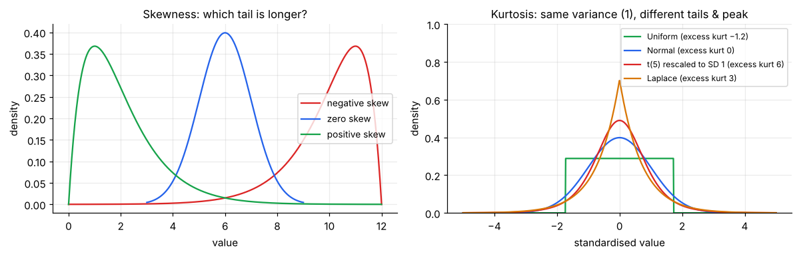
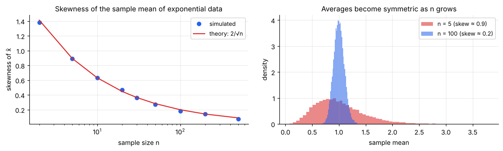

# Shape: Moments, Skewness & Kurtosis

> **Mean tells you where, SD tells you how wide, skewness tells you which way it leans, kurtosis tells you how heavy the tails are.** These four numbers are the first four *moments* of a distribution, and together they describe its shape far better than centre and spread alone.

**Contents**

1. [Moments: the big idea](#1-moments-the-big-idea)
2. [Skewness](#2-skewness)
3. [Kurtosis](#3-kurtosis)
4. [Sample formulas and software differences](#4-sample-formulas-and-software-differences)
5. [Worked example](#5-worked-example)
6. [Skewness and kurtosis of common distributions](#6-skewness-and-kurtosis-of-common-distributions)
7. [Skewness, the CLT and sample size](#7-skewness-the-clt-and-sample-size)
8. [Fixing skewed data](#8-fixing-skewed-data)
9. [Checking normality](#9-checking-normality)
10. [Connections to other notes](#10-connections-to-other-notes)
11. [Code snippets](#11-code-snippets)

---

## 1. Moments: the big idea

A **moment** is an average of a power of the variable. Raising to higher powers puts more and more weight on extreme values, so each moment reveals a different feature.

| Order | Name | Formula (population) | What it captures |
|---|---|---|---|
| 1 | **Mean** | μ = E[X] | Location |
| 2 | **Variance** | σ² = E[(X − μ)²] | Spread |
| 3 | **Skewness** | E[((X − μ)/σ)³] | Asymmetry |
| 4 | **Kurtosis** | E[((X − μ)/σ)⁴] | Tail weight / peakedness |

Three flavours exist:

- **Raw moments:** E[Xᵏ] (measured around 0)
- **Central moments:** E[(X − μ)ᵏ] (measured around the mean; removes location)
- **Standardised moments:** central moment ÷ σᵏ (also removes scale, so the number is unit-free and comparable across datasets). Skewness and kurtosis are standardised.

The sample version replaces E[·] by an average over the data. See [probability/01](../probability/01-random-variables-and-expectation.md#8-moments-and-the-shape-of-a-distribution) for the distribution (model) view and the moment table for named distributions.

---

## 2. Skewness



**Skewness** measures asymmetry. Cubing keeps the sign, so deviations on the long-tail side dominate.

| Skewness | Shape | Mean vs median | Typical data |
|---|---|---|---|
| **> 0** (positive / right) | Long tail to the right | mean > median | Income, prices, waiting times, claim sizes |
| **= 0** | Symmetric | mean = median | Heights, measurement errors |
| **< 0** (negative / left) | Long tail to the left | mean < median | Exam scores with a ceiling, age at retirement |

**Rough guide** (no formal cut-offs; always check with a histogram):

| |Skewness| | Interpretation |
|---|---|
| < 0.5 | Approximately symmetric |
| 0.5 – 1 | Moderately skewed |
| > 1 | Highly skewed |

**Pearson's quick check** (no formula needed): skewness ≈ 3 × (mean − median) / SD. It has the right sign and a similar size for moderately skewed data.

**Caution:** zero skewness does **not** prove symmetry (a lopsided distribution can have its third moment cancel), and a single outlier can create huge skewness. Always plot the data.

---

## 3. Kurtosis

**Kurtosis** measures how much of the variance comes from **extreme values (tails)** versus the centre. The fourth power makes far-away points count enormously.

- The normal distribution has kurtosis **3**.
- **Excess kurtosis** = kurtosis − 3, so the normal is **0**. Most software (SciPy, pandas) reports *excess* kurtosis. Always check which one you are reading.

| Excess kurtosis | Name | Tails & peak | Example |
|---|---|---|---|
| **> 0** | Leptokurtic | Heavy tails (more outliers), sharper peak | t-distribution, Laplace, stock returns |
| **= 0** | Mesokurtic | Like the normal | Normal |
| **< 0** | Platykurtic | Light tails, flatter | Uniform (−1.2) |

**Common misconception:** kurtosis is about the **tails**, not "peakedness". A distribution can be flat-topped and still heavy-tailed. The practical meaning: *high kurtosis = outliers are more common than a normal model predicts.* In finance, that is the difference between a "once in a lifetime" crash and one that happens every few years.

---

## 4. Sample formulas and software differences

With deviations dᵢ = xᵢ − x̄ and *m*ₖ = (1/n) Σ dᵢᵏ:

- **Skewness (biased):** g₁ = m₃ / m₂^(3/2)
- **Excess kurtosis (biased):** g₂ = m₄ / m₂² − 3

Small-sample adjusted versions (*G₁*, *G₂*) correct the bias, and are used by Excel, pandas and SPSS.

| Tool | Skewness | Kurtosis |
|---|---|---|
| `scipy.stats.skew` | g₁ (biased) by default; `bias=False` for G₁ | `kurtosis` → **excess**, biased by default |
| `pandas .skew()` | G₁ (adjusted) | `.kurt()` → G₂, **excess**, adjusted |
| Excel `SKEW`, `KURT` | G₁ | G₂ (excess) |

So the same data can give different numbers in different tools. The two agree for large n. For small n, state which one you used.

---

## 5. Worked example

Salary data: **28, 30, 32, 33, 35, 36, 38, 40, 45, 300**.

| Quantity | With 300 | Without 300 |
|---|---|---|
| Mean / median | 61.7 / 35.5 | 35.2 / 35.0 |
| Skewness (g₁) | **2.65** (G₁ = 3.14) | 0.46 |
| Excess kurtosis (g₂) | **5.06** (G₂ = 9.90) | −0.56 |

- Mean ≫ median and skewness ≫ 1 → **strongly right-skewed**.
- Pearson check: 3 × (61.7 − 35.5)/83.9 ≈ 0.94. It confirms the sign but understates the size, because the outlier also inflates the SD.
- High excess kurtosis → the heavy tail comes from one extreme point.
- Remove the outlier and the data become nearly symmetric. The shape statistics were *entirely* driven by one observation, which shows how sensitive higher moments are. **The higher the moment, the more outlier-sensitive.**

---

## 6. Skewness and kurtosis of common distributions

| Distribution | Mean | Skewness | Excess kurtosis |
|---|---|---|---|
| Normal | μ | **0** | **0** |
| Uniform(0, 1) | 0.5 | 0 | −1.2 |
| Exponential | 1/λ | **2** | **6** |
| Gamma(α) | αθ | 2/√α | 6/α |
| Chi-square(ν) | ν | √(8/ν) | 12/ν |
| Log-normal(σ) | eᵘ⁺ˢ²ᐟ² | (eˢ² + 2)√(eˢ² − 1) | grows very fast with σ |
| Beta(2, 5) / Beta(5, 2) | 0.286 / 0.714 | **+0.60 / −0.60** | −0.12 |
| Beta(5, 5) | 0.5 | 0 | −0.46 |
| Laplace | 0 | 0 | 3 |
| t(5) | 0 | 0 | 6 |
| t(10) | 0 | 0 | 1 |
| Binomial(n, p) | np | (1 − 2p)/√(np(1 − p)) | (1 − 6p(1 − p))/(np(1 − p)) |
| Poisson(λ) | λ | 1/√λ | 1/λ |
| Geometric(p) | 1/p | (2 − p)/√(1 − p) | 6 + p²/(1 − p) |
| Weibull(k = 1.5) | 0.903 (λ = 1) | 1.07 | 1.39 |
| Cauchy | **undefined** | **undefined** | **undefined** |

Patterns worth remembering:

- **Positive, stretched-to-the-right** families (exponential, gamma, log-normal, Weibull, Pareto, geometric) are right-skewed.
- Skewness **fades with a bigger shape parameter**: gamma → normal as α grows, binomial and Poisson → normal as n or λ grows.
- Binomial skew has the sign of (1 − 2p): right-skewed for p < 0.5, left-skewed for p > 0.5.
- The Cauchy has no finite moments at all (its tails are too heavy), so mean, variance, skewness and kurtosis do not exist.

---

## 7. Skewness, the CLT and sample size



A key link to inference: averages of skewed data become **less skewed as n grows**. For the mean of n independent observations, **skewness of x̄ = skewness of X / √n**, and excess kurtosis shrinks as 1/n. The Central Limit Theorem is exactly this. The more skewed the original data, the larger the sample you need before normal-based methods (t-tests, confidence intervals) are trustworthy.

| Data | Rough sample size for the t-test to be safe |
|---|---|
| Symmetric, light tails | 15–20 |
| Moderately skewed | 30 – 50 |
| Highly skewed (skew > 2) or with outliers | 100+, or use a transformation / non-parametric test |

**Significance of skewness:** the standard error of skewness is about √(6/n). If |g₁| > 2·√(6/n), the skew is unlikely to be noise. (For n = 100, the cut-off is ≈ 0.49.)

---

## 8. Fixing skewed data

| Problem | Transformation | Notes |
|---|---|---|
| Mild right skew | Square root, √x | Counts, areas |
| Strong right skew, positive values | **Log**, ln x | Income, prices, sales. Makes log-normal data normal |
| Right skew with zeros | log(1 + x) | Avoids log(0) |
| Strong right skew, any sign (≥ 0) | Box–Cox / Yeo–Johnson | Finds the best power automatically |
| Left skew | Reflect, then transform: ln(max + 1 − x) | |

Transformations help with a *generally* skewed distribution, not with one rogue value. In the salary example, even ln(x) leaves skewness at 2.47, because 300 is nearly 9× the typical salary. Deal with such a point directly (see [04](04-position-and-outliers.md#5-what-to-do-with-outliers)).

Transformations change interpretation: after a log, differences become *ratios* and a mean on the log scale corresponds to the *geometric* mean on the original scale. The alternative is to leave the data alone and use methods that do not need symmetry (median, quantile regression, non-parametric tests).

---

## 9. Checking normality

Many tests assume (approximately) normal data or a normal sampling distribution. Check in this order:

1. **Look:** histogram and **Q–Q plot** (points should lie on a straight line; a curve means skew, an S-shape means heavy/light tails).
2. **Numbers:** |skewness| < ~0.5–1 and |excess kurtosis| < ~1–2 are usually fine.
3. **Formal tests:** Shapiro–Wilk (best for small n), **Jarque–Bera** (built from skewness and kurtosis: JB = (n/6)(g₁² + g₂²/4)), Kolmogorov–Smirnov.

**Caution:** with very large n, formal tests reject for tiny, harmless departures; with very small n, they have no power. Use judgment together with plots.

---

## 10. Connections to other notes

- **Centre and spread:** the 1st and 2nd moments. → [01](01-central-tendency.md), [02](02-spread.md)
- **Outliers** inflate skewness and kurtosis; robust alternatives are quantile-based. → [04](04-position-and-outliers.md)
- **Distributions:** each named family has a characteristic skew/kurtosis signature. → [probability/02](../probability/02-discrete-distributions.md), [probability/03](../probability/03-continuous-distributions.md)
- **Heavy tails:** Pareto and Cauchy have infinite higher moments. → [probability/03 §9](../probability/03-continuous-distributions.md#9-heavy-tails-pareto-cauchy-laplace-and-scipys-alpha)
- **Charts:** a histogram or violin plot shows skew directly; a box plot shows it as an off-centre median and an uneven whisker. → [data-visualization/02](../data-visualization/02-choosing-the-right-chart.md#4-distribution-and-outliers-histogram-box-plot-violin)
- **Inference:** skew and kurtosis determine how big n must be for the CLT, and which tests are safe (t-test vs non-parametric).

---

## 11. Code snippets

```python
import numpy as np
from scipy import stats
import pandas as pd

x = np.array([28, 30, 32, 33, 35, 36, 38, 40, 45, 300])

stats.skew(x)                    # g1 = 2.65 (biased)
stats.skew(x, bias=False)        # G1 = 3.14 (matches pandas/Excel)
stats.kurtosis(x)                # excess kurtosis g2 = 5.06
stats.kurtosis(x, bias=False)    # G2 = 9.90
stats.kurtosis(x, fisher=False)  # raw kurtosis (normal = 3)

pd.Series(x).skew(), pd.Series(x).kurt()   # 3.14, 9.90 (adjusted, excess)

# Moments of a named distribution: mean, variance, skew, excess kurtosis
stats.gamma(a=2).stats(moments="mvsk")     # (2.0, 2.0, 1.414, 3.0)

# Skewed? → log transform and recheck
stats.skew(np.log(x))            # 2.47: still skewed! One extreme value (300 vs ~35)
                                 # is too far out for a log to fix. Investigate it first.

# Normality checks
stats.shapiro(x)                 # Shapiro–Wilk
stats.jarque_bera(x)             # uses skewness and kurtosis
stats.probplot(x, plot=None)     # Q–Q plot data (use plot=plt for the graph)
```
