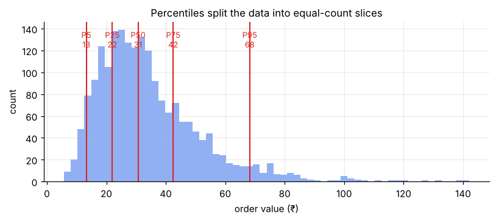
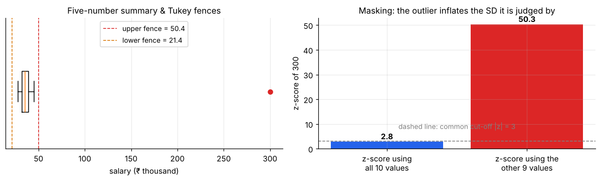

# Position & Outliers: Percentiles, Z-scores, Fences

> **Position measures answer "where does this value stand among the others?"** Percentiles and z-scores turn a raw number into a relative position, which is what lets you compare a ₹ amount, a test mark and a delivery time on the same footing, and spot values that don't belong.

**Contents**

1. [Percentiles and quartiles](#1-percentiles-and-quartiles)
2. [Five-number summary](#2-five-number-summary)
3. [Z-scores](#3-z-scores)
4. [Detecting outliers](#4-detecting-outliers)
5. [What to do with outliers](#5-what-to-do-with-outliers)
6. [A descriptive-statistics checklist](#6-a-descriptive-statistics-checklist)
7. [Connections to other notes](#7-connections-to-other-notes)
8. [Code snippets](#8-code-snippets)

---

## 1. Percentiles and quartiles

The **p-th percentile** is the value below which p% of the data fall.

- **Quartiles:** Q1 = 25th, Q2 = 50th (the **median**), Q3 = 75th percentile. They cut the data into four equal-count slices.
- **Deciles** (10%, 20%, …) and **percentiles** (1%, 2%, …) cut finer.
- **Percentile rank** goes the other way: "a score of 78 is at the 90th percentile" means 90% scored lower.



The figure shows why percentiles describe skewed data well: the slices are equal in *count*, but unequal in *width*, so the stretched right tail is visible.

**How a percentile is computed (and why software disagrees).** To find the p-th percentile of n sorted values, you locate position p·(n − 1) + 1 and, if it falls between two values, interpolate. Several conventions exist (NumPy's default is *linear interpolation*; Excel offers `PERCENTILE.INC` and `PERCENTILE.EXC`; textbooks often use "median of each half"). Results can differ slightly on small samples. They agree for large n, so state your method if exact values matter.

**Salary data** (28, 30, 32, 33, 35, 36, 38, 40, 45, 300), linear method: Q1 = **32.25**, median = **35.5**, Q3 = **39.5**.

*Link to probability:* a percentile is the inverse CDF, `ppf` in SciPy. The p-th percentile of a model is the x where F(x) = p ([probability/01](../probability/01-random-variables-and-expectation.md#2-pmf-pdf-and-cdf)).

---

## 2. Five-number summary

**min, Q1, median, Q3, max**. A compact, outlier-resistant description (apart from min and max). It is exactly what a box plot draws.

Salary data: **28, 32.25, 35.5, 39.5, 300**. The huge gap between Q3 (39.5) and the max (300) already shows the right skew and the lone high value.

---

## 3. Z-scores

**z = (x − x̄) / s**: how many standard deviations a value is from the mean.

- Unit-free, so you can compare across scales: a mark of 82 in a class with mean 70, SD 6 (z = 2.0) is *more exceptional* than a mark of 90 in a class with mean 78, SD 10 (z = 1.2).
- Standardised data always have **mean 0 and SD 1**.
- If the data are roughly normal, the empirical rule applies: |z| > 2 happens about 5% of the time, |z| > 3 about 0.3%.
- It uses the mean and SD, so it **inherits their weakness to outliers**. See "masking" below.
- A **robust z-score** replaces the mean by the median and the SD by 1.4826 × MAD.

The z-score is also the foundation of the z-test and of the standard normal table ([probability/03](../probability/03-continuous-distributions.md#3-normal)).

---

## 4. Detecting outliers

An **outlier** is a value unusually far from the rest. There is no universal definition; each rule below is a convention.



### Rule 1: Tukey's IQR fences (default of the box plot)

- Lower fence = Q1 − 1.5 × IQR
- Upper fence = Q3 + 1.5 × IQR
- Use 3 × IQR for "far out" or extreme values.

*Salary data:* IQR = 39.5 − 32.25 = 7.25. Fences: 32.25 − 10.875 = **21.4** and 39.5 + 10.875 = **50.4**. The value 300 lies far above 50.4, so it is flagged. Nothing is flagged below. (This is the same logic as the worked box-plot example in [data-visualization/02](../data-visualization/02-choosing-the-right-chart.md#41-box-plot-the-chart-for-outliers-and-spread).)

### Rule 2: z-score cut-off

Flag |z| > 3 (sometimes 2.5). Works best for roughly normal data.

### The masking problem

Using all ten salaries, the z-score of 300 is only **2.84**, which fails the |z| > 3 test, even though 300 is obviously extreme. The outlier has inflated the mean and the SD, which are then used to judge it. Judged against the *other nine* values, its z-score is **50.3**.

So **z-scores can miss outliers because the outlier itself distorts them.** The IQR fences do not suffer this, since quartiles barely move. Robust (median/MAD) rules are safer, especially with several outliers.

### Other approaches

Visual: box plot, scatter plot, histogram. Statistical: Grubbs' test, isolation forest or DBSCAN for multivariate data. A point can be normal in each variable separately and still unusual *jointly* (e.g. a 150 cm, 110 kg person).

---

## 5. What to do with outliers

An outlier is a **question, not a verdict**. Investigate first:

| Cause | Action |
|---|---|
| Data-entry or measurement error (e.g. age = 250) | Correct it if possible; otherwise remove and document |
| Different population (founder vs staff; a corporate order in retail data) | Analyse separately or exclude with a stated reason |
| Genuine but extreme (a viral product, a rare large claim) | **Keep it**; it may be the most important point |
| Skewed distribution producing a long tail | Transform (log) or use a model suited to skew |

Practical options: report **both** versions (with and without), use **robust statistics** (median, IQR, trimmed mean), **winsorise** (cap values at, say, the 5th/95th percentile), or use rank-based methods.

**Never delete a point just because it hurts your result.** Decide the rule before looking at the outcome and write it down; otherwise it is cherry-picking (see [data-visualization/01](../data-visualization/01-data-visualization-errors.md)).

---

## 6. A descriptive-statistics checklist

Before any modelling or test, do this for every important variable:

1. **Plot it:** histogram and box plot (shape, outliers, groups).
2. **Centre:** mean *and* median. A big gap means skew or outliers.
3. **Spread:** SD *and* IQR.
4. **Shape:** skewness and kurtosis, as a number *and* with a plot.
5. **Outliers:** apply the IQR fences; investigate each flagged point.
6. **Missing data and units:** how many, and why?
7. **Decide:** which summary to report (mean ± SD vs median [IQR]) and whether a transformation or robust method is needed.

---

## 7. Connections to other notes

- **Centre and spread:** the median and IQR are position measures; the mean and SD define z-scores. → [01](01-central-tendency.md), [02](02-spread.md)
- **Shape:** outliers drive skewness and kurtosis. → [03](03-skewness-and-kurtosis.md)
- **Probability:** percentile = inverse CDF; the z-score maps any normal to N(0, 1). → [probability/01](../probability/01-random-variables-and-expectation.md), [probability/03](../probability/03-continuous-distributions.md)
- **Charts:** the box plot is the five-number summary plus fences. → [data-visualization/02](../data-visualization/02-choosing-the-right-chart.md)
- **Inference:** outliers can badly distort means, t-tests and regression; robust and non-parametric methods are the remedy.

---

## 8. Code snippets

```python
import numpy as np
from scipy import stats

x = np.array([28, 30, 32, 33, 35, 36, 38, 40, 45, 300])

# Percentiles and five-number summary (NumPy: linear interpolation)
np.percentile(x, [0, 25, 50, 75, 100])     # [28, 32.25, 35.5, 39.5, 300]
stats.percentileofscore(x, 38)             # percentile rank of the value 38
stats.iqr(x)                               # 7.25

# Tukey fences
q1, q3 = np.percentile(x, [25, 75])
iqr = q3 - q1
low, high = q1 - 1.5 * iqr, q3 + 1.5 * iqr          # 21.4, 50.4
x[(x < low) | (x > high)]                           # array([300])

# Z-scores: note the masking effect
z = stats.zscore(x, ddof=1)
z[-1]                                               # 2.84 (misses |z| > 3 !)

# Robust z-score using median and MAD
mad = stats.median_abs_deviation(x, scale="normal")  # MAD * 1.4826
(x - np.median(x)) / mad                             # 300 → ≈ 44.6

# Winsorise: cap the top and bottom 10%
from scipy.stats.mstats import winsorize
winsorize(x, limits=(0.1, 0.1))

# pandas: describe() and a quick outlier mask
import pandas as pd
pd.Series(x).describe()
```
