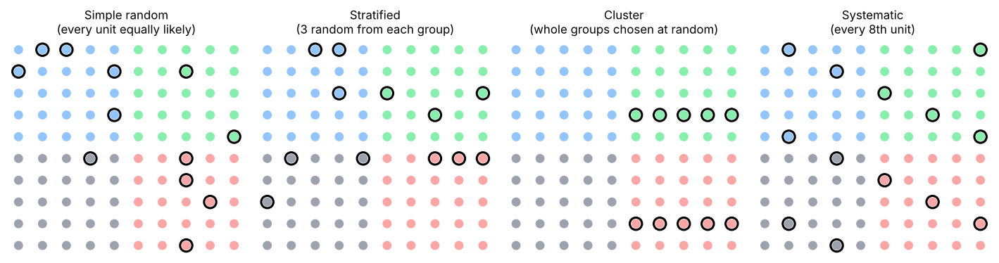
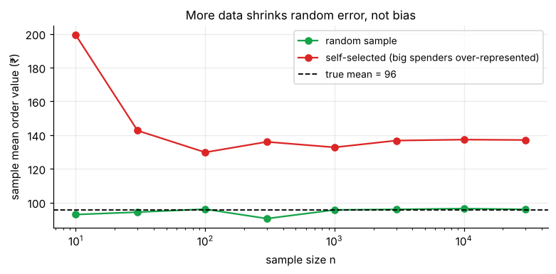

# Populations, Samples & Sampling

> **Inferential statistics lets you say something about a whole group (the population) after looking at only part of it (a sample), and tells you how sure you can be.** The quality of every conclusion rests on one thing before any formula: *how the sample was chosen.*

**Contents**

1. [The big picture](#1-the-big-picture)
2. [Parameter vs statistic](#2-parameter-vs-statistic)
3. [Sampling methods](#3-sampling-methods)
4. [Sampling error vs bias](#4-sampling-error-vs-bias)
5. [Common sources of bias](#5-common-sources-of-bias)
6. [Sample size and the finite population correction](#6-sample-size-and-the-finite-population-correction)
7. [Where this goes next](#7-where-this-goes-next)
8. [Code snippets](#8-code-snippets)

---

## 1. The big picture

| Descriptive statistics | Inferential statistics |
|---|---|
| Summarises the data **you have** | Uses the data you have to conclude about data you **don't** have |
| "Mean order value in this file is ₹96" | "Mean order value of *all* customers is probably between ₹90 and ₹102" |
| No uncertainty about the numbers | Uncertainty is quantified (confidence intervals, p-values) |
| [descriptive-statistics/](../descriptive-statistics/01-central-tendency.md) | This folder |

The reasoning chain used throughout this folder:

```
Population (unknown parameter θ)
        │  random sampling
        ▼
Sample (observed data) ──► statistic (x̄, p̂, s²)
        │  probability model of how the statistic varies from sample to sample
        ▼
Inference: estimate θ ± margin of error  (confidence interval)
           or decide whether a claim about θ is plausible  (hypothesis test)
```

The middle step, the *probability model of how a statistic varies*, is the sampling distribution ([note 02](02-sampling-distributions-and-clt.md)), and it is built from the distributions in [probability/](../probability/01-random-variables-and-expectation.md).

---

## 2. Parameter vs statistic

| | Population (all units of interest) | Sample (the units you actually measured) |
|---|---|---|
| Size | N | n |
| Mean | **μ** (parameter) | **x̄** (statistic) |
| Standard deviation | **σ** | **s** |
| Proportion | **p** | **p̂** ("p-hat") |
| Is it fixed? | Fixed but usually **unknown** | **Random**: changes from sample to sample |

- A **parameter** describes a population; a **statistic** describes a sample and is used to *estimate* the parameter.
- Greek letters for parameters, Roman letters (or hats) for statistics.
- The population is defined by your **question**: "all customers who ordered in 2025", not "customers" in general. Define it precisely before you sample.

**Example.** An e-commerce firm has N = 50,000 customers. The true average order value μ is unknown. A sample of n = 400 gives x̄ = ₹96. A different random sample of 400 would give, say, ₹93 or ₹99. The statistic x̄ varies; μ does not.

---

## 3. Sampling methods

**Sampling frame:** the list from which you sample (customer database, phone directory). A frame that misses part of the population (customers without email) builds in bias before you start.

### Probability sampling (each unit has a known, non-zero chance of selection)



| Method | How | Good when | Watch out |
|---|---|---|---|
| **Simple random** | Every unit equally likely; draw from the full list | A full frame exists, population fairly uniform | Needs a complete list; may miss small subgroups by chance |
| **Stratified** | Split into homogeneous groups (strata), sample within each | Subgroups differ (region, product line) and you want each represented | Needs strata info beforehand. Gives **more precise** estimates than SRS for the same n |
| **Cluster** | Randomly pick whole groups (stores, classrooms) and survey everyone in them | Units are spread out; travel/frame cost is high | Units within a cluster are alike, so you get **less precision** than SRS for the same n |
| **Systematic** | Every k-th unit after a random start | Ordered lists, production lines | Bias if the list has a hidden cycle of period k |

**Stratified vs cluster (a common confusion):** strata are *different from each other but alike inside*, and you sample **from every stratum**. Clusters are *alike each other but varied inside* (each is a mini-population), and you sample **some clusters entirely**.

### Non-probability sampling

| Method | Description | Use / risk |
|---|---|---|
| Convenience | Whoever is easy to reach | Quick pilots; **cannot be generalised** |
| Voluntary response | People choose to respond (online polls, reviews) | Strong bias toward extreme opinions |
| Quota | Fill set numbers per group, but not randomly | Cheaper than stratified; selection inside quotas is biased |
| Snowball | Participants refer others | Hidden populations; not representative |

**Rule:** the formulas for confidence intervals and p-values in this folder assume **random sampling** (or random assignment in experiments). Applying them to a convenience sample gives numbers that *look* precise but have no guaranteed meaning.

---

## 4. Sampling error vs bias

| | Sampling error | Bias (non-sampling error) |
|---|---|---|
| What | Natural chance variation: this sample isn't the whole population | Systematic distortion: the method favours certain values |
| Direction | Random, both sides | Consistently one side |
| Effect of larger n | **Shrinks** (like 1/√n) | **Does not shrink** |
| Controlled by | Sample size, good design | Good design, not more data |
| Quantified by | Standard error, margin of error | Cannot be computed from the sample itself |



In the simulation above, the random sample converges to the true mean as n grows. The self-selected sample (big spenders more likely to respond) converges just as confidently to the **wrong** number. A tiny interval around a biased estimate is the worst of both worlds: precise and wrong.

**Historical illustration:** in the 1936 US election, *The Literary Digest* polled over 2 million people (a huge n) and predicted a landslide for Landon; Roosevelt won easily. Their sample was drawn from car owners and telephone and magazine lists, which over-represented wealthier voters, and the respondents were self-selected. Gallup, with a far smaller sample (about 50,000) that was more representative of the electorate, called the winner correctly. The lesson is that representativeness matters more than raw size.

---

## 5. Common sources of bias

| Bias | What goes wrong | Business example |
|---|---|---|
| **Selection / coverage** | The frame misses part of the population | Surveying only app users to learn about *all* customers |
| **Non-response** | Those who answer differ from those who don't | Satisfaction survey answered mostly by very happy or very angry customers |
| **Voluntary response** | Self-selection | Online review averages |
| **Survivorship** | Only the "survivors" are in the data | Studying successful startups and ignoring those that failed |
| **Response / measurement** | Wrong answers given (leading questions, social desirability) | "How often do you exercise?" |
| **Undercoverage in time** | Sample taken at an unrepresentative time | Retail data collected only in festival season |

Before any analysis, ask: *"If I repeated this data collection many times, would the average of my statistic equal the parameter?"* If not, you have bias and more data will not help.

---

## 6. Sample size and the finite population correction

How the precision of an estimate depends on n is made exact in the next notes. The headline facts:

- The standard error of x̄ is **σ/√n**. To halve the error, you need **4 times** as many observations. Returns diminish fast.
- What matters is the **absolute** size of the sample, not its percentage of the population: a random sample of 1,000 is about equally informative about a country of 1 million or 1 billion.

**Finite population correction (FPC).** When you sample a large share of a *small* population without replacement (more than ~5–10%), the standard error shrinks by:

FPC = √[(N − n)/(N − 1)]

*Example:* N = 500 employees, n = 100: FPC = √(400/499) = **0.895**, so the SE is about 10% smaller than the usual formula says. For N = 50,000 and n = 400 it is 0.996, so ignore it.

---

## 7. Where this goes next

| Next note | Question it answers |
|---|---|
| [02 – Sampling Distributions & the CLT](02-sampling-distributions-and-clt.md) | How does a statistic vary from sample to sample? |
| [03 – Estimation & Confidence Intervals](03-estimation-and-confidence-intervals.md) | What is the likely range for the parameter? |
| [04 – Hypothesis Testing Fundamentals](04-hypothesis-testing-fundamentals.md) | Is the data consistent with a specific claim? |

---

## 8. Code snippets

```python
import numpy as np
import pandas as pd

rng = np.random.default_rng(42)
df = pd.DataFrame({
    "customer_id": range(50_000),
    "region": rng.choice(["North", "South", "East", "West"], 50_000, p=[.4, .3, .2, .1]),
    "order_value": rng.lognormal(np.log(80), 0.6, 50_000),
})

# Simple random sample
srs = df.sample(n=400, random_state=1)

# Stratified (proportional): same fraction from each region
strat = df.groupby("region").sample(frac=400 / len(df), random_state=1)

# Systematic: every k-th row after a random start
k = len(df) // 400
start = rng.integers(k)
sys_sample = df.iloc[start::k]

# Cluster: choose 2 of 4 regions entirely (illustrative only)
clusters = rng.choice(df["region"].unique(), 2, replace=False)
cluster_sample = df[df["region"].isin(clusters)]

print(df["order_value"].mean(), srs["order_value"].mean(), strat["order_value"].mean())

# Finite population correction
N, n = 500, 100
np.sqrt((N - n) / (N - 1))        # 0.895
```
