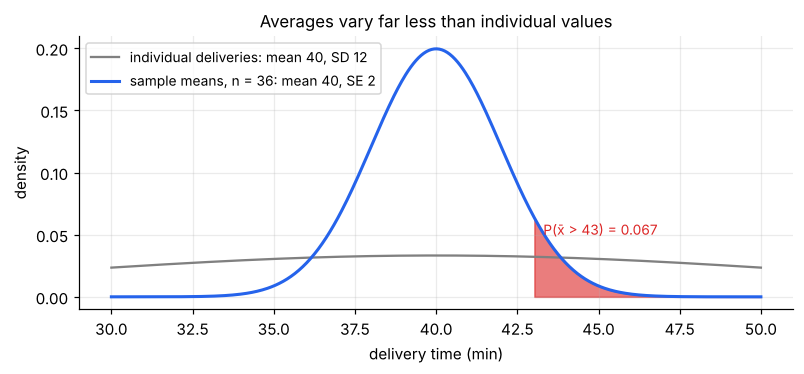
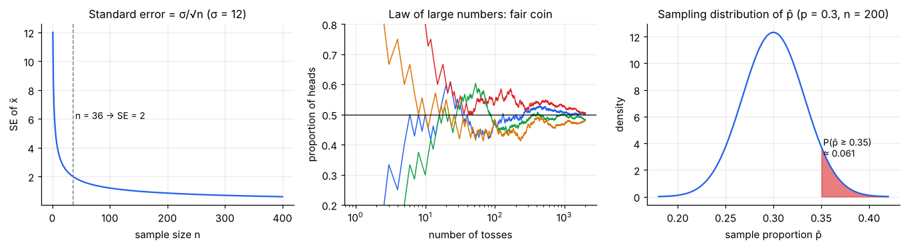
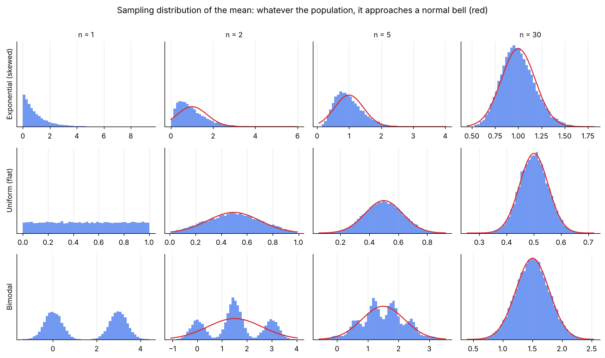

# Sampling Distributions & the Central Limit Theorem

> **A statistic is a random variable.** Draw a different sample and you get a different x̄. The *sampling distribution* describes how x̄ varies across all possible samples, and it is what lets us put a margin of error on any estimate. The Central Limit Theorem says that, for averages, it is almost always a normal curve.

**Contents**

1. [Three distributions to keep apart](#1-three-distributions-to-keep-apart)
2. [Sampling distribution of the mean](#2-sampling-distribution-of-the-mean)
3. [The Central Limit Theorem](#3-the-central-limit-theorem)
4. [Law of large numbers vs CLT](#4-law-of-large-numbers-vs-clt)
5. [Sampling distribution of a proportion](#5-sampling-distribution-of-a-proportion)
6. [Other statistics: variance, t, and the shape distributions](#6-other-statistics-variance-t-and-the-shape-distributions)
7. [How big must n be?](#7-how-big-must-n-be)
8. [Code snippets](#8-code-snippets)

---

## 1. Three distributions to keep apart

| Distribution of… | Describes | Spread |
|---|---|---|
| **The population** | Every individual value | σ |
| **One sample (the data)** | The n values you actually observed | s (an estimate of σ) |
| **The sampling distribution** | A **statistic** (e.g. x̄) over *all possible* samples of size n | **σ/√n** (the standard error) |

Mixing these up is the most common error in inference. Individual deliveries might range from 20 to 70 minutes (σ = 12), while the *average of 36 deliveries* will almost always fall within a few minutes of the true mean.



---

## 2. Sampling distribution of the mean

Take repeated random samples of size n from a population with mean μ and SD σ. The sample mean x̄ has:

| Property | Formula | Meaning |
|---|---|---|
| Mean | **E[x̄] = μ** | x̄ is **unbiased**: it is right on average |
| Standard deviation | **SD(x̄) = σ/√n** | Called the **standard error (SE)** |
| Shape | If the population is normal → x̄ is exactly normal. Otherwise → approximately normal for large n (CLT) | |

Derivation in one line (from [probability/01 §5](../probability/01-random-variables-and-expectation.md#5-useful-rules)): Var(x̄) = Var((X₁ + … + Xₙ)/n) = n·σ²/n² = σ²/n, using independence.



**The √n law:** quadrupling n only halves the SE. Going from n = 100 to n = 400 halves the error; getting a further halving needs n = 1,600.

**Worked example.** Delivery times have μ = 40 min, σ = 12 min. Take n = 36 deliveries.

- SE = 12/√36 = **2 min**
- P(x̄ > 43) = P(Z > (43 − 40)/2) = P(Z > 1.5) = **0.067**
- P(38 < x̄ < 42) = P(−1 < Z < 1) = **0.683**

So with 36 deliveries, the average is within ±2 min of the true mean about 68% of the time, even though single deliveries scatter widely.

*Distinguish:* σ (spread of individuals) and SE = σ/√n (spread of the average). **SD describes data; SE describes an estimate.**

---

## 3. The Central Limit Theorem

> **CLT.** If X₁, …, Xₙ are independent draws from *any* distribution with finite mean μ and finite variance σ², then for large n the distribution of x̄ is approximately **Normal(μ, σ/√n)**. Equivalently, (x̄ − μ)/(σ/√n) → N(0, 1).



Reading the grid: the first column (n = 1) is just the population: skewed, flat, or two-humped. By n = 30 all three rows are close to the red normal curve. The less normal the starting shape, the larger n you need.

**Why it matters:** it is the reason you can use normal-based confidence intervals and tests on data that are *not* normal, provided n is large enough. Almost every test statistic in later notes is, or is built from, an average.

**Conditions (the fine print):**

1. **Independent** observations (random sample, or less than ~10% of the population).
2. **Finite variance.** The theorem fails for distributions like the Cauchy ([probability/03 §9](../probability/03-continuous-distributions.md#9-heavy-tails-pareto-cauchy-laplace-and-scipys-alpha)), where averaging never stabilises.
3. **Large enough n** (see §7). The theorem is a statement about the limit; how fast you get there depends on skewness and outliers ([descriptive-statistics/03 §7](../descriptive-statistics/03-skewness-and-kurtosis.md#7-skewness-the-clt-and-sample-size)).

**Variants that follow:** sums are also approximately normal (mean nμ, SD σ√n); and the normal approximations to the binomial and Poisson ([probability/02 §8](../probability/02-discrete-distributions.md#8-approximations-between-distributions)) are CLT in action, since a binomial count is a sum of Bernoulli trials.

---

## 4. Law of large numbers vs CLT

| | Law of Large Numbers (LLN) | Central Limit Theorem (CLT) |
|---|---|---|
| Says | x̄ gets **close to μ** as n → ∞ | The **shape** of the distribution of x̄ becomes normal |
| About | Where the estimate ends up | How it fluctuates around μ |
| Gives you | Consistency of the estimator | Probabilities / margin of error at a finite n |

LLN: "the average settles down". CLT: "and here is how much it wobbles on the way". The middle panel of the figure above shows the LLN for coin tosses. It does **not** say a streak of tails makes heads "due" (gambler's fallacy); the early deviation is just diluted by later tosses.

---

## 5. Sampling distribution of a proportion

For a yes/no trait with population proportion p, the sample proportion p̂ = (number of successes)/n has:

- **E[p̂] = p**
- **SE(p̂) = √(p(1 − p)/n)**
- Approximately **normal** if **np ≥ 10 and n(1 − p) ≥ 10** (the "success–failure condition").

**Worked example.** 30% of customers use a coupon (p = 0.3). In a random sample of n = 200:

- SE = √(0.3 × 0.7/200) = **0.0324** (3.2 percentage points)
- P(p̂ ≥ 0.35) = P(Z ≥ 0.05/0.0324) = P(Z ≥ 1.54) = **0.061**

So seeing 35% or more in the sample, when the truth is 30%, would happen about 6% of the time by chance alone. This is the kind of reasoning hypothesis tests formalise ([note 04](04-hypothesis-testing-fundamentals.md)).

Largest SE occurs at p = 0.5 (SE ≤ 0.5/√n), the "worst case" used for sample-size planning in [note 03](03-estimation-and-confidence-intervals.md#6-choosing-the-sample-size).

---

## 6. Other statistics: variance, t, and the shape distributions

The same idea (a statistic has a distribution across samples) applies to every statistic, which is where the distributions of [probability/04](../probability/04-distributions-behind-tests.md) come from:

| Statistic | Sampling distribution (normal population) |
|---|---|
| x̄ with σ **known** | Normal(μ, σ/√n) |
| (x̄ − μ)/(s/√n), σ **unknown** | **t** with n − 1 df |
| (n − 1)s²/σ² | **Chi-square** with n − 1 df |
| Ratio of two sample variances s₁²/s₂² | **F** with (n₁ − 1, n₂ − 1) df |
| Sample median, max, etc. | No simple formula, so use **bootstrap** (note 09) |

Replacing σ by s adds randomness, so the t-distribution has heavier tails than the normal. As n grows, s ≈ σ and t → z.

---

## 7. How big must n be?

| Population | n for a good normal approximation of x̄ |
|---|---|
| Normal | Any n (exact) |
| Roughly symmetric, light tails | ~15–20 |
| Moderately skewed | ~30–50 |
| Highly skewed or with outliers (e.g. income, claim sizes) | 100+, or transform/use a non-parametric method |
| Proportion p | np ≥ 10 and n(1 − p) ≥ 10 |

These are rules of thumb. Check the data first: a histogram and skewness ([descriptive-statistics/03](../descriptive-statistics/03-skewness-and-kurtosis.md)). Skewness of x̄ shrinks like (skewness of X)/√n, so very skewed data need much larger n.

---

## 8. Code snippets

```python
import numpy as np
from scipy import stats

rng = np.random.default_rng(0)

# Worked example: mu = 40, sigma = 12, n = 36
mu, sigma, n = 40, 12, 36
se = sigma / np.sqrt(n)                          # 2.0
stats.norm.sf(43, mu, se)                        # P(xbar > 43) = 0.067
stats.norm.cdf(42, mu, se) - stats.norm.cdf(38, mu, se)   # 0.683

# Proportion: p = 0.3, n = 200
p, n = 0.3, 200
se_p = np.sqrt(p * (1 - p) / n)                  # 0.0324
stats.norm.sf(0.35, p, se_p)                     # 0.061

# Simulate the sampling distribution of the mean of skewed data
pop = rng.exponential(scale=40, size=1_000_000)  # skewed population, mean 40
for n in (2, 10, 50, 200):
    means = rng.choice(pop, size=(10_000, n)).mean(axis=1)
    print(n, round(means.mean(), 2), round(means.std(), 2),     # SD ≈ 40/√n
          round(stats.skew(means), 2))                           # → 0 as n grows

# SE vs SD in a real sample
x = rng.normal(40, 12, 36)
x.std(ddof=1)                    # SD: spread of the data   (≈ 12)
stats.sem(x)                     # SE: precision of the mean (≈ 2)
```
