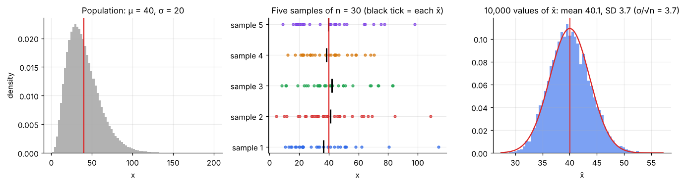
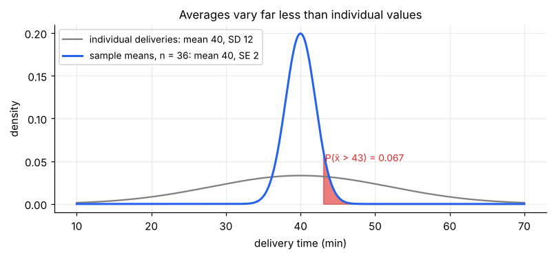
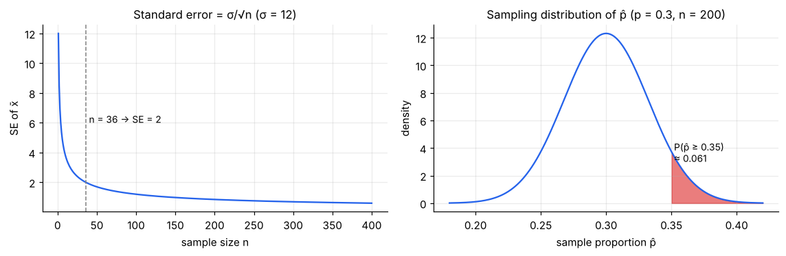
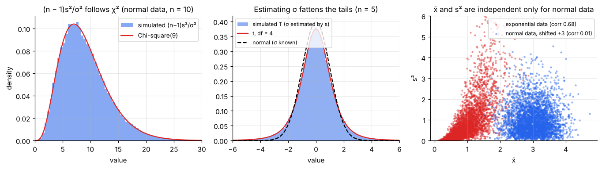

# Sampling Distributions

> **A statistic is a random variable.** Draw a different sample and you get a different x̄, p̂ or s². The *sampling distribution* is the probability distribution of that statistic over all the samples you could have drawn. It is the single idea that turns "my sample says 96" into "the population value is probably between 90 and 102".

**Contents**

1. [The idea](#1-the-idea)
2. [Three distributions to keep apart](#2-three-distributions-to-keep-apart)
3. [Sampling distribution of the mean](#3-sampling-distribution-of-the-mean)
4. [Sampling distribution of a proportion](#4-sampling-distribution-of-a-proportion)
5. [Sampling distribution of the variance](#5-sampling-distribution-of-the-variance)
6. [The t statistic: when σ is unknown](#6-the-t-statistic-when-σ-is-unknown)
7. [Difference of two sample means](#7-difference-of-two-sample-means)
8. [When there is no formula: simulation](#8-when-there-is-no-formula-simulation)
9. [Summary table](#9-summary-table)
10. [Code snippets](#10-code-snippets)

---

## 1. The idea

Imagine the following thought experiment, which is the foundation of all frequentist inference:

1. There is one fixed population with unknown mean μ.
2. You draw a random sample of size n and compute x̄.
3. Now imagine repeating step 2 thousands of times, each time with a *fresh* sample.
4. The thousands of values of x̄ form a distribution. **That is the sampling distribution of x̄.**



In the figure:

- **Left:** a right-skewed population (e.g. delivery times; mean 40, SD 20).
- **Middle:** five different samples of n = 30. Each sample has its own x̄ (black tick). They differ from one another and from μ.
- **Right:** 10,000 such x̄ values. The histogram is **centred on μ**, much **narrower** than the population, and **bell-shaped** even though the population is skewed.

In real life you only ever see *one* sample. The sampling distribution is a **theoretical** object that tells you how far that one x̄ is likely to be from μ. Everything in this folder (standard errors, confidence intervals, p-values) is a statement about it.

---

## 2. Three distributions to keep apart

| Distribution of… | Describes | Spread |
|---|---|---|
| **The population** | Every individual value | σ |
| **One sample (your data)** | The n values you observed | s (an estimate of σ) |
| **The sampling distribution of x̄** | The *statistic* over all possible samples of size n | **σ/√n** (the standard error) |

Mixing these up is the most common error in inference. Individual deliveries might range from 20 to 70 minutes (σ = 12), while the average of 36 deliveries will almost always lie within a few minutes of the true mean.



---

## 3. Sampling distribution of the mean

Let X₁, …, Xₙ be an **independent** random sample from a population with mean μ and variance σ². The sample mean is

x̄ = (X₁ + X₂ + … + Xₙ)/n

### Mean of x̄ (unbiasedness)

E[x̄] = (1/n) Σ E[Xᵢ] = (1/n) · n · μ = **μ**

So on average, over many samples, x̄ is exactly right. We say x̄ is an **unbiased** estimator of μ. (This needs no assumption about independence or shape.)

### Variance of x̄ (the standard error)

Using Var(aY) = a²Var(Y) and, for independent variables, Var(ΣXᵢ) = ΣVar(Xᵢ):

Var(x̄) = (1/n²) Σ Var(Xᵢ) = (1/n²) · n · σ² = **σ²/n**

so the **standard error** is **SE(x̄) = σ/√n**. (Rules from [probability/01 §5](../probability/01-random-variables-and-expectation.md#5-useful-rules).)

### Shape of x̄

- If the **population is normal**, x̄ is *exactly* normal for every n, because a sum of independent normals is normal: **x̄ ~ N(μ, σ/√n)**.
- If the population is **not** normal, x̄ is *approximately* normal for large n. That is the Central Limit Theorem, the subject of [note 03](03-law-of-large-numbers-and-clt.md).

### Reading the formula



- **Larger σ → larger SE.** Noisy data give a noisy average.
- **The √n law.** Quadrupling n halves the SE. From n = 100 to n = 400 the error halves; to halve it again you need n = 1,600.
- It is the **absolute** sample size that matters, not the fraction of the population sampled (unless the population is small; see the finite population correction in [note 01](01-populations-samples-and-sampling.md#6-sample-size-and-the-finite-population-correction): SE × √((N − n)/(N − 1))).

### In practice σ is unknown

Replace σ by the sample SD s to get the **estimated standard error**: **SE ≈ s/√n**. Software reports this as "standard error of the mean". Do not confuse it with the SD:

| | SD (s) | Standard error (s/√n) |
|---|---|---|
| Describes | Spread of the **data** | Precision of the **estimate x̄** |
| Shrinks with n? | No (converges to σ) | **Yes** (like 1/√n) |

### Worked example

Delivery times have μ = 40 min, σ = 12 min. Take n = 36 deliveries.

- SE = 12/√36 = **2 min**
- P(x̄ > 43) = P(Z > (43 − 40)/2) = P(Z > 1.5) = **0.067**
- P(38 < x̄ < 42) = P(−1 < Z < 1) = **0.683**

So with 36 deliveries, the average is within ±2 min of the true mean about 68% of the time, even though single deliveries scatter widely. (Assumes x̄ is approximately normal: delivery times are probably skewed, but n = 36 is usually enough; see note 03.)

---

## 4. Sampling distribution of a proportion

Let each person be a Bernoulli trial: Xᵢ = 1 (success) with probability p, else 0. Then the sample proportion is p̂ = (ΣXᵢ)/n, which is just a sample *mean* of 0/1 values with μ = p and σ² = p(1 − p). So the results of §3 apply directly:

| Property | Formula |
|---|---|
| Mean | **E[p̂] = p** (unbiased) |
| Variance | Var(p̂) = p(1 − p)/n |
| Standard error | **SE(p̂) = √(p(1 − p)/n)** |
| Exact distribution | n·p̂ ~ **Binomial(n, p)** |
| Normal approximation | p̂ ≈ N(p, √(p(1 − p)/n)) if **np ≥ 10 and n(1 − p) ≥ 10** |

The success–failure condition is not arbitrary: the binomial's skewness is (1 − 2p)/√(np(1 − p)), and the condition keeps that small ([descriptive-statistics/03](../descriptive-statistics/03-skewness-and-kurtosis.md#6-skewness-and-kurtosis-of-common-distributions)).

**SE is largest at p = 0.5** (SE ≤ 0.5/√n), the worst case used for sample-size planning.

### Worked example 1: coupon usage

30% of customers use a coupon (p = 0.3). A random sample of n = 200:

- SE = √(0.3 × 0.7/200) = **0.0324** (3.2 percentage points)
- P(p̂ ≥ 0.35) = P(Z ≥ 0.05/0.0324) = P(Z ≥ 1.54) = **0.061**

Seeing 35% or more, when the truth is 30%, happens by chance about 6% of the time. This is the kind of reasoning that hypothesis tests formalise ([note 06](06-hypothesis-testing-fundamentals.md)).

### Worked example 2: an opinion poll

A candidate truly has 52% support. A poll of n = 1,000 voters:

- SE = √(0.52 × 0.48/1000) = **0.0158**
- P(p̂ < 0.50) = P(Z < (0.50 − 0.52)/0.0158) = P(Z < −1.27) = **0.103**

There is about a 10% chance that a perfectly fair poll shows the candidate *behind*, even though they are ahead. Sampling variation alone can flip a close race.

---

## 5. Sampling distribution of the variance

For a sample variance s² = Σ(Xᵢ − x̄)²/(n − 1):

### Unbiasedness (why n − 1)

Start from the identity Σ(Xᵢ − x̄)² = Σ(Xᵢ − μ)² − n(x̄ − μ)². Taking expectations:

E[Σ(Xᵢ − x̄)²] = nσ² − n · (σ²/n) = (n − 1)σ²

so E[s²] = σ². Dividing by n instead would give (n − 1)σ²/n, which is too small. The "lost" σ² comes from estimating μ by x̄ (the data sit closer to x̄ than to μ). Link: [descriptive-statistics/02 §4](../descriptive-statistics/02-spread.md#4-why-divide-by-n--1).

### Shape (normal populations)

If the population is **normal**, then

**(n − 1)s²/σ² ~ χ² with n − 1 degrees of freedom**

with mean n − 1 and variance 2(n − 1). It follows that **Var(s²) = 2σ⁴/(n − 1)**: the sample variance is a much noisier estimate than the sample mean (for n = 10, its relative SD is √(2/9) ≈ 47%).

The chi-square comes from s² being a (scaled) sum of squared normal deviations ([probability/04 §3](../probability/04-distributions-behind-tests.md#3-chi-square)). This result is **sensitive to non-normality**: for heavy-tailed data the sample variance behaves very differently (its variance depends on the kurtosis), which is why tests on variances are fragile.



---

## 6. The t statistic: when σ is unknown

If σ is known, Z = (x̄ − μ)/(σ/√n) is exactly N(0, 1) for normal data. In practice we plug in s:

**T = (x̄ − μ)/(s/√n)**

### Why T is not normal

Write T as a ratio:

T = [ (x̄ − μ)/(σ/√n) ] / √[ ((n − 1)s²/σ²)/(n − 1) ] = Z / √(V/(n − 1))

with Z ~ N(0, 1) and V ~ χ²(n − 1). **If Z and V are independent**, this ratio is by definition a **t-distribution with n − 1 degrees of freedom**.

The needed independence is a special property of the normal: for normal data, x̄ and s² are independent (right panel above: correlation ≈ 0). For skewed data they are positively correlated (a big x̄ tends to come with a big s²) and the t-result is only approximate.

### What the t-distribution does

The denominator s is itself random, so T varies more than Z: **heavier tails** (middle panel). For n = 5, P(|T| > 1.96) = 12.2%, not 5%. As n grows, s ≈ σ and **t → normal** (by n ≈ 30 the difference is small, and the 95% multiplier falls from 2.776 at n = 5 to 2.045 at n = 30 and 1.96 in the limit).

This single fact explains why confidence intervals and tests for a mean use **t** rather than **z** ([note 05](05-confidence-intervals.md)).

---

## 7. Difference of two sample means

Comparing two independent groups is one of the most common tasks. If x̄₁ comes from n₁ values (σ₁) and x̄₂ from n₂ values (σ₂), independent:

| Property | Formula |
|---|---|
| Mean | E[x̄₁ − x̄₂] = μ₁ − μ₂ |
| Variance | Var(x̄₁ − x̄₂) = σ₁²/n₁ + σ₂²/n₂ (variances **add**, even for a difference) |
| SE | **√(σ₁²/n₁ + σ₂²/n₂)** |
| Shape | Normal if each x̄ is |

Estimate by plugging in s₁², s₂² (Welch's approach, covered with the t-tests). For two *proportions*: SE = √(p₁(1 − p₁)/n₁ + p₂(1 − p₂)/n₂).

**Example.** Store A: n = 50, s = 8; Store B: n = 40, s = 10. SE of the difference = √(64/50 + 100/40) = √3.78 = **1.94**. Note that this is larger than either store's own SE (1.13 and 1.58), because the noise of both means is present.

---

## 8. When there is no formula: simulation

For many statistics (median, trimmed mean, maximum, a ratio, a correlation) there is no neat formula for the sampling distribution. Two practical routes:

1. **Monte Carlo (when you know/assume the population):** simulate many samples from the assumed model and look at the distribution of the statistic.
2. **Bootstrap (when you only have data):** treat your sample as the population, resample **with replacement** many times, and use the spread of the resampled statistic as the estimated SE. This is developed in the resampling note; a first look is in [note 05 §8](05-confidence-intervals.md#8-other-intervals-exact-bootstrap-and-prediction).

The simulation approach is also the best way to *learn* a sampling distribution: see the code below.

---

## 9. Summary table

| Statistic | Mean | SE (or variance) | Distribution (when) |
|---|---|---|---|
| x̄ | μ | σ/√n | Normal (normal population, or large n by CLT) |
| x̄ standardised, σ unknown | 0 | n/a | **t**ₙ₋₁ (normal population) |
| p̂ | p | √(p(1 − p)/n) | n·p̂ ~ Binomial; ≈ Normal if np, n(1 − p) ≥ 10 |
| s² | σ² | Var = 2σ⁴/(n − 1) | (n − 1)s²/σ² ~ **χ²**ₙ₋₁ (normal population) |
| x̄₁ − x̄₂ | μ₁ − μ₂ | √(σ₁²/n₁ + σ₂²/n₂) | Normal / t |
| s₁²/s₂² | σ₁²/σ₂² (ratio) | n/a | (s₁²/σ₁²)/(s₂²/σ₂²) ~ **F** (normal populations) |
| median, max, etc. | depends | no simple formula | simulate / bootstrap |

---

## 10. Code snippets

```python
import numpy as np
from scipy import stats

rng = np.random.default_rng(0)

# Worked example: mu = 40, sigma = 12, n = 36
mu, sigma, n = 40, 12, 36
se = sigma / np.sqrt(n)                                    # 2.0
stats.norm.sf(43, mu, se)                                  # P(xbar > 43) = 0.067
stats.norm.cdf(42, mu, se) - stats.norm.cdf(38, mu, se)    # 0.683

# Proportions
se_p = np.sqrt(0.3 * 0.7 / 200)                            # 0.0324
stats.norm.sf(0.35, 0.3, se_p)                             # 0.061
stats.norm.cdf(0.50, 0.52, np.sqrt(0.52 * 0.48 / 1000))    # poll example: 0.103

# Simulate a sampling distribution (population need not be normal)
pop = rng.gamma(shape=4, scale=10, size=500_000)           # skewed, mean 40, SD 20
means = rng.choice(pop, size=(10_000, 30)).mean(axis=1)    # 10,000 samples of n = 30
means.mean(), means.std(), pop.std() / np.sqrt(30)         # ≈ 40, ≈ 3.65, 3.65

# Chi-square result for s²: P((n-1)s²/σ² > 16.9) with n = 10 should be 0.05
x = rng.normal(0, 1, (100_000, 10))
q = 9 * x.var(axis=1, ddof=1)
(q > stats.chi2.ppf(0.95, 9)).mean()                       # ≈ 0.05

# t-statistic with n = 5: how often is |T| > 1.96?
x = rng.normal(0, 1, (200_000, 5))
t = x.mean(axis=1) / (x.std(axis=1, ddof=1) / np.sqrt(5))
(np.abs(t) > 1.96).mean(), 2 * stats.t.sf(1.96, 4)         # ≈ 0.122 both

# SD vs SE in a real sample
data = rng.normal(40, 12, 36)
data.std(ddof=1)               # SD: spread of the data (≈ 12)
stats.sem(data)                # SE: precision of the mean (≈ 2)
```
