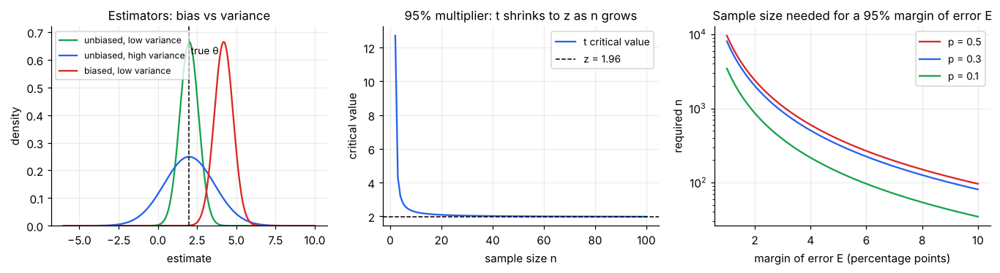
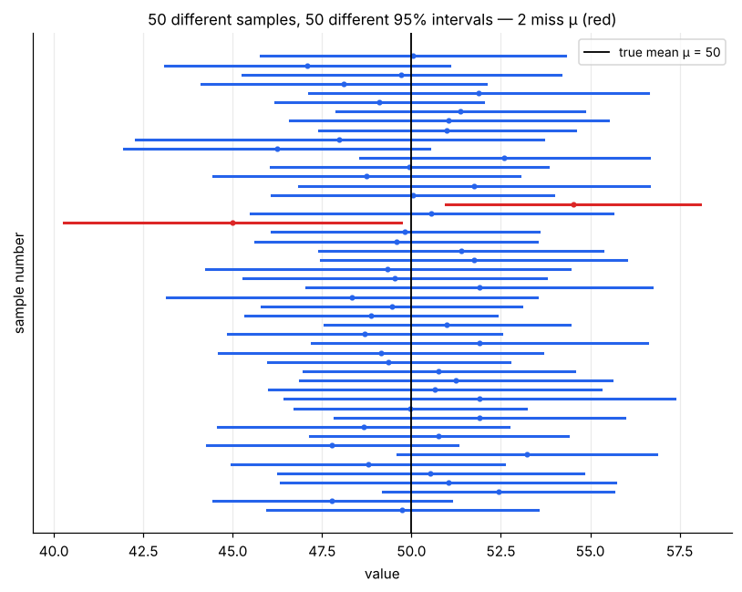
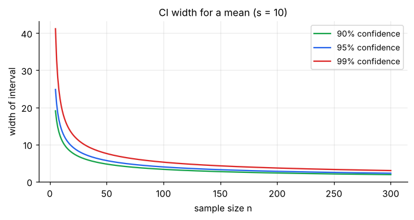

# Estimation & Confidence Intervals

> **A single number (a point estimate) is almost surely wrong; an interval that says how wrong it might be is useful.** A confidence interval is "estimate ± margin of error", where the margin comes straight from the sampling distribution ([note 02](02-sampling-distributions-and-clt.md)).

**Contents**

1. [Point estimation and what makes a good estimator](#1-point-estimation-and-what-makes-a-good-estimator)
2. [The confidence interval idea](#2-the-confidence-interval-idea)
3. [CI for a mean](#3-ci-for-a-mean)
4. [CI for a proportion](#4-ci-for-a-proportion)
5. [What controls the width](#5-what-controls-the-width)
6. [Choosing the sample size](#6-choosing-the-sample-size)
7. [Interpreting a CI correctly](#7-interpreting-a-ci-correctly)
8. [Other intervals (variance, difference, bootstrap)](#8-other-intervals-variance-difference-bootstrap)
9. [Code snippets](#9-code-snippets)

---

## 1. Point estimation and what makes a good estimator

A **point estimate** is one number computed from the sample to estimate a parameter: x̄ for μ, p̂ for p, s² for σ². The recipe or formula is the **estimator**; the number it produces for your data is the **estimate**.



| Property | Meaning | Examples |
|---|---|---|
| **Unbiased** | E[estimator] = parameter: right on average | x̄ for μ; p̂ for p; **s² (with n − 1)** for σ² |
| **Low variance (efficient)** | Little scatter from sample to sample | x̄ beats the sample median for normal data |
| **Consistent** | Converges to the parameter as n → ∞ | x̄, p̂, s² |
| **Low MSE** | MSE = variance + bias². Overall accuracy | Sometimes a slightly *biased* estimator with much lower variance wins |

Why s² divides by n − 1: the data sit closer to x̄ than to μ, so dividing by n underestimates σ² on average ([descriptive-statistics/02 §4](../descriptive-statistics/02-spread.md#4-why-divide-by-n--1)).

**How estimators are found (briefly):**

- **Method of moments:** set sample moments equal to model moments and solve (e.g. gamma α = x̄²/s², θ = s²/x̄; see [probability/01 §8](../probability/01-random-variables-and-expectation.md#8-moments-and-the-shape-of-a-distribution)).
- **Maximum likelihood (MLE):** choose the parameter that makes the observed data most probable. For a normal it gives x̄ (and s² with divisor n); for a Poisson, λ̂ = x̄; for a binomial, p̂ = successes/n. MLEs are consistent and approximately normal for large n, which is why they underpin regression and most modern modelling.

---

## 2. The confidence interval idea

Every CI has the same form:

**point estimate ± critical value × standard error**

The "critical value × SE" part is the **margin of error (ME)**. The critical value comes from the sampling distribution (z or t) and sets the **confidence level**, typically 90%, 95% or 99%.

**What "95% confident" means.** The *procedure* captures the true parameter in 95% of repeated samples. In the simulation below we draw 50 samples of n = 25 from a population with μ = 50 and build a 95% t-interval from each. About 5% (here 2 of 50, in red) miss μ, and any one interval either contains μ or doesn't.



The key picture: **μ is fixed; the intervals move.** Each sample gives a different interval, which is why we say "95% of intervals constructed this way contain μ" rather than "μ has a 95% chance of being in this interval".

---

## 3. CI for a mean

**σ known** (rare): x̄ ± z\* · σ/√n, with z\* = 1.645 (90%), **1.960 (95%)**, 2.576 (99%).

**σ unknown** (the usual case): x̄ ± t\* · s/√n, with t\* from the t-distribution with **n − 1** df.

- Assumes the sampling distribution of x̄ is roughly normal: data roughly normal, or n large enough (CLT).
- t\* > z\* for small n (heavier tails, more caution); the gap vanishes as n grows (middle panel of the figure above).

**Worked example.** A sample of n = 25 customers has x̄ = ₹52 per visit and s = ₹10.

- SE = 10/√25 = **2**
- df = 24, t\* (95%) = **2.064**
- ME = 2.064 × 2 = **4.13**
- **95% CI = (47.87, 56.13)**

*Reading:* we estimate the true mean spend lies between about ₹48 and ₹56. Had we wrongly used z\* = 1.96, we'd report (48.08, 55.92), slightly too narrow.

---

## 4. CI for a proportion

**Wald (textbook) interval:** p̂ ± z\* · √(p̂(1 − p̂)/n). Needs np̂ ≥ 10 and n(1 − p̂) ≥ 10.

**Worked example.** 120 of n = 400 sampled customers used the coupon: p̂ = 0.30.

- SE = √(0.3 × 0.7/400) = **0.0229**
- ME = 1.96 × 0.0229 = **0.0449**
- **95% CI = (0.255, 0.345)**, i.e. 25.5% to 34.5% of all customers.

**Better for small n or p near 0/1: the Wilson interval** (here (0.257, 0.347)). It never leaves [0, 1] and has more accurate coverage; software gives it directly. *(Bayesian cousin: a **credible interval** from a Beta posterior, [probability/03 §7](../probability/03-continuous-distributions.md#7-beta-α-and-β).)*

A news-style "margin of error ±3 points" is exactly this ME computed at the worst case p = 0.5 (see §6).

---

## 5. What controls the width



Width = 2 × t\* × s/√n. Three levers:

| Lever | Effect on width | Trade-off |
|---|---|---|
| **Larger n** | Narrower, but as 1/√n (4× n for half the width) | Costs money and time |
| **Lower confidence level** | Narrower (90% < 95% < 99%) | You are more often wrong |
| **Smaller σ (less variable data)** | Narrower | Better measurement, stratified design, matched pairs |

**The trade-off is unavoidable:** more confidence or more precision needs more data. A narrow interval and high confidence together cost a large n.

---

## 6. Choosing the sample size

Set a desired margin of error E, then solve ME = z\* · SE for n.

**For a mean:** n = (z\* · σ / E)²  (use a pilot or past estimate of σ).
*Example:* σ ≈ 10, want E = ₹2 at 95%: n = (1.96 × 10/2)² = **96.04 → 97**.

**For a proportion:** n = z\*² · p(1 − p) / E².
With no prior idea of p, use the worst case p = 0.5: n = z\*²/(4E²).
*Example:* E = ±3 points at 95%: n = 1.96² × 0.25/0.03² = 1067.1 → **1,068** (the classic "about 1,000 respondents" poll).

Always **round up**, then inflate for expected non-response and drop-outs. For a small finite population, apply the finite population correction ([note 01 §6](01-populations-samples-and-sampling.md#6-sample-size-and-the-finite-population-correction)).

---

## 7. Interpreting a CI correctly

| Correct | Common wrong readings |
|---|---|
| "We are 95% confident the true mean lies in (47.9, 56.1). The method captures the truth 95% of the time." | "There is a 95% probability μ is in this interval." (μ is fixed. A given interval either contains it or not.) |
| "Values inside the interval are plausible given the data; values far outside are not." | "95% of customers spend between 47.9 and 56.1." (That is about the *mean*, not individuals; for individuals use a **prediction interval**, which is much wider.) |
| "A different sample would give a different interval." | "A second sample's mean has a 95% chance of falling in this interval." (No: it's about capturing μ, not future x̄) |
| "More data → narrower interval" | "Non-overlapping 95% CIs are *required* for a significant difference" (overlap alone doesn't settle it) |

A CI also does **not** protect against bias: a tight interval from a biased sample is precisely wrong ([note 01 §4](01-populations-samples-and-sampling.md#4-sampling-error-vs-bias)).

**Link to testing:** a two-sided test at α = 0.05 rejects H₀: μ = μ₀ exactly when μ₀ lies **outside** the 95% CI. The CI is therefore more informative: it shows *which* values are plausible, not just whether one is rejected ([note 04 §7](04-hypothesis-testing-fundamentals.md#7-connections-and-pitfalls)).

---

## 8. Other intervals (variance, difference, bootstrap)

| Interval for | Formula idea | Where |
|---|---|---|
| **Variance σ²** | [(n − 1)s²/χ²ᵤ , (n − 1)s²/χ²ₗ] using the chi-square distribution. *n = 25, s = 10: (61.0, 193.5), so σ ∈ (7.8, 13.9)* | [probability/04](../probability/04-distributions-behind-tests.md#3-chi-square) |
| **Difference of two means** | (x̄₁ − x̄₂) ± t\* · SE of the difference | Next batch of notes (tests for means) |
| **Difference of two proportions** | (p̂₁ − p̂₂) ± z\* · √(p̂₁q̂₁/n₁ + p̂₂q̂₂/n₂) | Same |
| **Regression slope** | b ± t\* · SE(b) | Correlation and regression inference |
| **Anything awkward (median, ratio, etc.)** | **Bootstrap:** resample your data with replacement thousands of times and take the middle 95% of the resulting statistics | Non-parametric and resampling note |

Whenever you see "estimate ± something × SE", you are looking at a CI.

---

## 9. Code snippets

```python
import numpy as np
from scipy import stats

# Mean, summary stats given (worked example)
n, xbar, s = 25, 52, 10
se = s / np.sqrt(n)                                 # 2.0
tcrit = stats.t.ppf(0.975, df=n - 1)                # 2.064
(xbar - tcrit * se, xbar + tcrit * se)              # (47.87, 56.13)

# Same with scipy directly
stats.t.interval(0.95, df=n - 1, loc=xbar, scale=se)

# From raw data
data = np.array([32, 35, 29, 38, 31, 34, 36, 30, 33, 37])
stats.t.interval(0.95, df=len(data) - 1, loc=data.mean(), scale=stats.sem(data))

# Proportion: Wald and Wilson
k, n = 120, 400
phat = k / n
se = np.sqrt(phat * (1 - phat) / n)
(phat - 1.96 * se, phat + 1.96 * se)                # Wald (0.255, 0.345)
stats.binomtest(k, n).proportion_ci(confidence_level=0.95, method="wilson")  # (0.257, 0.347)

# Sample size
np.ceil((1.96 * 10 / 2) ** 2)                       # mean:        97
np.ceil(1.96 ** 2 * 0.25 / 0.03 ** 2)               # proportion: 1068

# Variance CI
n, s = 25, 10
lo = (n - 1) * s**2 / stats.chi2.ppf(0.975, n - 1)  # 61.0
hi = (n - 1) * s**2 / stats.chi2.ppf(0.025, n - 1)  # 193.5

# Bootstrap CI (works for any statistic)
res = stats.bootstrap((data,), np.median, confidence_level=0.95, random_state=1)
res.confidence_interval
```
