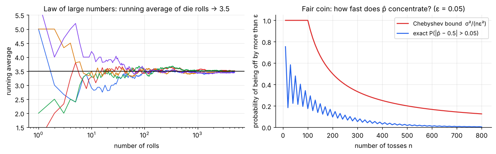
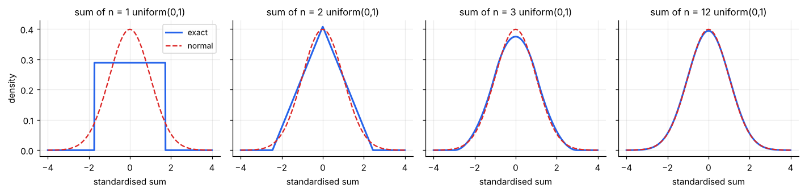
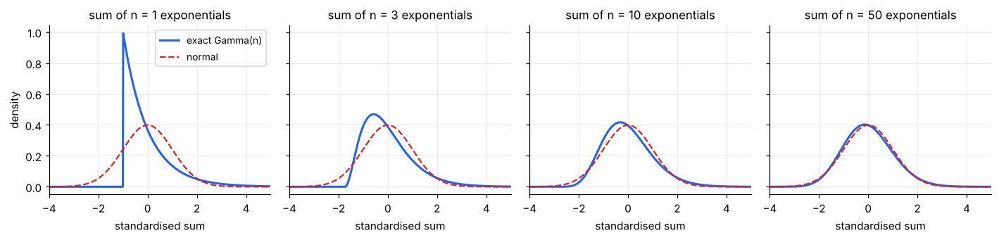
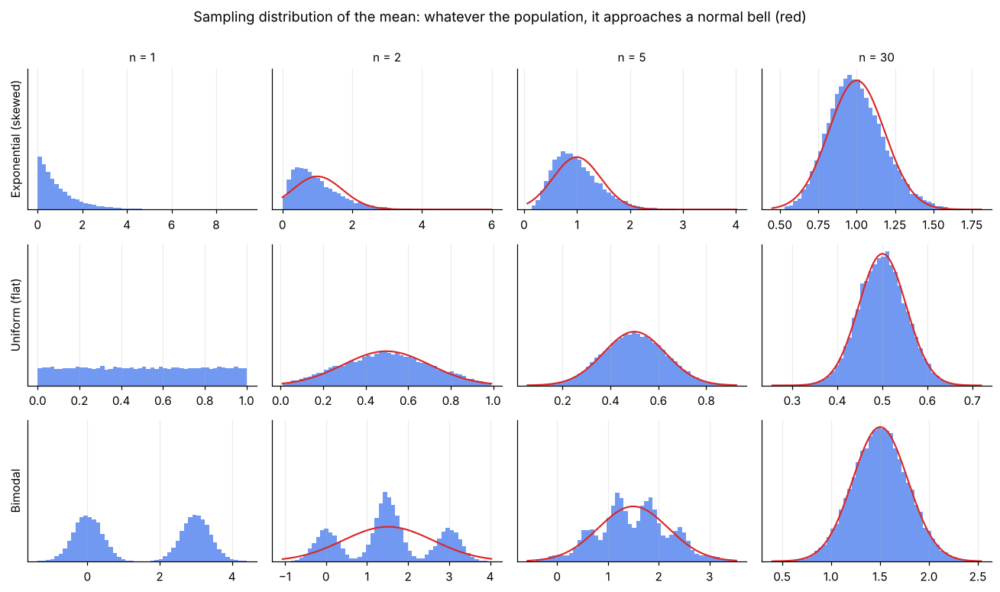
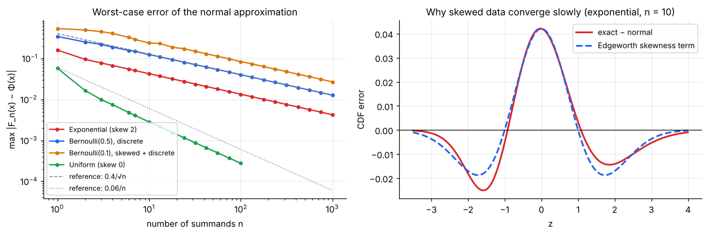
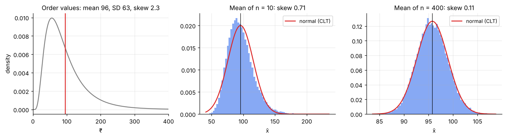
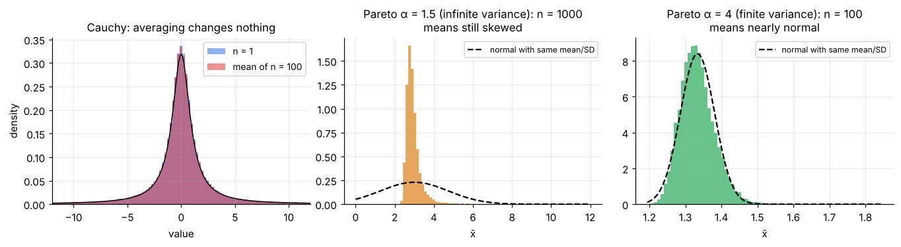

# The Law of Large Numbers & the Central Limit Theorem

> **Two theorems justify almost everything in inference.** The **Law of Large Numbers** says averages settle down at the true mean. The **Central Limit Theorem** says *how* they wobble on the way: in a bell-shaped (normal) pattern, with a spread that shrinks like 1/√n, **whatever shape the original data have**.

**Contents**

1. [Why averages are special](#1-why-averages-are-special)
2. [Law of Large Numbers](#2-law-of-large-numbers)
3. [The Central Limit Theorem: statement](#3-the-central-limit-theorem-statement)
4. [Seeing it work](#4-seeing-it-work)
5. [Why a normal curve? A proof sketch](#5-why-a-normal-curve-a-proof-sketch)
6. [How fast does it work? Berry–Esseen and skewness](#6-how-fast-does-it-work-berryesseen-and-skewness)
7. [Worked examples](#7-worked-examples)
8. [Useful consequences and extensions](#8-useful-consequences-and-extensions)
9. [When the CLT fails](#9-when-the-clt-fails)
10. [Checklist: can I use a normal approximation?](#10-checklist-can-i-use-a-normal-approximation)
11. [Code snippets](#11-code-snippets)

---

## 1. Why averages are special

Raw business data come in all shapes: skewed order values, bimodal arrival times, discrete counts. You cannot expect a single formula for "the probability that a sample mean is off by more than ₹5" unless the data follow a known distribution.

The CLT removes that obstacle for **averages and sums**. Provided there are enough independent observations with finite variance, the sampling distribution of x̄ is approximately normal *regardless of the shape of the data*. This is why a handful of normal-based procedures (z and t intervals and tests, regression inference) work on so many kinds of data.

Two questions to keep in mind throughout:

1. **Where does x̄ end up?** (Law of Large Numbers)
2. **How does x̄ fluctuate around there?** (Central Limit Theorem)

---

## 2. Law of Large Numbers

> **LLN.** If X₁, X₂, … are independent with the same finite mean μ, then the sample mean x̄ₙ converges to μ as n → ∞.

- **Weak LLN** (convergence in probability): for every ε > 0, P(|x̄ₙ − μ| > ε) → 0.
- **Strong LLN** (almost sure): with probability 1, the sequence x̄₁, x̄₂, … converges to μ. (Kolmogorov.)



### A short proof of the weak LLN (needs finite variance σ²)

From the previous note, E[x̄ₙ] = μ and Var(x̄ₙ) = σ²/n. **Chebyshev's inequality** says P(|Y − E Y| ≥ ε) ≤ Var(Y)/ε². Apply it to Y = x̄ₙ:

**P(|x̄ₙ − μ| ≥ ε) ≤ σ²/(nε²) → 0 as n → ∞**

The right panel above shows this bound for a fair coin with ε = 0.05 (red) against the exact probability (blue). Chebyshev is **very loose** (it must hold for any distribution), but it is enough to prove convergence. To be 95% sure that the proportion of heads is within 0.05 of 0.5, Chebyshev demands n ≥ 2,000, whereas the normal approximation (CLT) says about 385 suffice.

### What the LLN does and does not say

| It says | It does not say |
|---|---|
| The *average* converges to μ | The *sum* converges (it diverges: sum ≈ nμ) |
| Bigger samples give consistent estimates (x̄ is a **consistent** estimator of μ) | A streak of tails makes heads "due" (gambler's fallacy: early deviations are *diluted*, not corrected) |
| Casinos and insurers can predict *long-run* totals | Anything about a *single* trial |

The LLN is also why relative frequency is a valid definition of probability and why Monte Carlo simulation works.

---

## 3. The Central Limit Theorem: statement

> **CLT (Lindeberg–Lévy).** Let X₁, …, Xₙ be independent and identically distributed with mean μ and **finite** variance σ² > 0. Then as n → ∞,
>
> **Zₙ = (x̄ₙ − μ)/(σ/√n) → N(0, 1) in distribution**,
>
> that is, P(Zₙ ≤ z) → Φ(z) for every z.

Equivalent forms you will meet:

| Quantity | Approximate distribution for large n |
|---|---|
| Sample mean x̄ | **N(μ, σ/√n)** |
| Sample sum S = ΣXᵢ | **N(nμ, σ√n)** |
| Sample proportion p̂ | **N(p, √(p(1 − p)/n))** (Bernoulli data) |
| Binomial count | **N(np, √(np(1 − p)))** |
| Poisson count (large λ) | **N(λ, √λ)** (a Poisson(λ) is a sum of λ unit-rate Poissons) |

### In words

> *Add up many small, independent, random contributions and the total is approximately normal, almost no matter what the individual pieces look like.*

Heights (many genes and environmental factors), measurement errors (many tiny disturbances), and daily sales totals (many customers) are all sums of many small pieces, which is why the normal curve describes so many real quantities.

### The three conditions

| Condition | What it means | If violated |
|---|---|---|
| **Independence** | One observation tells you nothing about another | Effective sample size is smaller (§8, §9) |
| **Identical distribution** (relaxable) | All come from the same population | Needs the Lindeberg condition: no single term may dominate the sum |
| **Finite variance** | No extremely heavy tails | The limit is *not* normal (§9) |

And a *practical* fourth: **n large enough**, which depends on how skewed and heavy-tailed the data are (§6).

---

## 4. Seeing it work

### Sums of uniforms (symmetric): fast

A single uniform(0,1) is flat. The sum of two is a triangle; the sum of three is a smooth, bell-like curve made of three parabolic pieces; the sum of twelve is almost indistinguishable from a normal. (In the plots, each sum is standardised to mean 0 and SD 1 and compared with the exact density. This is the "exact" Irwin–Hall distribution, so no simulation is involved.)



*Historical aside:* adding twelve uniform(0,1) numbers and subtracting 6 was a classic way to generate a standard normal on early computers.

### Sums of exponentials (strongly skewed): slow

An exponential waiting time is skewed to the right with skewness 2. The **exact** distribution of the sum of n of them is Gamma(n) ([probability/03 §5](../probability/03-continuous-distributions.md#5-gamma-and-what-α-means)). Even at n = 10 the right tail is visibly longer than the normal's; at n = 50 the two are close.



### Many shapes, one destination

Three very different populations (skewed, flat, two-humped). The first column is the population (n = 1); by n = 30 all three sampling distributions of x̄ are close to the red normal curve.



The bimodal population converges *fast* (it is symmetric); the skewed one is slowest.

---

## 5. Why a normal curve? A proof sketch

The standard proof shows that the **moment generating function** (MGF) of the standardised mean converges to that of N(0, 1). (If the MGF does not exist, the same argument works with the *characteristic function*, which always exists.)

**Setup.** Let Yᵢ = (Xᵢ − μ)/σ, so E[Yᵢ] = 0 and Var(Yᵢ) = E[Yᵢ²] = 1. Then

Zₙ = (x̄ₙ − μ)/(σ/√n) = (1/√n) Σ Yᵢ.

**Step 1: MGF of the sum.** Let M(t) = E[e^{tY}]. For independent Yᵢ,

M_{Zₙ}(t) = E[e^{tZₙ}] = [ M(t/√n) ]ⁿ

**Step 2: Taylor-expand M near 0.** Because E[Y] = 0 and E[Y²] = 1,

M(s) = 1 + E[Y]·s + E[Y²]·s²/2 + o(s²) = **1 + s²/2 + o(s²)**

Put s = t/√n:

M(t/√n) = 1 + t²/(2n) + o(1/n)

**Step 3: take the limit.** Using (1 + a/n)ⁿ → eᵃ,

M_{Zₙ}(t) = [1 + t²/(2n) + o(1/n)]ⁿ → **e^{t²/2}**

and e^{t²/2} is exactly the MGF of the standard normal. Since convergence of MGFs implies convergence of distributions (Lévy's continuity theorem), Zₙ → N(0, 1). ∎

### What the proof tells you

- **Only the mean and variance survive.** All other features of the distribution (skewness, kurtosis, multi-modality, discreteness) appear in the *o(s²)* remainder, which vanishes in the limit. That is why the limit is universal.
- **Finite variance is essential** (E[Y²] = 1 is used).
- **The next term is the skewness.** Extending the expansion one more term, M(s) = 1 + s²/2 + γs³/6 + ⋯, with γ = E[Y³] the skewness, gives

 ln M_{Zₙ}(t) = t²/2 + γt³/(6√n) + O(1/n).

 So the error shrinks like **1/√n and is proportional to the skewness**. This leads directly to §6.

---

## 6. How fast does it work? Berry–Esseen and skewness

The CLT is a statement about n → ∞. For a given finite n, how good is the approximation?

### Berry–Esseen theorem

If ρ = E|X − μ|³ < ∞, then for all n

**sup ₓ | Fₙ(x) − Φ(x) | ≤ C · ρ / (σ³ √n)**,  with a constant C < 0.48.

So the worst-case error is **O(1/√n)** and depends on the third absolute moment relative to σ³: the more skewed or heavy-tailed, the larger it is. For the exponential, ρ/σ³ = 12/e − 2 ≈ 2.41, giving a guaranteed error ≤ 1.15/√n. At n = 30 that is at most 0.21, which is a pessimistic bound (the true error is 0.024).

### The Edgeworth correction

A sharper first-order description includes the skewness γ explicitly:

**Fₙ(z) ≈ Φ(z) − (γ / (6√n)) · (z² − 1) · φ(z)**

where φ is the standard normal density. It shows (right panel below, exponential with n = 10) *where* the error sits: the normal approximation overstates the probability near the centre and in the left tail and understates the right tail. That matches the skew of the data, whose long tail the normal underestimates.



### Reading the left panel

| Distribution | Error behaviour | Observation |
|---|---|---|
| **Uniform** (symmetric, skew 0) | Shrinks like **1/n**, very fast | Already tiny at n = 5 |
| **Exponential** (skew 2) | Shrinks like **1/√n** | Error 0.042 at n = 10, 0.013 at n = 100 |
| **Bernoulli(0.5)** (symmetric but discrete) | Like 1/√n (lattice jumps) | Needs continuity correction ([probability/02 §8](../probability/02-discrete-distributions.md#8-approximations-between-distributions)) |
| **Bernoulli(0.1)** (skewed + discrete) | Largest | Why "np ≥ 10" is needed |

**Rule of thumb that follows.** The skewness of x̄ is (population skewness)/√n. To bring it under about 0.2, you need

**n ≳ (γ/0.2)²**

For symmetric data (γ ≈ 0) a handful of observations suffice; for γ = 2 (exponential) about **100**; for the very right-skewed order values in §7 (γ ≈ 2.3) about **130**.

---

## 7. Worked examples

### Example 1: sum of 100 dice rolls

One roll: μ = 3.5, σ² = 35/12 ≈ 2.917, σ ≈ 1.708. For S = total of n = 100 rolls:

- E[S] = 100 × 3.5 = **350**
- SD(S) = 1.708 × √100 = **17.08**

**P(S > 370)?** Since S is an integer, "S > 370" means S ≥ 371, so use the continuity-corrected boundary 370.5:

- z = (370.5 − 350)/17.08 = 1.20 → P ≈ **0.1150**
- Without the correction (z = 1.171): 0.1208
- **Exact** (by convolution): **0.1152**

The corrected approximation is accurate to three decimals using nothing but a mean and an SD.

### Example 2: mean order value (a skewed population)

An online shop's order values are right-skewed: log-normal with median ₹80, μ = ₹95.8, σ = ₹63.0, skewness 2.26. We look at the sample mean for small and large n.



**n = 400:** SE = 63.0/√400 = **₹3.15**.

| Event | Normal (CLT) | Simulation | Verdict |
|---|---|---|---|
| x̄ > μ + 1·SE | 0.1587 | 0.157 | Excellent |
| x̄ > μ + 2·SE | 0.0228 | 0.025 | Good |

Skewness of x̄ is 2.26/√400 = 0.11, so the distribution is nearly symmetric. A 95% interval x̄ ± 1.96 × 3.15 is trustworthy.

**n = 10:** SE = 19.9. The CLT is *not yet reliable*:

| Event | Normal | Simulation |
|---|---|---|
| x̄ > μ + 2·SE | 0.023 | **0.039** (70% more often than claimed) |
| x̄ < μ − 2·SE | 0.023 | **0.005** (4× less often) |

The normal treats both tails alike, but the real distribution has a long right tail. A symmetric interval around x̄ would **miss on the high side too often**. This is exactly what the skewness-based rule above predicts: you need roughly n ≈ 130 for this population.

### Example 3: a poll (proportion)

True support p = 0.52, n = 1,000. SE = √(0.52 × 0.48/1000) = 0.0158. P(p̂ < 0.50) = P(Z < −1.27) = **0.103**. np = 520 and n(1 − p) = 480, both far above 10, so the normal approximation is safe. A binomial is a sum of 1,000 Bernoulli trials, so this is the CLT directly.

### Example 4: when is the binomial approximation poor?

n = 20, p = 0.05: np = 1 < 10. The binomial is strongly right-skewed (skewness (1 − 2p)/√(np(1 − p)) = 0.9/0.975 = 0.92) and the normal N(1, 0.97) assigns about **15%** probability to *negative* counts, which are impossible. Use the exact binomial or a Poisson(1) here ([probability/02 §8](../probability/02-discrete-distributions.md#8-approximations-between-distributions)).

---

## 8. Useful consequences and extensions

### Standard errors and confidence intervals

Because x̄ ≈ N(μ, σ/√n), the interval x̄ ± 1.96·σ/√n captures μ about 95% of the time. This is the origin of every "estimate ± 2 standard errors" statement ([note 05](05-confidence-intervals.md)).

### The delta method (CLT for functions of x̄)

If x̄ ≈ N(μ, σ/√n) and g is smooth with g′(μ) ≠ 0, then

**g(x̄) ≈ N( g(μ), |g′(μ)| · σ/√n )**

*Example.* For exponential data with mean μ = 2 (rate λ = 1/μ = 0.5), the estimator λ̂ = 1/x̄ has g(μ) = 1/μ and g′(μ) = −1/μ². With σ = μ = 2 and n = 100:

SE(λ̂) ≈ (1/μ²) · σ/√n = (1/4)(2/10) = **0.05**

which matches the simulation in [note 04 §6](04-parameter-estimation.md#6-properties-of-the-mle-and-fisher-information) (0.051). Use it for logs, ratios, reciprocals and odds.

### CLT for non-identical variables (Lindeberg–Feller)

Independent variables with different means and variances still sum to a normal as long as **no single term dominates** (the Lindeberg condition). Daily revenue from thousands of different customers fits this; revenue where one customer accounts for half the total does not.

### Dependent data

Positive correlation between observations reduces the information in the sample. For a stationary series with lag-1 autocorrelation ρ (AR(1)), the variance of the mean is inflated by about (1 + ρ)/(1 − ρ):

**n_effective ≈ n · (1 − ρ)/(1 + ρ)**

With ρ = 0.5 you effectively have only a **third** of the observations you think you have (e.g. 300 days of correlated daily sales behave like 100 independent ones). The CLT still holds for many dependent series ("m-dependence", mixing) but the variance formula σ²/n must be corrected. Ignoring this makes confidence intervals far too narrow, a common error in time-series data.

### Multivariate CLT

Vectors of averages (e.g. average price *and* average quantity) are jointly approximately multivariate normal, with covariance matrix Σ/n. This underlies inference for regression coefficients.

---

## 9. When the CLT fails



| Situation | What happens | Example |
|---|---|---|
| **No mean** (Cauchy) | x̄ₙ has the **same distribution as a single observation**. Averaging never helps (left panel) | Ratios of two normals; some financial shocks |
| **Infinite variance** (Pareto with α ≤ 2, power laws) | Means converge to a skewed **stable law**, not a normal; convergence is extremely slow (middle panel) | Wealth, city sizes, insurance mega-claims |
| **Finite variance but heavy tail** (Pareto α = 4) | CLT holds, but needs a big n for the tails (right panel) | Customer revenue |
| **Strong dependence** | Variance of x̄ does not shrink like 1/n; effective n small | Autocorrelated sales, clustered data |
| **Extremes, not averages** | Max, min and range obey *extreme value theory* (Gumbel/Fréchet/Weibull), not the CLT | Maximum daily load, worst-case loss |
| **Tiny n with outliers** | Asymptotics have not kicked in | n = 10 with one huge value |

**Diagnosis.** Plot the data and check skewness and kurtosis ([descriptive-statistics/03](../descriptive-statistics/03-skewness-and-kurtosis.md)); inspect the largest values; look at how the mean changes as you add data (a running mean that keeps jumping signals infinite variance). When in doubt, use a **bootstrap** or **median-based/non-parametric** method, or transform (log) first.

---

## 10. Checklist: can I use a normal approximation?

| Question | Good sign |
|---|---|
| Is the sample random and are observations independent? | Yes (or correct for clustering and time dependence) |
| Is the variance finite? | No extreme, unbounded outliers; not a power law with α ≤ 2 |
| How skewed is the population? | Absolute skewness below 1: n ≈ 30 is fine. Skewness 2 or more: n ≳ 100 |
| Proportion or count? | np ≥ 10 and n(1 − p) ≥ 10 (and a continuity correction for discrete counts) |
| Is the statistic an average, sum or smooth function of them? | Yes. For medians, extremes etc. use other methods |

---

## 11. Code snippets

```python
import numpy as np
from scipy import stats

rng = np.random.default_rng(0)

# --- Example 1: sum of 100 dice rolls -------------------------------------
mu, sd = 3.5, np.sqrt(35 / 12)
m, s = 100 * mu, sd * np.sqrt(100)          # 350, 17.08
stats.norm.sf(370.5, m, s)                  # with continuity correction: 0.1150
stats.norm.sf(370, m, s)                    # without: 0.1208

pmf = np.ones(6) / 6                        # exact distribution by repeated convolution
dist = np.array([1.0])
for _ in range(100):
    dist = np.convolve(dist, pmf)
totals = np.arange(len(dist)) + 100
dist[totals > 370].sum()                    # 0.1152 (exact)

# --- Example 2: the CLT on skewed order values -----------------------------
ln = stats.lognorm(0.6, scale=80)           # mean 95.8, SD 63.0, skew 2.26
for n in (10, 400):
    xbar = rng.lognormal(np.log(80), 0.6, (40_000, n)).mean(axis=1)
    se = ln.std() / np.sqrt(n)
    print(n, round(stats.skew(xbar), 2),
          (xbar > ln.mean() + 2 * se).mean(),     # upper-tail rate (normal says 0.0228)
          (xbar < ln.mean() - 2 * se).mean())     # lower-tail rate

# --- Distance between exact CDF and normal (Kolmogorov distance) -----------
z = np.linspace(-6, 6, 20001)
def kd(n):                                  # sum of n Exp(1)  ~  Gamma(n)
    return np.max(np.abs(stats.gamma.cdf(n + np.sqrt(n) * z, n) - stats.norm.cdf(z)))
[round(kd(n), 4) for n in (10, 100, 1000)]  # 0.0421, 0.0133, 0.0042   (≈ 0.4/√n)

# --- Berry–Esseen bound for the exponential --------------------------------
rho_over_sigma3 = 12 / np.e - 2             # 2.41
0.4748 * rho_over_sigma3 / np.sqrt(30)      # 0.209 (guarantee; true error is 0.024)

# --- Delta method: SE of lambda_hat = 1/xbar --------------------------------
mu, n = 2.0, 100
(1 / mu**2) * mu / np.sqrt(n)               # 0.05

# --- Failure: Cauchy means do not settle -----------------------------------
c = rng.standard_cauchy((100_000, 100)).mean(axis=1)
np.percentile(c, [25, 75])                  # ≈ [-1, 1]: same spread as n = 1
```
