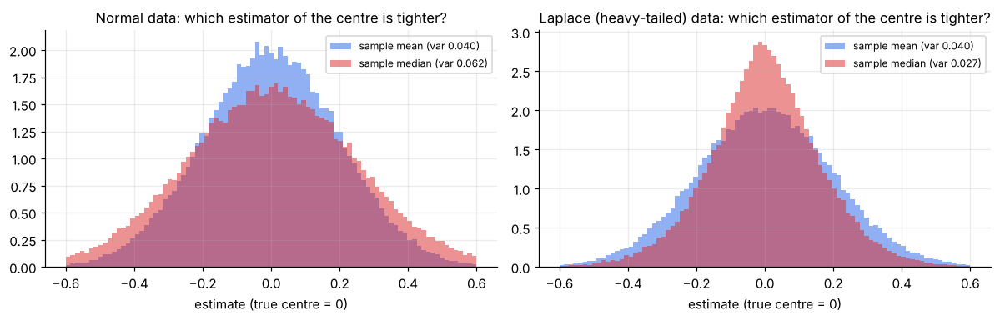
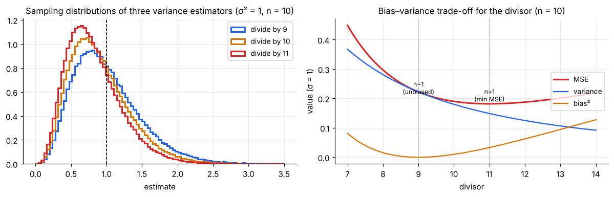
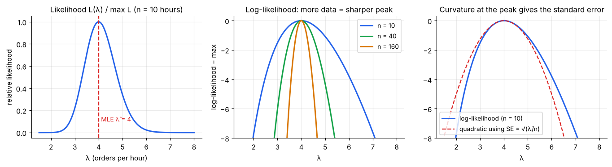
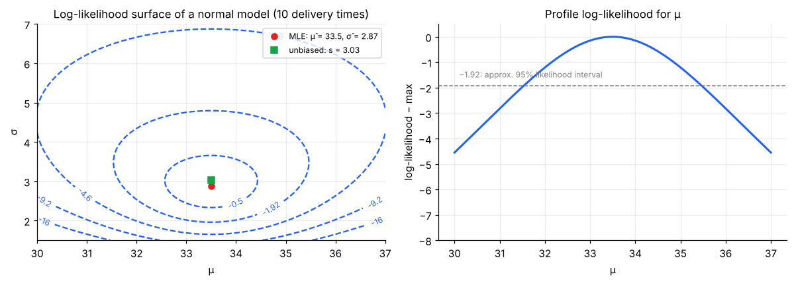
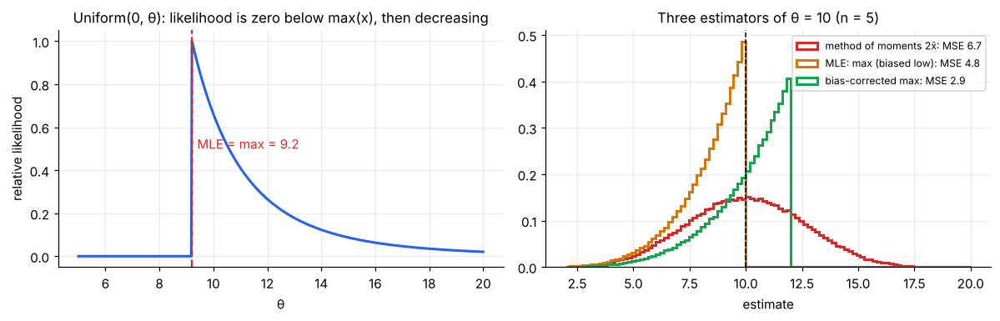
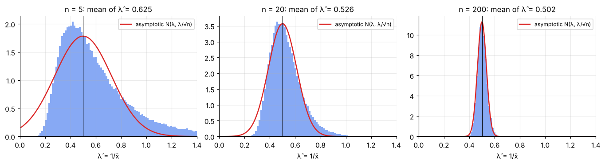
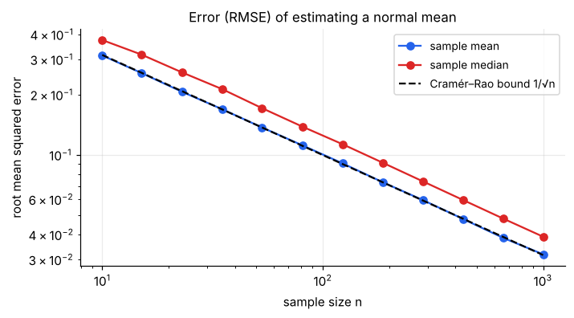

# Parameter Estimation

> **A statistical model describes data with a few unknown numbers called parameters (a mean μ, a rate λ, a proportion p). Parameter estimation is the art of choosing those numbers from data, and of knowing how good the choice is.** Two classic recipes (method of moments and maximum likelihood) and a small toolkit of quality measures (bias, variance, MSE, consistency, efficiency) cover most of what you will use in practice.

**Contents**

1. [What is parameter estimation?](#1-what-is-parameter-estimation)
2. [What makes an estimator good?](#2-what-makes-an-estimator-good)
3. [Method of moments](#3-method-of-moments)
4. [Maximum likelihood: the idea](#4-maximum-likelihood-the-idea)
5. [Maximum likelihood: worked derivations](#5-maximum-likelihood-worked-derivations)
6. [Properties of the MLE and Fisher information](#6-properties-of-the-mle-and-fisher-information)
7. [Least squares and Bayesian estimation](#7-least-squares-and-bayesian-estimation)
8. [Choosing a method](#8-choosing-a-method)
9. [Standard errors of common estimators](#9-standard-errors-of-common-estimators)
10. [Code snippets](#10-code-snippets)

---

## 1. What is parameter estimation?

**The setting.** You believe your data X₁, …, Xₙ are independent draws from a distribution f(x; θ) whose *form* you chose (normal, Poisson, exponential, …) but whose *parameter* θ is unknown. The task: use the data to say something about θ.

| Term | Meaning | Example |
|---|---|---|
| **Parameter** θ | Fixed, unknown population quantity (the *estimand*) | Average orders per hour λ |
| **Estimator** θ̂ | A *rule* (formula) turning data into a guess. A random variable | θ̂ = X̄ |
| **Estimate** | The number the rule gives for *your* data | λ̂ = 4.0 |
| **Standard error** | The SD of the estimator across samples | SE(λ̂) = 0.63 |

Two types of estimates:

- **Point estimate:** one best-guess number (this note).
- **Interval estimate:** a range of plausible values, built from the point estimate and its SE ([note 05](05-confidence-intervals.md)).

### Running examples

| # | Situation | Model | Parameter | Data |
|---|---|---|---|---|
| A | Orders arriving per hour | Poisson(λ) | λ | 3, 5, 2, 4, 6, 3, 4, 5, 2, 6 (10 hours) |
| B | Delivery times | Normal(μ, σ²) | μ, σ² | 32, 35, 29, 38, 31, 34, 36, 30, 33, 37 |
| C | Waiting time between calls | Exponential(rate λ) | λ | 4.2, 1.1, 7.5, 3.3, 0.8, 5.9, 2.4, 9.6, 1.7, 3.5 min |
| D | Time a bus arrives, uniform over an unknown window | Uniform(0, θ) | θ | 3.1, 7.4, 5.9, 9.2, 1.8 |
| E | Coupon use | Bernoulli(p) | p | 120 of 400 customers |

**Two general recipes.** *Method of moments* matches the model's moments to the sample's. *Maximum likelihood* picks the θ under which the observed data are most probable. First, we need to know how to judge an estimator.

---

## 2. What makes an estimator good?

Since θ̂ is random, "good" is a statement about its **sampling distribution** ([note 02](02-sampling-distributions.md)): where it is centred and how spread out it is.

### Bias, variance, MSE

| Quantity | Definition | Meaning |
|---|---|---|
| **Bias** | E[θ̂] − θ | Systematic error: is the estimator centred on the truth? |
| **Variance** | Var(θ̂) | Random error: how much does it scatter? |
| **MSE** | E[(θ̂ − θ)²] | Total expected squared error |

**The decomposition** (add and subtract E[θ̂] inside the square; the cross term vanishes):

**MSE(θ̂) = Var(θ̂) + Bias(θ̂)²**

An estimator with **zero bias** is *unbiased*. But unbiased is not automatically best: an estimator can trade a little bias for a lot less variance and win on MSE.

### Consistency

θ̂ₙ is **consistent** if θ̂ₙ → θ (in probability) as n → ∞. A sufficient condition: bias → 0 and variance → 0. Examples: x̄, p̂, s² and (as shown below) the MLEs. Consistency is the minimum requirement. It says that more data eventually helps, but not how fast.

### Efficiency

For two unbiased estimators, the one with the smaller variance is **more efficient**. The **relative efficiency** is Var(θ̂₁)/Var(θ̂₂). There is a theoretical floor for the variance, the Cramér–Rao bound (§6).

### Example 1: mean vs median as estimators of the centre

For N(μ, σ²) data, both the sample mean and sample median are unbiased for μ. Their variances:

- Var(x̄) = σ²/n
- Var(median) ≈ (π/2) · σ²/n ≈ 1.57σ²/n



So for **normal** data the median needs **57% more data** to match the mean's precision. But for **heavy-tailed** data (Laplace, also scaled to SD 1) the order flips: in the simulation the mean's variance is 0.040 and the median's only 0.027, so the median is about 33% more precise. The "best" estimator depends on the model. The mean is optimal under normality and is fragile to outliers; the median is robust.

### Example 2: three estimators of a variance

Take normal data and estimate σ² by SS/d, where SS = Σ(xᵢ − x̄)² and the divisor d is n − 1, n or n + 1. Because SS/σ² ~ χ²ₙ₋₁ (mean n − 1, variance 2(n − 1)):

| Divisor d | Bias | Variance | MSE (in units of σ⁴) |
|---|---|---|---|
| n − 1 | **0** | 2σ⁴/(n − 1) | 2/(n − 1) |
| n | −σ²/n | 2(n − 1)σ⁴/n² | (2n − 1)/n² |
| n + 1 | −2σ²/(n + 1) | 2(n − 1)σ⁴/(n + 1)² | **2/(n + 1)** |

In general MSE/σ⁴ = 2(n − 1)/d² + ((n − 1)/d − 1)², minimised at d = n + 1.

For n = 10: MSE = 0.222, 0.190, 0.182 respectively.



**Lesson:** the unbiased n − 1 divisor is the *standard* choice (it is the one that makes confidence intervals and t-tests exact), but it is **not** the lowest-MSE estimator. Biased estimators can be better, which is the principle behind shrinkage and regularisation (ridge, lasso).

---

## 3. Method of moments

**Idea:** a model's moments (E[X], E[X²], …) are functions of its parameters. Replace each population moment by the corresponding **sample moment** and solve for the parameters.

**Recipe** (k parameters → k equations):

1. Express the first k population moments μ'ⱼ = E[Xʲ] in terms of θ.
2. Set μ'ⱼ = m'ⱼ = (1/n)ΣXᵢʲ for j = 1, …, k.
3. Solve for θ̂.

### Examples

| Model | Population moments | Method-of-moments estimator |
|---|---|---|
| Poisson(λ) | E[X] = λ | **λ̂ = x̄** |
| Exponential(rate λ) | E[X] = 1/λ | **λ̂ = 1/x̄** |
| Normal(μ, σ²) | E[X] = μ, Var = σ² | **μ̂ = x̄**, **σ̂² = (1/n)Σ(xᵢ − x̄)²** |
| Uniform(0, θ) | E[X] = θ/2 | **θ̂ = 2x̄** |
| Gamma(α, scale θ) | mean = αθ, variance = αθ² | **α̂ = x̄²/s²**, **θ̂ = s²/x̄** |
| Beta(α, β) | mean m, variance v | α̂ = x̄(x̄(1 − x̄)/s² − 1), β̂ = (1 − x̄)(x̄(1 − x̄)/s² − 1) |

### Worked example: gamma

Data (simulated, n = 200, true α = 3, scale θ = 5) have x̄ = 13.66 and s² = 59.94.

- α̂ = 13.66²/59.94 = **3.11**
- θ̂ = 59.94/13.66 = **4.39**

(True values 3 and 5. The maximum likelihood estimates for the same data are α̂ = 3.23, θ̂ = 4.22. See §5.)

### Example D: uniform(0, θ)

x̄ = (3.1 + 7.4 + 5.9 + 9.2 + 1.8)/5 = 5.48, so **θ̂ = 2x̄ = 10.96**. A flaw: if the sample were 1.0, 9.9, 9.9, 9.9, 9.9, x̄ is smaller and 2x̄ could be below the largest observation (impossible, since θ ≥ max). Method of moments can return values that are **inconsistent with the data**.

### Pros and cons

- **Pros:** simple, closed form, often a good starting value for harder methods, consistent.
- **Cons:** may be inefficient (higher variance than MLE), may give impossible values (negative variances, α < 0), ignores the full shape of the distribution (uses only a few moments).

---

## 4. Maximum likelihood: the idea

**Question the method asks:** *which parameter value makes the data I actually saw the most likely?*

### The likelihood function

For independent observations x₁, …, xₙ from f(x; θ), the **likelihood** is the joint density *viewed as a function of θ with the data held fixed*:

**L(θ) = f(x₁; θ) · f(x₂; θ) ⋯ f(xₙ; θ) = Πᵢ f(xᵢ; θ)**

Probability vs likelihood: the same formula, different roles. *Probability* fixes θ and asks about data; *likelihood* fixes the data and asks about θ. L(θ) is **not** a probability distribution over θ (it need not integrate to 1).

### A tiny example

You flip a coin 10 times and see 7 heads. For a candidate p, the probability of exactly that data is L(p) = C(10,7) p⁷(1 − p)³:

| p | 0.3 | 0.5 | **0.7** | 0.9 |
|---|---|---|---|---|
| L(p) | 0.009 | 0.117 | **0.267** | 0.057 |

The data were most probable if p = 0.7. The maximum likelihood estimate is **p̂ = 0.7**, matching intuition.

### Why take logs

Products are awkward and numerically unstable; sums are easy. Since log is increasing, maximising L also maximises the **log-likelihood**

**ℓ(θ) = log L(θ) = Σᵢ log f(xᵢ; θ)**

### The recipe

1. Write L(θ) and take logs: ℓ(θ).
2. Differentiate: the **score** is ℓ′(θ). Set **ℓ′(θ) = 0** and solve for θ̂.
3. Check it is a maximum (ℓ″(θ̂) < 0).
4. If the support depends on θ, or the derivative has no zero (as for the uniform), reason from the shape of L directly.

For several parameters, set every partial derivative to zero.

---

## 5. Maximum likelihood: worked derivations

### Bernoulli / binomial (Example E)

k successes in n trials: ℓ(p) = k log p + (n − k) log(1 − p).

ℓ′(p) = k/p − (n − k)/(1 − p) = 0 ⟹ **p̂ = k/n**

For 120 of 400: **p̂ = 0.30**. (The sample proportion is the MLE.)

### Poisson (Example A)

ℓ(λ) = Σ(yᵢ log λ − λ − log yᵢ!) ⟹ ℓ′(λ) = Σyᵢ/λ − n = 0 ⟹ **λ̂ = ȳ**

For the ten hours: Σyᵢ = 40, so **λ̂ = 4.0** orders per hour.



- **Left:** the likelihood for our 10 hours peaks at 4.0.
- **Middle:** more data (same average, n = 40 and 160) make the log-likelihood peak **sharper**. A sharp peak = precise estimate.
- **Right:** near the maximum the log-likelihood is a parabola, ℓ(λ) ≈ ℓ(λ̂) − (λ − λ̂)²/(2·SE²). The *curvature* at the top gives the standard error (§6). Here SE = √(λ̂/n) = **0.632**.

### Exponential (Example C)

f(x) = λe^{−λx}: ℓ(λ) = n log λ − λΣxᵢ ⟹ ℓ′ = n/λ − Σxᵢ = 0 ⟹ **λ̂ = 1/x̄**

Data: x̄ = 4.0 min, so **λ̂ = 0.25 calls per minute**.

**The MLE can be biased.** Σxᵢ ~ Gamma(n, scale 1/λ), and E[1/Σx] = λ/(n − 1), so

E[λ̂] = **nλ/(n − 1)**: too high by a factor n/(n − 1)

(25% too high at n = 5; 11% at n = 10; 1% at n = 100). The bias-corrected version is (n − 1)/Σxᵢ = 0.225 for Example C. Bias vanishes as n grows, so λ̂ is **consistent** but not unbiased. This is typical of MLEs.

### Normal (Example B)

ℓ(μ, σ) = −n log σ − Σ(xᵢ − μ)²/(2σ²) + const.

- ∂ℓ/∂μ = Σ(xᵢ − μ)/σ² = 0 ⟹ **μ̂ = x̄**
- ∂ℓ/∂σ = −n/σ + Σ(xᵢ − μ)²/σ³ = 0 ⟹ **σ̂² = (1/n) Σ(xᵢ − x̄)²**

The MLE of the variance divides by **n**, so it is biased (E[σ̂²] = (n − 1)σ²/n). For the delivery times: μ̂ = 33.5, σ̂² = 8.25 (σ̂ = 2.87), whereas the unbiased s² = 9.17 (s = 3.03).



- **Left:** contours of the log-likelihood as a function of (μ, σ). The peak is at the MLE (red). The unbiased s (green) is just above it. Contours at −1.92 enclose an approximate 95% region (see the CI note).
- **Right:** the profile log-likelihood for μ. The set of μ values within 1.92 of the top, about (31.5, 35.5), is an approximate **likelihood-based 95% interval**.

### Uniform(0, θ) (Example D): a case calculus cannot solve

L(θ) = θ⁻ⁿ if θ ≥ max(xᵢ), and **0** otherwise (a smaller θ could not have produced the largest observation). For θ ≥ max, L decreases in θ, so the maximum sits at the boundary:

**θ̂ = max(xᵢ)**; for Example D, **θ̂ = 9.2**.



Compare the three estimators for θ = 10, n = 5 (exact results):

| Estimator | Bias | Variance | MSE |
|---|---|---|---|
| Method of moments, 2x̄ | 0 | θ²/(3n) = 6.67 | **6.67** |
| MLE, max | −θ/(n + 1) = −1.67 | nθ²/((n + 1)²(n + 2)) = 1.98 | **4.76** |
| Bias-corrected, ((n + 1)/n)·max | 0 | θ²/(n(n + 2)) = 2.86 | **2.86** (best) |

The **biased MLE beats the unbiased method-of-moments estimator**, because the max uses the shape information that all values lie below θ. Correcting the bias helps further. With Example D the corrected estimate is **(6/5) × 9.2 = 11.04**.

---

## 6. Properties of the MLE and Fisher information

Under mild regularity conditions, the MLE θ̂ has attractive **large-sample** properties:

| Property | Meaning |
|---|---|
| **Consistent** | θ̂ → θ as n → ∞ |
| **Asymptotically normal** | θ̂ ≈ N(θ, 1/(n·I(θ))) for large n |
| **Asymptotically efficient** | Its variance reaches the Cramér–Rao lower bound; among well-behaved ("regular") estimators none does better for large n |
| **Invariant** | The MLE of g(θ) is g(θ̂). E.g. σ̂ = √σ̂²; the MLE of an odds ratio is the ratio of MLEs |

### Fisher information

The **Fisher information** (per observation) measures how sharply the data pin down θ:

**I(θ) = E[(∂ log f(X; θ)/∂θ)²] = −E[∂² log f(X; θ)/∂θ²]**

The second form says: *information = expected curvature of the log-likelihood*. For n independent observations the total information is **n·I(θ)**.

| Model | Parameter | I(θ) | Asymptotic SE of MLE = 1/√(n·I) |
|---|---|---|---|
| Bernoulli(p) | p | 1/(p(1 − p)) | **√(p(1 − p)/n)** |
| Poisson(λ) | λ | 1/λ | **√(λ/n)** |
| Exponential (rate λ) | λ | 1/λ² | **λ/√n** |
| Normal(μ, σ²), σ known | μ | 1/σ² | **σ/√n** |
| Normal, μ known | σ² | 1/(2σ⁴) | **σ²√(2/n)** |

Look at the SEs: they are exactly the standard errors derived in [note 02](02-sampling-distributions.md) for p̂ and x̄. MLE theory *unifies* them, and gives the SE for any model.

**In practice** use the *observed* information: the curvature −ℓ″(θ̂) of your actual log-likelihood at the maximum, SE ≈ 1/√(−ℓ″(θ̂)). For Poisson: −ℓ″(λ̂) = Σy/λ̂² = n/λ̂ ⟹ SE = √(λ̂/n) = 0.632. (This is the "parabola" in the previous figure.)

### Asymptotic normality in action



For exponential data with true λ = 0.5, the MLE λ̂ = 1/x̄ is badly skewed and biased at n = 5 (mean 0.628), improving at n = 20, and **at n = 200 is almost exactly N(0.5, 0.5/√200)**, the asymptotic normal curve (red). Its SE at n = 100 is 0.05 (simulation: 0.051), the same number given by the delta method in [note 03 §8](03-law-of-large-numbers-and-clt.md#8-useful-consequences-and-extensions). Asymptotic results are **approximations**: check n.

### The Cramér–Rao lower bound

> For **any unbiased** estimator θ̂ of θ based on n independent observations:
> **Var(θ̂) ≥ 1/(n · I(θ))**

It is a floor on variance: no unbiased estimator can be more precise. An estimator reaching the floor is called **efficient**; efficiency = (1/(nI))/Var(θ̂) ∈ (0, 1].

- x̄ for the normal mean: Var = σ²/n = 1/(nI) ⟹ **efficient**.
- The median for normal data: variance ≈ (π/2)σ²/n ⟹ efficiency 2/π ≈ **64%**.
- p̂ for a Bernoulli and ȳ for a Poisson are also efficient.



Both errors shrink like 1/√n, but the mean sits **on** the bound while the median sits 25% above it (RMSE ratio √(π/2) = 1.25).

---

## 7. Least squares and Bayesian estimation

### Least squares as maximum likelihood

If the data are normal, the log-likelihood contains the term −Σ(xᵢ − μ)²/(2σ²). Maximising ℓ in μ is therefore the same as **minimising the sum of squared errors**: the least-squares estimate. In regression, yᵢ = β₀ + β₁xᵢ + εᵢ with normal errors, so ordinary least squares *is* maximum likelihood, which is why OLS inherits the nice properties above. With Laplace-distributed errors the same logic gives **least absolute deviations** (the median).

### Bayesian estimation

Maximum likelihood treats θ as a fixed number. The Bayesian approach treats θ as uncertain, with a **prior** distribution π(θ), and updates it with the likelihood to a **posterior** ∝ π(θ)·L(θ). A point estimate can be the posterior mean.

**Beta–binomial (the key example).** Prior Beta(a, b) for p; observe k successes in n trials. The posterior is exactly **Beta(a + k, b + n − k)** with mean

**(a + k)/(a + b + n) = w·p̂ + (1 − w)·(a/(a + b))**,  w = n/(a + b + n)

a weighted average of the MLE and the prior mean, **shrinking** the MLE toward the prior. With prior Beta(2, 2) and 7 successes in 10: posterior mean = 9/14 = **0.643** vs MLE 0.70. With 70 in 100 the pull is weaker: 72/104 = **0.692**. As n grows, w → 1 and the prior's influence disappears. See the plotted prior-to-posterior update in [probability/03 §7](../probability/03-continuous-distributions.md#7-beta-α-and-β).

Shrinkage trades a little bias for a lower variance, which is the same principle as §2's variance example.

---

## 8. Choosing a method

| Method | Strengths | Weaknesses | Use when |
|---|---|---|---|
| **Method of moments** | Simple, closed form, no optimisation | Can be inefficient or give impossible values | Quick estimates, starting values for MLE |
| **Maximum likelihood** | Efficient for large n, gives SEs and tests, invariant, general | Needs a full model; can be biased for small n; may need numerical optimisation | Default for parametric models |
| **Least squares** | Easy; equals MLE for normal errors | Sensitive to outliers | Regression, normal-ish errors |
| **Bayesian** | Uses prior information; full uncertainty; handles small n | Needs a prior; more computation | Little data, real prior knowledge, sequential updating |
| **Robust (median, trimmed mean, M-estimators)** | Resistant to outliers | Slightly less efficient on clean data | Outliers or heavy tails |

**Practical principle:** pick the model first (look at the data and [distribution shapes](../probability/03-continuous-distributions.md)), then the estimator. A superb estimator of the wrong model is still wrong.

---

## 9. Standard errors of common estimators

| Estimator | Standard error | Notes |
|---|---|---|
| x̄ | σ/√n (≈ s/√n) | Exact for any distribution with variance σ² |
| p̂ | √(p̂(1 − p̂)/n) | |
| λ̂ (Poisson) | √(λ̂/n) | |
| λ̂ (exponential) | λ̂/√n | Delta method / Fisher information |
| s² | σ²√(2/(n − 1)) | Normal data only |
| x̄₁ − x̄₂ | √(σ₁²/n₁ + σ₂²/n₂) | |
| Median | ≈ 1.25 σ/√n | Normal data |
| Anything else | **Bootstrap** | Resample the data, recompute the estimate, take the SD |

The bootstrap SE is just: resample with replacement B times (say 5,000), compute θ̂* each time, and report the SD of those θ̂* values. This is detailed in the resampling note and previewed in [note 05 §8](05-confidence-intervals.md#8-other-intervals-exact-bootstrap-and-prediction).

---

## 10. Code snippets

```python
import numpy as np
from scipy import stats, optimize

# ---------- Example A: Poisson ------------------------------------------
y = np.array([3, 5, 2, 4, 6, 3, 4, 5, 2, 6])
lam_hat = y.mean()                                  # MLE = MoM = 4.0
se = np.sqrt(lam_hat / len(y))                      # 0.632

# Numerical MLE: maximise the log-likelihood (minimise its negative)
negll = lambda lam: -stats.poisson.logpmf(y, lam).sum()
optimize.minimize_scalar(negll, bounds=(0.1, 20), method="bounded").x    # 4.0

# ---------- Example B: normal --------------------------------------------
x = np.array([32, 35, 29, 38, 31, 34, 36, 30, 33, 37])
mu_hat = x.mean()                                   # 33.5
sigma2_mle = x.var(ddof=0)                          # 8.25   (divide by n)
s2 = x.var(ddof=1)                                  # 9.17   (divide by n - 1)
stats.norm.fit(x)                                   # (33.5, 2.87)  -> MLE: loc, scale

# ---------- Example C: exponential ---------------------------------------
t = np.array([4.2, 1.1, 7.5, 3.3, 0.8, 5.9, 2.4, 9.6, 1.7, 3.5])
lam_mle = 1 / t.mean()                              # 0.25
lam_unbiased = (len(t) - 1) / t.sum()               # 0.225
se_lam = lam_mle / np.sqrt(len(t))                  # 0.079

# ---------- Example D: uniform(0, theta) ---------------------------------
u = np.array([3.1, 7.4, 5.9, 9.2, 1.8])
2 * u.mean(), u.max(), (len(u) + 1) / len(u) * u.max()   # 10.96, 9.2, 11.04

# ---------- Gamma: method of moments vs MLE ------------------------------
rng = np.random.default_rng(7)
g = rng.gamma(shape=3, scale=5, size=200)
m, v = g.mean(), g.var(ddof=1)
alpha_mom, theta_mom = m**2 / v, v / m              # 3.11, 4.39
a, _, sc = stats.gamma.fit(g, floc=0)               # MLE: 3.23, 4.22  (floc=0 fixes location)

# ---------- Bias and MSE by simulation -----------------------------------
n = 10
x = rng.normal(0, 1, (200_000, n))
ss = ((x - x.mean(axis=1, keepdims=True)) ** 2).sum(axis=1)
for d in (n - 1, n, n + 1):
    est = ss / d
    print(d, round(est.mean() - 1, 3), round(((est - 1) ** 2).mean(), 3))   # bias, MSE

# ---------- Beta-binomial posterior mean ----------------------------------
a0, b0, k, n = 2, 2, 7, 10
(a0 + k) / (a0 + b0 + n)                            # 0.643 vs MLE 0.70

# ---------- Bootstrap standard error of any estimator --------------------
boot = [np.median(rng.choice(t, size=len(t))) for _ in range(5000)]   # t = Example C data
np.std(boot)                                                           # bootstrap SE of the median
```
