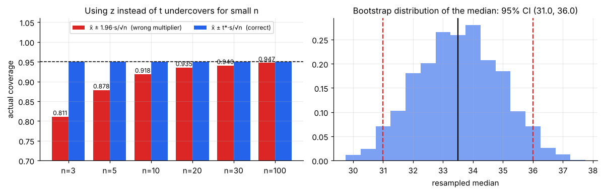
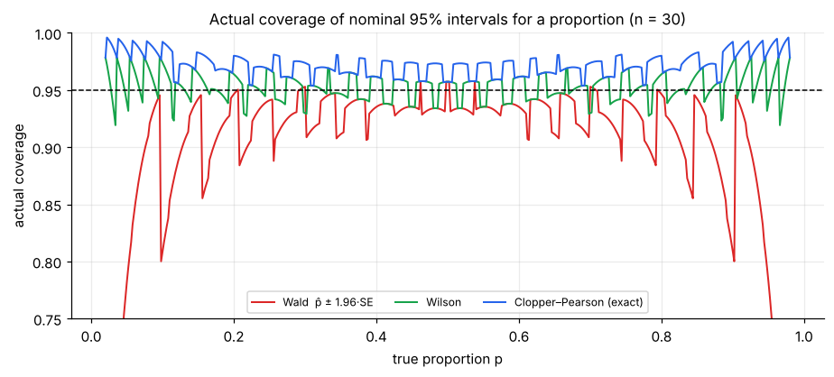
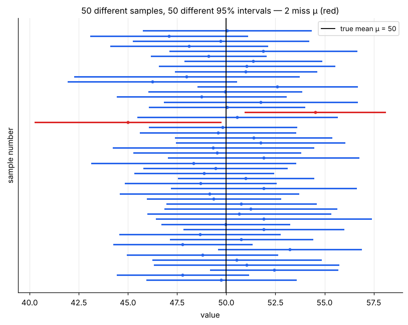
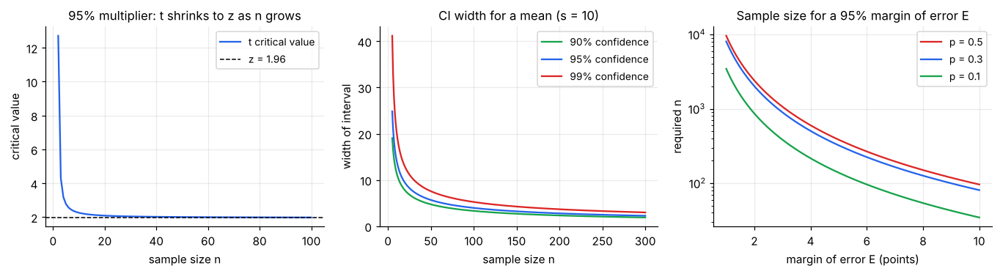

# Confidence Intervals

> **A point estimate is almost surely wrong; an interval that says *how* wrong it might be is what you can act on.** A confidence interval is built from an estimator ([note 04](04-parameter-estimation.md)) and its sampling distribution ([notes 02](02-sampling-distributions.md) and [03](03-law-of-large-numbers-and-clt.md)): **estimate ± critical value × standard error**.

**Contents**

1. [From estimate to interval](#1-from-estimate-to-interval)
2. [The pivot method: deriving the interval](#2-the-pivot-method-deriving-the-interval)
3. [CI for a mean](#3-ci-for-a-mean)
4. [CI for a proportion](#4-ci-for-a-proportion)
5. [What "95% confidence" really means](#5-what-95-confidence-really-means)
6. [Width and sample size](#6-width-and-sample-size)
7. [Interpreting a CI correctly](#7-interpreting-a-ci-correctly)
8. [Other intervals: exact, bootstrap and prediction](#8-other-intervals-exact-bootstrap-and-prediction)
9. [Confidence intervals and hypothesis tests](#9-confidence-intervals-and-hypothesis-tests)
10. [Code snippets](#10-code-snippets)

---

## 1. From estimate to interval

Every estimator θ̂ has a sampling distribution with a standard error SE(θ̂). When that distribution is roughly normal (CLT, or MLE theory), we can say how far θ̂ typically lies from θ. The general **large-sample (Wald) confidence interval** is

**θ̂ ± z\* · SE(θ̂)**

with z\* the normal critical value for the chosen confidence level:

| Confidence level | 80% | 90% | 95% | 99% |
|---|---|---|---|---|
| z\* | 1.282 | 1.645 | **1.960** | 2.576 |

The product z\*·SE is the **margin of error (ME)**, so the interval is "estimate ± margin of error".

This single template covers means, proportions, differences, regression slopes, and MLEs (SE = 1/√(n·I(θ̂)), [note 04 §6](04-parameter-estimation.md#6-properties-of-the-mle-and-fisher-information)). The rest of this note is about getting the critical value and the SE right in each case.

---

## 2. The pivot method: deriving the interval

A **pivot** (pivotal quantity) is a function of the data *and* the parameter whose distribution does **not** depend on the unknown parameter. Pivots let us turn a probability statement about the data into a statement about the parameter.

### Derivation for a mean, σ known

For normal data (or large n), Z = (x̄ − μ)/(σ/√n) ~ N(0, 1), a pivot. So

P(−z\* ≤ (x̄ − μ)/(σ/√n) ≤ z\*) = 1 − α

Rearrange the inequality to isolate μ (multiply by σ/√n, subtract x̄, multiply by −1, flipping the signs):

P( x̄ − z\*σ/√n ≤ μ ≤ x̄ + z\*σ/√n ) = 1 − α

The random quantities are the **endpoints**; μ is fixed. The interval **x̄ ± z\*σ/√n** is the (1 − α) confidence interval.

### Derivation for a mean, σ unknown

Replace σ by s. The new pivot T = (x̄ − μ)/(s/√n) follows the **t-distribution with n − 1 df** for normal data ([note 02 §6](02-sampling-distributions.md#6-the-t-statistic-when-σ-is-unknown)). Exactly the same algebra gives

**x̄ ± t\*ₙ₋₁ · s/√n**,  where P(−t\* ≤ Tₙ₋₁ ≤ t\*) = 1 − α

### General recipe

1. Find a **pivot** involving θ whose distribution is known.
2. Pick the middle (1 − α) probability range [a, b] of that distribution.
3. Solve a ≤ pivot ≤ b for θ.

The same steps yield intervals for variances (χ² pivot), exponential means (χ² pivot) and so on (§8).

---

## 3. CI for a mean

| Situation | Interval | Critical value |
|---|---|---|
| σ known | x̄ ± z\*·σ/√n | z\* from N(0, 1) |
| **σ unknown (usual case)** | **x̄ ± t\*·s/√n** | t\* from t with **n − 1** df |

**Assumptions:** independent observations, and either roughly normal data or large enough n for the CLT (check skewness; [note 03 §6](03-law-of-large-numbers-and-clt.md#6-how-fast-does-it-work-berryesseen-and-skewness)).

### Why t and not z: the cost of estimating σ

Using the z multiplier 1.96 with s plugged in is **too narrow** for small n:



| n | 3 | 5 | 10 | 20 | 30 | 100 |
|---|---|---|---|---|---|---|
| Real coverage of "95%" z-interval | 81.1% | 87.8% | 91.8% | 93.5% | 94.0% | 94.7% |
| t\* (95%) | 4.303 | 2.776 | 2.262 | 2.093 | 2.045 | 1.984 |

For n = 5, the "95%" z-interval is a 88% interval. The t multiplier restores exactly 95% (for normal data).

### Worked example

n = 25 customers, x̄ = ₹52, s = ₹10.

- SE = 10/√25 = **2**
- df = 24, t\* = **2.064**
- ME = 2.064 × 2 = **4.13**
- **95% CI = (47.87, 56.13)**

(With z\* = 1.96 you would report (48.08, 55.92), slightly too narrow.)

### One-sided intervals

If only a lower (or upper) limit matters ("spend is at least …"), use the one-sided multiplier: lower bound = x̄ − t\*₀.₉₅ · SE = 52 − 1.711 × 2 = **48.58** (a 95% lower confidence bound).

---

## 4. CI for a proportion

With k successes in n trials, p̂ = k/n and SE(p̂) = √(p(1 − p)/n). The pivot is not so simple here because the SE depends on the unknown p. Different solutions give different intervals.

**Example:** 120 of 400 customers use a coupon: p̂ = 0.30.

| Method | Formula | 95% interval | Notes |
|---|---|---|---|
| **Wald** | p̂ ± z\*√(p̂(1 − p̂)/n) | (0.2551, 0.3449) | Textbook, simple. Needs np̂, n(1 − p̂) ≥ 10 |
| **Wilson (score)** | see below | (0.2572, 0.3466) | Much better coverage; never leaves [0, 1] |
| **Agresti–Coull** | add z²/2 successes and z²/2 failures, then Wald | (0.2571, 0.3467) | Wald-like formula with Wilson-like accuracy |
| **Clopper–Pearson (exact)** | Beta quantiles of the binomial | (0.2555, 0.3475) | Guaranteed ≥ 95%, conservative |

**Wilson interval (derived by solving the pivot properly).** Start from |p̂ − p| ≤ z\*√(p(1 − p)/n) and solve the resulting quadratic in p:

**centre = (p̂ + z²/(2n)) / (1 + z²/n)**,  **half-width = z/(1 + z²/n) · √( p̂(1 − p̂)/n + z²/(4n²) )**

The centre is pulled slightly toward 0.5, and the interval is asymmetric when p̂ is near 0 or 1.

### Why the choice matters: actual coverage



Each curve is the *true* probability that the interval contains p, computed exactly from the binomial. For n = 30:

- **Wald** is often far below 95% (about 78% at p = 0.05, 81% at p = 0.1) and collapses near 0 and 1.
- **Wilson** stays close to 95% (it oscillates, as coverage must for discrete data) even for small p.
- **Clopper–Pearson** never falls below 95% but is often noticeably higher (conservative).

**Recommendation:** use **Wilson** (or Agresti–Coull) by default; use **Clopper–Pearson** when a guarantee matters (e.g. defect rates in quality control); the Wald interval is acceptable only when n is large and p̂ is not extreme. For 0 successes the Wald interval degenerates to a single point (0, 0), which is plainly wrong.

*Bayesian alternative:* a **credible interval** from the posterior Beta(a + k, b + n − k) ([probability/03 §7](../probability/03-continuous-distributions.md#7-beta-α-and-β)).

---

## 5. What "95% confidence" really means

The 95% describes the **procedure**, not one particular interval. Draw 50 samples of n = 25 from a population with μ = 50 and build a 95% t-interval from each:



About 5% of intervals miss μ (here 2 of 50, in red). The key picture: **μ is fixed; the intervals move.** Each sample produces its own interval. After you compute one interval, it either contains μ or it does not; the "95%" refers to how often the *method* succeeds over repeated sampling.

**Coverage probability** = P(interval contains θ). A valid (1 − α) CI has coverage ≥ 1 − α for every θ. §4 showed that approximate intervals can fall short.

---

## 6. Width and sample size



**Width = 2 × (critical value) × SE = 2 · t\* · s/√n.** Three levers:

| Lever | Effect on width | Trade-off |
|---|---|---|
| **Larger n** | Narrower, like 1/√n (4× n for half the width) | Cost and time |
| **Lower confidence level** | Narrower (90% < 95% < 99%) | Wrong more often |
| **Smaller σ** | Narrower | Better measurement, stratification, matched pairs |

### Choosing n for a target margin of error E

Set ME = z\*·SE ≤ E and solve for n.

**Mean:** n = (z\*σ/E)²  (σ from a pilot or past data)
*Example:* σ ≈ 10, E = ₹2, 95%: n = (1.96 × 10/2)² = 96.04 → **97**.

**Proportion:** n = z\*² p(1 − p)/E². With no prior guess use the worst case p = 0.5: n = z\*²/(4E²).
*Example:* E = ±3 points, 95%: n = 1.96² × 0.25/0.03² = 1067.1 → **1,068**. (The classic "about 1,000 respondents" poll.)

Notes: always round **up**; inflate for non-response; for a small finite population apply the finite population correction ([note 01 §6](01-populations-samples-and-sampling.md#6-sample-size-and-the-finite-population-correction)); the formula for a mean uses the *large-n* z (add a couple of observations to be safe for t).

---

## 7. Interpreting a CI correctly

| Correct | Common wrong reading |
|---|---|
| "The method captures the true mean in 95% of repeated samples; here it gave (47.9, 56.1)." | "There is a 95% probability that μ lies in this particular interval." (μ is fixed; this interval either contains it or not.) |
| "Values inside the interval are plausible given the data; values far outside are not." | "95% of customers spend between 47.9 and 56.1." (That interval is about the *mean*. For individuals see the prediction interval in §8.) |
| "Another sample would give a different interval." | "A new sample's mean has a 95% chance of lying in this interval." (No: it concerns capturing μ, not a future x̄.) |
| "More data give a narrower interval." | "Non-overlapping 95% CIs are *required* for a significant difference." (Non-overlap is *sufficient*, not necessary.) |

A CI also does **not** protect against **bias**: a tight interval from a biased sample is precisely wrong ([note 01 §4](01-populations-samples-and-sampling.md#4-sampling-error-vs-bias)).

---

## 8. Other intervals: exact, bootstrap and prediction

### Exact intervals from other pivots

| Parameter | Pivot | Interval | Example |
|---|---|---|---|
| **Normal variance σ²** | (n − 1)s²/σ² ~ χ²ₙ₋₁ | [(n − 1)s²/χ²₍₀.₉₇₅₎ , (n − 1)s²/χ²₍₀.₀₂₅₎] | n = 25, s = 10: σ² ∈ (61.0, 193.5), so σ ∈ (7.8, 13.9) |
| **Exponential mean θ = 1/λ** | 2Σxᵢ/θ ~ χ²₂ₙ | [2S/χ²₍₀.₉₇₅, ₂ₙ₎ , 2S/χ²₍₀.₀₂₅, ₂ₙ₎], S = Σxᵢ | n = 10, S = 40: θ ∈ **(2.34, 8.34)** min, so λ = 1/θ ∈ **(0.120, 0.427)** |
| **Poisson rate λ** (Garwood) | via Poisson–gamma link | [χ²₍₀.₀₂₅, ₂S₎/(2n) , χ²₍₀.₉₇₅, ₂S+₂₎/(2n)] | S = 40 events in n = 10 hours: **(2.86, 5.45)** |

Compare with the large-sample intervals from MLE theory (Example A of [note 04](04-parameter-estimation.md)): Poisson Wald 4 ± 1.96 × 0.632 = (2.76, 5.24), and exponential rate (delta method) 0.25 ± 1.96 × 0.079 = (0.095, 0.405). The Wald versions are symmetric but the truth is skewed (exact: 0.120–0.427, longer on the high side), a reminder that Wald intervals are approximations that work best for larger n.

**Likelihood-based interval.** An alternative that respects skew: keep all θ with ℓ(θ) ≥ ℓ(θ̂) − 1.92 (1.92 = χ²₁,₀.₉₅/2). For the Poisson example this gives **(2.89, 5.37)**, close to the exact interval.

### Bootstrap intervals (any statistic)

When no pivot or formula is available (median, ratio, trimmed mean, correlation):

1. Resample the data **with replacement**, B times (e.g. 10,000), each of size n.
2. Compute the statistic on each resample.
3. **Percentile interval:** take the 2.5th and 97.5th percentiles of the B values.

In the right panel of the figure in §3, the median delivery time of the ten observations (33.5) has bootstrap SE ≈ 1.4 and a 95% interval of **(31, 36)**. Bootstrap intervals are simple and flexible, but need a reasonably sized sample (n ≳ 20–30) and misbehave for extreme statistics (max, min).

### Confidence interval vs prediction interval

A CI is for a **parameter** (the mean); a **prediction interval** is for a **single future observation** and must also include the individual's own scatter:

**x̄ ± t\*·s·√(1 + 1/n)**

*Example (n = 25, x̄ = 52, s = 10):* the CI for the mean is (47.9, 56.1), but a **95% prediction interval** for the next customer's spend is **(31.0, 73.0)**, over five times wider. It does not shrink to zero with n: it tends to μ ± 1.96σ.

### Difference of two means or proportions

Same template, with the SE from [note 02 §7](02-sampling-distributions.md#7-difference-of-two-sample-means): (x̄₁ − x̄₂) ± t\*·√(s₁²/n₁ + s₂²/n₂), using Welch's df. *Example:* n₁ = 50, x̄₁ = 60, s₁ = 8; n₂ = 40, x̄₂ = 55, s₂ = 10: SE = 1.94, Welch df ≈ 73.8, **95% CI for μ₁ − μ₂ = (1.13, 8.87)**. Because zero is not inside, the difference is statistically significant at 5%.

---

## 9. Confidence intervals and hypothesis tests

A two-sided test at level α rejects H₀: θ = θ₀ **exactly when θ₀ lies outside the (1 − α) CI** (for the standard pivot-based intervals). So:

- The CI is the set of all parameter values **not rejected** by the test.
- It gives everything the p-value gives (is 0 or the claimed value inside?) **plus** the size and uncertainty of the effect.
- Report both, but lead with the interval. See [note 06](06-hypothesis-testing-fundamentals.md#7-connections-and-pitfalls).

---

## 10. Code snippets

```python
import numpy as np
from scipy import stats

# ---- Mean, from summary statistics (worked example) -----------------------
n, xbar, s = 25, 52, 10
se = s / np.sqrt(n)                                   # 2.0
tcrit = stats.t.ppf(0.975, df=n - 1)                  # 2.064
(xbar - tcrit * se, xbar + tcrit * se)                # (47.87, 56.13)
stats.t.interval(0.95, df=n - 1, loc=xbar, scale=se)  # same, one line
xbar - stats.t.ppf(0.95, n - 1) * se                  # 95% lower bound: 48.58

# From raw data
data = np.array([32, 35, 29, 38, 31, 34, 36, 30, 33, 37])
stats.t.interval(0.95, df=len(data) - 1, loc=data.mean(), scale=stats.sem(data))   # (31.3, 35.7)

# ---- Proportion: four intervals for 120 of 400 -----------------------------
k, n = 120, 400
phat = k / n
se = np.sqrt(phat * (1 - phat) / n)
(phat - 1.96 * se, phat + 1.96 * se)                                # Wald  (0.2551, 0.3449)
stats.binomtest(k, n).proportion_ci(0.95, method="wilson")          # Wilson (0.2572, 0.3466)
stats.binomtest(k, n).proportion_ci(0.95, method="exact")           # Clopper–Pearson (0.2555, 0.3475)
z = 1.96; nt = n + z**2; pt = (k + z**2 / 2) / nt                   # Agresti–Coull
(pt - z * np.sqrt(pt * (1 - pt) / nt), pt + z * np.sqrt(pt * (1 - pt) / nt))   # (0.2571, 0.3467)

# ---- Sample size -------------------------------------------------------------
np.ceil((1.96 * 10 / 2) ** 2)                         # mean: 97
np.ceil(1.96**2 * 0.25 / 0.03**2)                     # proportion: 1068

# ---- Exact intervals from chi-square pivots ----------------------------------
n, s = 25, 10                                         # variance
(n - 1) * s**2 / stats.chi2.ppf([0.975, 0.025], n - 1)            # (61.0, 193.5)

t = np.array([4.2, 1.1, 7.5, 3.3, 0.8, 5.9, 2.4, 9.6, 1.7, 3.5])  # exponential mean
S, n = t.sum(), len(t)
2 * S / stats.chi2.ppf([0.975, 0.025], 2 * n)         # (2.34, 8.34)

S, n = 40, 10                                         # Poisson rate (Garwood)
stats.chi2.ppf(0.025, 2 * S) / (2 * n), stats.chi2.ppf(0.975, 2 * S + 2) / (2 * n)   # (2.86, 5.45)

# ---- Prediction interval ------------------------------------------------------
n, xbar, s = 25, 52, 10
stats.t.ppf(0.975, n - 1) * s * np.sqrt(1 + 1 / n)    # half-width 21.05 -> (30.95, 73.05)

# ---- Bootstrap CI for the median ----------------------------------------------
res = stats.bootstrap((data,), np.median, confidence_level=0.95, method="percentile",
                      n_resamples=10_000, random_state=4)
res.confidence_interval, res.standard_error

# ---- Welch CI for a difference of means --------------------------------------
a = dict(n=50, m=60, s=8); b = dict(n=40, m=55, s=10)
v1, v2 = a["s"]**2 / a["n"], b["s"]**2 / b["n"]
se = np.sqrt(v1 + v2)                                                # 1.94
df = (v1 + v2) ** 2 / (v1**2 / (a["n"] - 1) + v2**2 / (b["n"] - 1))  # 73.8
(a["m"] - b["m"]) + np.array([-1, 1]) * stats.t.ppf(0.975, df) * se  # (1.13, 8.87)
```
