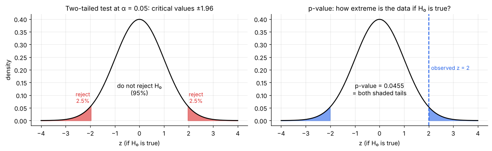
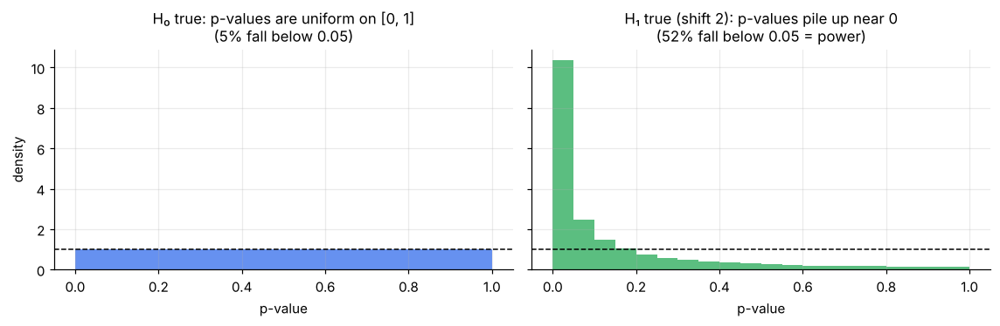
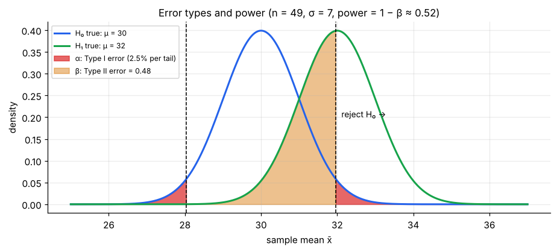
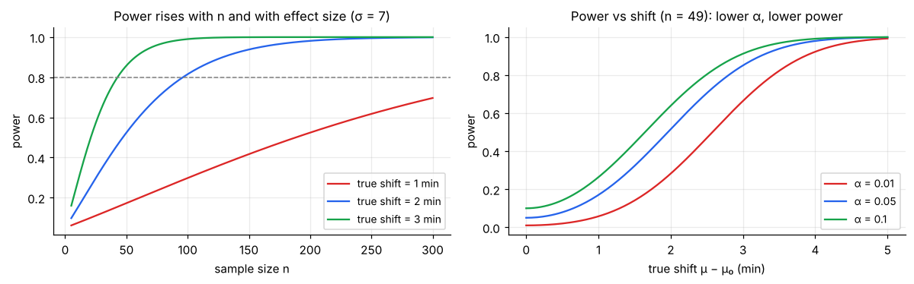

# Hypothesis Testing Fundamentals

> **A hypothesis test asks: "If nothing special were going on, how surprising would my data be?"** If the data would be very surprising under the "nothing special" assumption, we doubt that assumption. Every specific test (t, z, chi-square, F) is this same logic with a different test statistic.

**Contents**

1. [The logic](#1-the-logic)
2. [Setting up the hypotheses](#2-setting-up-the-hypotheses)
3. [Test statistic, p-value and decision](#3-test-statistic-p-value-and-decision)
4. [Worked example: a z-test](#4-worked-example-a-z-test)
5. [Errors, α, β and power](#5-errors-α-β-and-power)
6. [Worked example: a t-test](#6-worked-example-a-t-test)
7. [Connections and pitfalls](#7-connections-and-pitfalls)
8. [The five-step recipe (cheat sheet)](#8-the-five-step-recipe-cheat-sheet)
9. [Code snippets](#9-code-snippets)

---

## 1. The logic

It resembles a courtroom: **presumed innocent** (the null hypothesis) **unless the evidence is strong enough** to convict beyond reasonable doubt. Failing to convict does *not* prove innocence; it only means the evidence was insufficient.

Formally it is a probabilistic proof by contradiction:

1. **Assume** the null hypothesis H₀ is true.
2. Use the sampling distribution ([note 02](02-sampling-distributions.md); for means, the CLT of [note 03](03-law-of-large-numbers-and-clt.md)) to compute how likely data *at least as extreme* as yours would be.
3. If that probability is very small, the assumption and the data are in conflict. **Reject H₀** in favour of the alternative.
4. If it is not small, **fail to reject H₀**. The data are compatible with it.

---

## 2. Setting up the hypotheses

| | Null hypothesis H₀ | Alternative hypothesis H₁ (or Hₐ) |
|---|---|---|
| Role | The default, "no effect / no difference / status quo" claim | What you suspect or want to demonstrate |
| Always contains | An **equality** (=, ≤ or ≥) | The strict opposite (≠, >, <) |
| Example | μ = 30 min (average delivery time is 30) | μ ≠ 30 |

Hypotheses are about **parameters** (μ, p), never about statistics (x̄). Write them *before* looking at the data.

### One-tailed vs two-tailed

| Type | H₁ | Reject when | Use when |
|---|---|---|---|
| **Two-tailed** | μ ≠ μ₀ | z is large in absolute value (either tail) | Any change matters. **The safe default** |
| **Right-tailed** | μ > μ₀ | z large positive | Only an *increase* matters (and a decrease would be treated like "no change") |
| **Left-tailed** | μ < μ₀ | z large negative | Only a *decrease* matters |

Decide the direction **before** seeing the data. Choosing one-tailed after noticing which way x̄ went is a form of cheating (it halves the p-value).

---

## 3. Test statistic, p-value and decision

**Test statistic:** a number that measures how far the sample result is from H₀, in standard errors:

**test statistic = (estimate − hypothesised value) / standard error**

e.g. z = (x̄ − μ₀)/(σ/√n), or t = (x̄ − μ₀)/(s/√n). Under H₀ it follows a known distribution (normal, t, chi-square, F), see [probability/04](../probability/04-distributions-behind-tests.md).

**p-value:** the probability, **assuming H₀ is true**, of getting a test statistic *at least as extreme* as the one observed. Extreme means "in the direction(s) of H₁".

**Significance level α:** the threshold chosen in advance (conventionally 0.05; 0.01 for stricter evidence). It is the tolerated probability of a false alarm.



**Two equivalent decision rules:**

| Rule | Reject H₀ if |
|---|---|
| p-value | **p ≤ α** |
| Critical value | test statistic falls in the rejection region (e.g. z ≥ 1.96 or z ≤ −1.96 at α = 0.05, two-tailed) |

The p-value is more informative (it shows *how* surprising), and software reports it. Always state the conclusion in plain words about the context, not just "reject".

### What the p-value is and is not

| It **is** | It is **not** |
|---|---|
| P(data this extreme, *given* H₀ is true) | P(H₀ is true, *given* the data): it does not tell you the probability the null is true |
| A measure of incompatibility with H₀ | The size or importance of the effect |
| Small when the sample is large, even for a tiny effect | A reason by itself to act |

"Not significant" (p > α) means "no clear evidence against H₀", **not** "H₀ is true". With a small sample you might simply lack power.

### Why the rule "reject if p ≤ α" has error rate exactly α

If H₀ is true and the test statistic is continuous, the **p-value is uniformly distributed on [0, 1]**. Reason: the p-value is P(T ≥ t_obs | H₀) = 1 − F(t_obs), where F is the CDF of the test statistic under H₀; and F(T) is uniform for any continuous T (the probability integral transform). Therefore

**P(p ≤ α | H₀ true) = α**

so 5% of true nulls give p ≤ 0.05: that is exactly the Type I error rate. Under a **true effect** the p-values pile up near 0, and the fraction below α is the **power**.



(Simulation of the delivery example: 100,000 samples of n = 49, σ = 7. Left: μ = 30 (H₀ true), 5% of p-values fall below 0.05. Right: μ = 32 (H₁ true), 52% do: the power.) A flat histogram under H₀ is also a handy diagnostic that a testing procedure is valid.

---

## 4. Worked example: a z-test

A courier company claims an average delivery time of **30 minutes**. From long experience σ = 7 min. A customer-service team samples **n = 49** deliveries and finds **x̄ = 32** min. Has the true mean changed? (α = 0.05)

1. **Hypotheses:** H₀: μ = 30 vs H₁: μ ≠ 30 (two-tailed).
2. **Test statistic:** SE = 7/√49 = 1, so **z = (32 − 30)/1 = 2.0**.
3. **p-value:** two-tailed p = 2 × P(Z ≥ 2) = 2 × 0.0228 = **0.0455**.
4. **Decision:** p = 0.0455 < 0.05 → reject H₀. (Critical-value route: |z| = 2 > 1.96, same answer.)
5. **Conclusion:** there is statistically significant evidence that the mean delivery time differs from 30 min; the sample suggests it is longer.

*If the alternative had been one-tailed (μ > 30):* p = 0.0228, a stronger result, but only allowed if "longer" was the *only* direction of interest, decided in advance.

The 95% CI is 32 ± 1.96 → **(30.04, 33.96)**: 30 is just outside, which matches the rejection. The CI also shows the effect is plausibly as small as 0.04 minutes, a reminder that "significant" is not "big".

---

## 5. Errors, α, β and power

| | H₀ actually true | H₀ actually false |
|---|---|---|
| **Reject H₀** | **Type I error** (false positive), probability **α** | Correct. Probability = **power = 1 − β** |
| **Do not reject H₀** | Correct (probability 1 − α) | **Type II error** (false negative), probability **β** |



- **α is chosen by you**, so it is the false-alarm rate you accept when H₀ is true.
- **β depends on** the true effect size, the sample size, the noise and α. You cannot choose it directly.
- **Power = 1 − β** is the probability of detecting a real effect. A common target is **80%**.
- **Trade-off:** lowering α (stricter) raises β (less power) for the same data. The only free lunch is more data or less noise.

**Deriving the power of a two-sided z-test.** Let δ = μ − μ₀ be the true shift and SE = σ/√n. We reject when |Z| > z_{α/2}, where Z = (x̄ − μ₀)/SE. If the truth is μ, then Z ~ N(δ/SE, 1) (the whole bell is shifted by δ/SE standard errors). Hence

**power = P(Z > z_{α/2}) + P(Z < −z_{α/2}) = Φ(δ/SE − z_{α/2}) + Φ(−δ/SE − z_{α/2})**

The second term is negligible unless δ is tiny. For δ = 2, SE = 1, z_{α/2} = 1.96: Φ(0.04) + Φ(−3.96) = 0.516 + 0.00004 = **0.516**. Everything that raises power is visible in the formula: a larger shift δ, a smaller SE (bigger n or smaller σ), or a smaller z_{α/2} (larger α).

**Power in the delivery example** (true mean 32, σ = 7, n = 49, α = 0.05 two-sided): power ≈ **0.52** and β ≈ **0.48**. A real 2-minute slowdown would be missed nearly half the time with this sample. That is, "no significant difference" from such a study would mean little.



**Four things that raise power:** bigger n, bigger true effect, smaller noise (σ), larger α (or a one-tailed test, if justified).

**Planning n for a target power.** Setting the dominant power term to 1 − β gives δ/SE − z_{α/2} = z_β, i.e. δ√n/σ = z_{α/2} + z_β, so for a two-sided z-test **n = ((z_{α/2} + z_β) · σ / δ)²**, where δ is the smallest shift worth detecting.
Here δ = 2, σ = 7: for **80% power** n = ((1.96 + 0.84) × 7/2)² = 96.2 → **97**; for **90% power** → **129**.

**Real-world meaning of the errors:** which is worse depends on cost. Approving a faulty drug (Type I) vs missing a good one (Type II); sending a fraud alert to an innocent customer vs missing a real fraud. Set α accordingly.

---

## 6. Worked example: a t-test

Usually σ is unknown, so we estimate it with s and use the **t-distribution** with n − 1 df.

Ten delivery times (min): 32, 35, 29, 38, 31, 34, 36, 30, 33, 37. Test H₀: μ = 30 vs H₁: μ ≠ 30 at α = 0.05.

1. x̄ = 33.5, s = 3.03, n = 10, SE = 3.03/√10 = 0.957.
2. **t = (33.5 − 30)/0.957 = 3.66**, with df = 9.
3. **p-value ≈ 0.0053** (two-tailed). The critical value is t\* = 2.262, and 3.66 exceeds it.
4. **Decision:** reject H₀: strong evidence the mean exceeds 30 min.
5. 95% CI: 33.5 ± 2.262 × 0.957 = **(31.3, 35.7)**, so 30 is well outside.

**Assumptions:** independent observations, and either roughly normal data or a large enough n for the CLT. With n = 10, check a plot and the shape ([descriptive-statistics/03 §9](../descriptive-statistics/03-skewness-and-kurtosis.md#9-checking-normality)); if it is badly skewed, use a non-parametric test (later note).

---

## 7. Connections and pitfalls

**Test ↔ confidence interval duality.** A two-sided test at level α rejects H₀: μ = μ₀ exactly when μ₀ is outside the (1 − α) CI ([note 05](05-confidence-intervals.md#9-confidence-intervals-and-hypothesis-tests)). Report the CI as well: it gives the *size* of the effect.

**Statistical vs practical significance.** With a huge sample, trivial differences become "significant"; with a tiny sample, large ones may not. Always report an **effect size**: a raw difference, or standardised (Cohen's d = (x̄ − μ₀)/σ). The z-test example has d = 2/7 ≈ **0.29** (small); the t-test example d ≈ **1.16** (large). Rough guide: 0.2 small, 0.5 medium, 0.8 large.

**Multiple testing.** Each test at α = 0.05 has a 5% false-alarm chance. Run 20 independent tests on pure noise and the chance of at least one "significant" result is 1 − 0.95²⁰ = **64%**. Plan the tests in advance, correct for multiplicity (Bonferroni, FDR; see the ANOVA note), and treat exploratory findings as hypotheses, not conclusions.

**p-hacking and the garden of forking paths.** Trying many outcomes, subgroups, or exclusions until p < 0.05, then reporting only that, makes p-values meaningless. Pre-specify the analysis; report all tests done.

**Other traps:** stopping data collection once p dips below 0.05 ("optional stopping"); treating p = 0.049 and p = 0.051 as completely different; confusing "not significant" with "no effect"; and ignoring assumptions or bias in how the data were collected ([note 01](01-populations-samples-and-sampling.md)).

---

## 8. The five-step recipe (cheat sheet)

1. **State** H₀ and H₁ (parameter, direction) and choose **α** *before* seeing the data.
2. **Check conditions:** random sample, independence, normality or large n.
3. **Compute** the test statistic: (estimate − H₀ value)/SE.
4. **Find** the p-value (or critical value) from the right distribution.
5. **Decide and state in context:** reject / fail to reject H₀; give the effect size and a CI; note limits (power, assumptions).

| Parameter | Test statistic | Null distribution |
|---|---|---|
| Mean, σ known (or large n) | z = (x̄ − μ₀)/(σ/√n) | Normal |
| Mean, σ unknown | t = (x̄ − μ₀)/(s/√n) | t, n − 1 df |
| Proportion | z = (p̂ − p₀)/√(p₀(1 − p₀)/n) | Normal (np₀, n(1 − p₀) ≥ 10) |
| Counts in categories | χ² = Σ(O − E)²/E | Chi-square |
| Several means / variance ratio | F | F |

The tests for two means, proportions, categorical data and several groups follow this recipe and are covered in the next notes.

---

## 9. Code snippets

```python
import numpy as np
from scipy import stats

# --- z-test from summary numbers (worked example) ---
mu0, sigma, n, xbar = 30, 7, 49, 32
z = (xbar - mu0) / (sigma / np.sqrt(n))        # 2.0
p_two = 2 * stats.norm.sf(abs(z))              # 0.0455
p_right = stats.norm.sf(z)                     # 0.0228
(xbar - 1.96 * sigma / np.sqrt(n), xbar + 1.96 * sigma / np.sqrt(n))   # (30.04, 33.96)

# --- one-sample t-test on raw data ---
x = np.array([32, 35, 29, 38, 31, 34, 36, 30, 33, 37])
res = stats.ttest_1samp(x, popmean=30)         # t = 3.66, p = 0.0053
res.statistic, res.pvalue
res.confidence_interval(0.95)                  # (31.3, 35.7)
stats.ttest_1samp(x, 30, alternative="greater")   # one-tailed

# --- one-sample proportion test: 120/400 vs p0 = 0.25 ---
stats.binomtest(120, 400, p=0.25).pvalue       # exact binomial test

# --- power of the z-test, and required n ---
delta, se = 2, sigma / np.sqrt(n)
power = stats.norm.sf(1.96 - delta / se) + stats.norm.cdf(-1.96 - delta / se)   # 0.516
n_needed = ((1.96 + stats.norm.ppf(0.80)) * sigma / delta) ** 2                 # 96.2 → 97

# Cohen's d (effect size)
(x.mean() - 30) / x.std(ddof=1)                # 1.16

# Chance of ≥1 false positive in 20 independent tests at α = 0.05
1 - 0.95 ** 20                                 # 0.64
```
