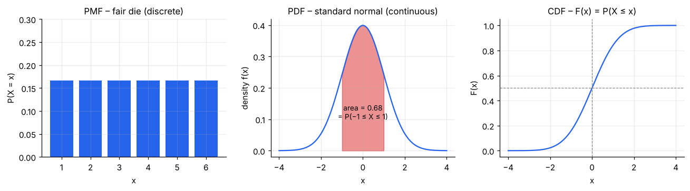
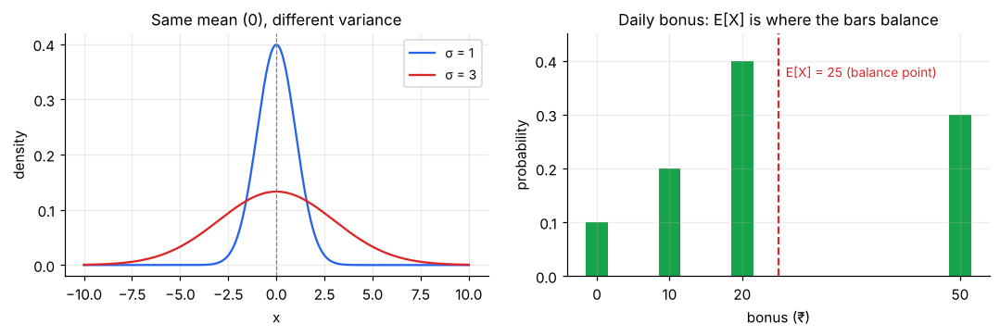
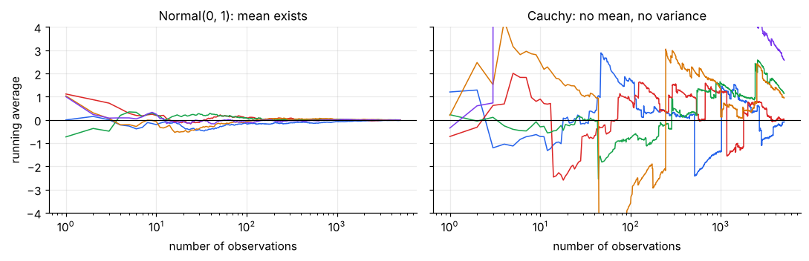

# Random Variables, Distributions & Expectation

> **A probability distribution is just a rule that says how likely each possible value of an uncertain quantity is.** Everything in inferential statistics (confidence intervals, p-values, regression) is built on top of a handful of such rules.

**Contents**

1. [Random variables](#1-random-variables)
2. [PMF, PDF and CDF](#2-pmf-pdf-and-cdf)
3. [Expectation (mean)](#3-expectation-mean)
4. [Variance and standard deviation](#4-variance-and-standard-deviation)
5. [Useful rules](#5-useful-rules)
6. [Parameters, and the map of distributions](#6-parameters-and-the-map-of-distributions)
7. [Median, mode and quantiles of a distribution](#7-median-mode-and-quantiles-of-a-distribution)
8. [Moments and the shape of a distribution](#8-moments-and-the-shape-of-a-distribution)
9. [Code snippets](#9-code-snippets)

---

## 1. Random variables

A **random variable** (r.v.) is a number whose value is decided by chance. We write it with a capital letter (X) and a particular value it can take with a lowercase letter (x).

| Type | Possible values | Examples |
|---|---|---|
| **Discrete** | Countable (0, 1, 2, …) | Orders today, defective items in a batch, number of heads |
| **Continuous** | Any value in an interval | Delivery time, height, rupee amount, a proportion between 0 and 1 |

**Why the distinction matters:** the two types are described by different tools (PMF vs PDF below), and for a continuous variable the probability of hitting *one exact value* is 0. You only ask about *ranges* ("between 3 and 5 minutes").

---

## 2. PMF, PDF and CDF



| Tool | For | Meaning | Rules |
|---|---|---|---|
| **PMF** – probability mass function, P(X = x) | Discrete | The probability of each exact value | Every value ≥ 0; all values add to **1** |
| **PDF** – probability density function, f(x) | Continuous | Height of the curve. **Probability = area under the curve** | f(x) ≥ 0; total area = **1** |
| **CDF** – cumulative distribution function, F(x) = P(X ≤ x) | Both | Probability of being *at most* x | Starts at 0, never decreases, ends at 1 |

Key facts:

- A **density is not a probability.** A PDF can exceed 1 (a very narrow distribution is tall); only the *area* must be ≤ 1.
- Ranges come from the CDF: **P(a < X ≤ b) = F(b) − F(a)**.
- The **median** is the x where F(x) = 0.5; the **p-th percentile** is the x where F(x) = p. Statistical tables and `ppf` in Python are just the CDF run backwards (the *quantile function*).

**Example (discrete).** A fair die: P(X = x) = 1/6 for x = 1…6. P(X ≤ 4) = F(4) = 4/6 ≈ 0.667.

**Example (continuous).** For a standard normal, the shaded area in the middle panel above (between −1 and 1) is 0.68. That *is* P(−1 ≤ X ≤ 1).

---

## 3. Expectation (mean)

The **expected value** E[X] (also written μ) is the long-run average of X if you could repeat the experiment forever. It is the "balance point" of the distribution.

- Discrete: **E[X] = Σ x · P(X = x)**
- Continuous: **E[X] = ∫ x · f(x) dx**

**Worked example.** A delivery app gives a random daily bonus:

| Bonus x (₹) | 0 | 10 | 20 | 50 |
|---|---|---|---|---|
| P(X = x) | 0.1 | 0.2 | 0.4 | 0.3 |

E[X] = 0(0.1) + 10(0.2) + 20(0.4) + 50(0.3) = 2 + 8 + 15 = **₹25**.

Note ₹25 is never actually paid on any single day. The expectation is an *average over many days*, not a value you will necessarily see.

---

## 4. Variance and standard deviation

Two distributions can share the same mean and still behave very differently. **Variance** measures spread: the average squared distance from the mean.

**Var(X) = E[(X − μ)²] = E[X²] − (E[X])²**, and **SD = √Var** (same units as X).



**Continuing the bonus example:**

- E[X²] = 0²(0.1) + 10²(0.2) + 20²(0.4) + 50²(0.3) = 20 + 160 + 750 = 930
- Var(X) = 930 − 25² = 930 − 625 = **305**, so SD ≈ **₹17.5**

Read it as: the bonus is typically about ₹25 give or take ₹17.5. Each day is quite unpredictable.

---

## 5. Useful rules

For constants a, b and random variables X, Y:

| Rule | Formula | Needs independence? |
|---|---|---|
| Linearity of mean | E[aX + b] = a·E[X] + b | No |
| Sum of means | E[X + Y] = E[X] + E[Y] | **No** |
| Scaling variance | Var(aX + b) = a²·Var(X) | No |
| Sum of variances | Var(X + Y) = Var(X) + Var(Y) | **Yes** (or uncorrelated) |

Two consequences you will use constantly:

- Adding a constant (b) shifts the mean but **does not change the spread**.
- For the average of n independent measurements: **Var(X̄) = σ²/n**, so **SD(X̄) = σ/√n**. This √n is the heart of the standard error and the Central Limit Theorem (inferential-statistics notes).

**Standardising (z-score):** Z = (X − μ)/σ always has mean 0 and SD 1. It converts any scale (marks, rupees, minutes) to "how many SDs from average".

---

## 6. Parameters, and the map of distributions

Each named distribution is a *family* of curves controlled by a few numbers called **parameters** (e.g., n and p for a binomial; μ and σ for a normal). Choosing the family is a modelling decision; estimating the parameters from data is what statistics does.

The common families, and what they are for:

| Question you are asking | Distribution |
|---|---|
| One yes/no trial | Bernoulli |
| Number of successes in n yes/no trials | Binomial (with replacement) / Hypergeometric (without) |
| Number of trials until the 1st (or r-th) success | Geometric / Negative binomial |
| Number of events in a fixed time or space | Poisson |
| Equally likely over an interval | Uniform |
| Measurement that is a sum of many small effects | Normal |
| Waiting time until the next event | Exponential |
| Waiting time until the k-th event; any positive skewed amount | Gamma |
| An unknown *proportion* between 0 and 1 | Beta |
| A positive quantity built by *multiplying* effects (income, prices) | Log-normal |
| Time to failure with ageing | Weibull |
| Test statistics (small samples, variances, ANOVA) | t, chi-square, F |

Details, formulas and examples: [02 – Discrete Distributions](02-discrete-distributions.md), [03 – Continuous Distributions](03-continuous-distributions.md), [04 – Distributions Behind Statistical Tests](04-distributions-behind-tests.md).

---

## 7. Median, mode and quantiles of a distribution

The "typical value" measures from data ([descriptive-statistics/01](../descriptive-statistics/01-central-tendency.md)) have exact model counterparts:

| Measure | For a distribution | How to find it |
|---|---|---|
| **Mean** μ | E[X] | Weighted average / integral (section 3) |
| **Median** | The x with F(x) = 0.5 | Solve the CDF, or `ppf(0.5)` |
| **Mode** | The most likely value / peak of the PMF or PDF | Highest bar / top of the curve |
| **p-th quantile** | The x with F(x) = p | `ppf(p)` |

For a **symmetric** unimodal distribution all three coincide. For a **right-skewed** one: mode < median < mean.
*Example:* exponential with rate 1: mode = 0, median = ln 2 ≈ 0.693, mean = 1. This is the same ordering the data-side note shows with histograms.

---

## 8. Moments and the shape of a distribution

A **moment** averages a power of X; higher powers weight extreme values more heavily.

| Order | Central moment E[(X − μ)ᵏ] | Standardised | Name | Measures |
|---|---|---|---|---|
| 1 | (0, by definition) | (raw: E[X] = μ) | Mean | Location |
| 2 | σ² | 1 | Variance | Spread |
| 3 | E[(X − μ)³] | **E[Z³]** | **Skewness** | Asymmetry (+ = long right tail) |
| 4 | E[(X − μ)⁴] | **E[Z⁴]** | **Kurtosis** | Tail weight (normal = 3; *excess* = kurtosis − 3) |

where Z = (X − μ)/σ. Skewness and kurtosis are **unit-free**, so they can be compared across variables.

**Examples** (excess kurtosis shown): the normal has skewness 0 and kurtosis 0. The exponential has skewness 2 and kurtosis 6 (very right-skewed, heavy tail). The uniform has skewness 0 and kurtosis −1.2 (flat, no tails). Full table: [descriptive-statistics/03](../descriptive-statistics/03-skewness-and-kurtosis.md#6-skewness-and-kurtosis-of-common-distributions); the cheat sheets in [02](02-discrete-distributions.md#9-cheat-sheet) and [03](03-continuous-distributions.md#11-cheat-sheet) include these columns.

**Moments need not exist.** E[Xᵏ] is finite only if the tail is thin enough. The Cauchy distribution has *no* mean, variance, skewness or kurtosis; a Pareto with shape α has a mean only if α > 1 and a variance only if α > 2. When the mean does not exist, averages do not settle down however much data you collect:



This is why the Law of Large Numbers and the Central Limit Theorem need conditions (finite mean, finite variance), and why heavy-tailed business data (claim sizes, city populations, customer revenue) need care.

**Moments identify a distribution.** Matching the first few sample moments to the formulas for mean and variance is a classic way to *estimate parameters* (the method of moments). E.g. a gamma with sample mean m and variance v has θ = v/m and α = m²/v.

**Sample vs population:** x̄, s², and the sample skewness and kurtosis estimate their population counterparts. The sample versions, their small-sample corrections and the software differences are in [descriptive-statistics/03](../descriptive-statistics/03-skewness-and-kurtosis.md#4-sample-formulas-and-software-differences).

---

## 9. Code snippets

```python
import numpy as np
from scipy import stats

# Discrete: the bonus example
x = np.array([0, 10, 20, 50]); p = np.array([0.1, 0.2, 0.4, 0.3])
mean = (x * p).sum()                    # 25.0
var  = (x**2 * p).sum() - mean**2       # 305.0
print(mean, var, var**0.5)

# Every scipy distribution shares the same methods
d = stats.norm(loc=60, scale=10)        # frozen distribution: mean 60, sd 10
d.pdf(60)    # density at 60            (continuous)  | .pmf(k) for discrete
d.cdf(80)    # P(X <= 80)  = 0.977
d.sf(80)     # P(X >  80)  = 0.0228     (survival function = 1 - cdf)
d.ppf(0.9)   # 90th percentile = 72.8   (inverse CDF)
d.rvs(5)     # 5 random draws
d.mean(), d.var(), d.interval(0.95)   # summary and central 95% range
d.stats(moments="mvsk")              # mean, variance, skewness, excess kurtosis
d.median()                            # = d.ppf(0.5)
```
