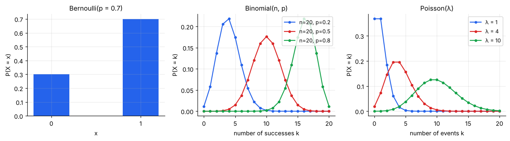
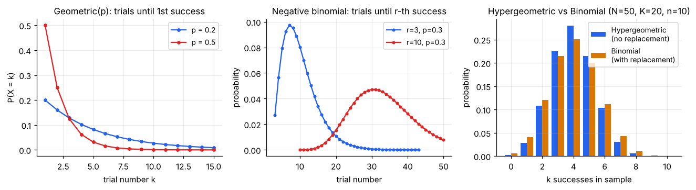
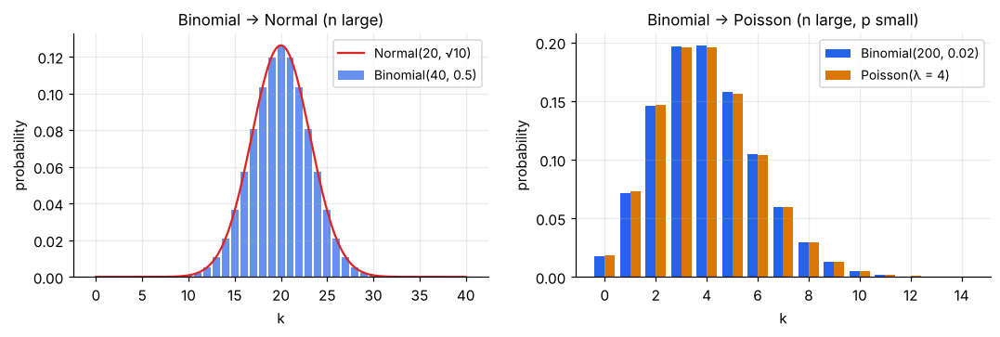

# Discrete Distributions

> **Discrete distributions answer "how many?"**: how many successes, how many events, how many trials until something happens. Pick the one whose *story* matches your data.

**Contents**

1. [Quick chooser](#1-quick-chooser)
2. [Discrete uniform](#2-discrete-uniform)
3. [Bernoulli](#3-bernoulli)
4. [Binomial](#4-binomial)
5. [Poisson](#5-poisson)
6. [Geometric and negative binomial](#6-geometric-and-negative-binomial)
7. [Hypergeometric](#7-hypergeometric)
8. [Approximations between distributions](#8-approximations-between-distributions)
9. [Cheat sheet](#9-cheat-sheet)
10. [Code snippets](#10-code-snippets)

---

## 1. Quick chooser

| The story | Distribution |
|---|---|
| One trial, yes/no | Bernoulli(p) |
| Fixed n trials, count the successes, same p each time, independent | Binomial(n, p) |
| Events arriving randomly in time/space, count them in a window | Poisson(λ) |
| Repeat trials until the **first** success | Geometric(p) |
| Repeat trials until the **r-th** success | Negative binomial(r, p) |
| Sample **without replacement** from a small finite pool | Hypergeometric(N, K, n) |
| All outcomes equally likely (die, random draw of an ID) | Discrete uniform |

---

## 2. Discrete uniform

Each of m values is equally likely: P(X = x) = 1/m. A fair die is uniform on {1,…,6}: mean 3.5, variance (m² − 1)/12 = 35/12 ≈ 2.92.

Use it for: random sampling from a list, random assignment to groups, a "no information" starting model.

---

## 3. Bernoulli

A single trial with two outcomes. X = 1 ("success") with probability p, X = 0 with probability 1 − p.

- P(X = x) = pˣ(1 − p)¹⁻ˣ
- **Mean = p**, **Variance = p(1 − p)**

Examples: a customer buys or doesn't; an email is spam or not; a part is defective or not. It is the building block of the binomial, geometric and negative binomial.

---

## 4. Binomial

**Story:** n independent Bernoulli(p) trials; X = number of successes.

- P(X = k) = C(n, k) · pᵏ · (1 − p)ⁿ⁻ᵏ,  k = 0, 1, …, n
- **Mean = np**, **Variance = np(1 − p)**
- Shape: symmetric when p = 0.5, right-skewed when p is small, left-skewed when p is large.

**Check four conditions:** (1) fixed n, (2) two outcomes, (3) same p each trial, (4) trials independent. If trial 2 depends on trial 1 (e.g. sampling without replacement from a small group), it is *not* binomial; see hypergeometric.



**Worked example.** Each of 10 website visitors buys with probability 0.3.

- P(exactly 3 buy) = C(10,3)(0.3)³(0.7)⁷ = 120 × 0.027 × 0.0824 ≈ **0.267**
- P(at least 5 buy) = 1 − P(X ≤ 4) ≈ **0.150**
- Mean = 10 × 0.3 = 3 buyers; SD = √(10 × 0.3 × 0.7) ≈ 1.45.

Business uses: conversion counts, defect counts, survey "yes" counts, A/B-test successes.

---

## 5. Poisson

**Story:** events occur independently at a constant average **rate**; X = number that occur in a fixed window (an hour, a page, a square metre).

- P(X = k) = e⁻λ · λᵏ / k!,  k = 0, 1, 2, … (λ = average count per window)
- **Mean = λ and Variance = λ** (equal). If your count data have variance much larger than the mean ("overdispersion"), Poisson is too tight; consider a negative binomial.
- No upper limit on k, unlike the binomial.
- Right-skewed for small λ, nearly bell-shaped for large λ.

**Worked example.** A help-desk gets on average λ = 4 calls per hour.

- P(0 calls) = e⁻⁴ ≈ **0.018**
- P(exactly 2 calls) = e⁻⁴·4²/2! ≈ **0.147**
- P(8 or more calls) ≈ **0.051**, which is rare enough that a sudden burst may signal a problem.
- **Rescaling:** for 30 minutes, λ becomes 4 × 0.5 = 2. Always match λ to the window.

Business uses: arrivals, defects per metre of cloth, typos per page, claims per month, website hits per second.

> The Poisson (counts) and the exponential (waiting times between events) are two views of the same process. See [03 – Continuous Distributions](03-continuous-distributions.md#6-exponential).

---

## 6. Geometric and negative binomial



### Geometric(p) – trials until the first success

- P(X = k) = (1 − p)ᵏ⁻¹ · p,  k = 1, 2, 3, …
- **Mean = 1/p**, **Variance = (1 − p)/p²**
- **Memoryless:** after any run of failures, the chance of success on the next try is still p. The process has no "I'm due" memory.

**Example.** A sales call converts with p = 0.2. P(first sale on exactly the 3rd call) = 0.8² × 0.2 = **0.128**. P(within the first 3 calls) = **0.488**. Expected calls to get a sale = 1/0.2 = **5**.

### Negative binomial(r, p) – trials until the r-th success

- Sum of r independent geometrics, so **mean = r/p**.
- Wider (more variable) than a Poisson with the same mean, which is why it is popular for *overdispersed count data* (e.g. customer purchases, insurance claims).

**Convention warning:** some books and libraries count *failures before the r-th success* rather than *trials*. SciPy's `nbinom` counts failures. Always check which one a formula uses.

---

## 7. Hypergeometric

**Story:** a pool of N items contains K "successes". Draw n **without replacement**; X = number of successes in the sample.

- P(X = k) = C(K, k) · C(N − K, n − k) / C(N, n)
- **Mean = n·K/N**
- Compared with the binomial it has **less variance**, since each draw removes an item and changes the odds.

**Worked example.** A box of 50 parts has 20 defective. Inspect 10 without replacement.

- P(exactly 4 defective) = C(20,4)C(30,6)/C(50,10) ≈ **0.280**
- Treating it as binomial(10, 0.4) would give 0.251, a noticeable error because the sample (10) is a big share of the pool (50).

**Rule of thumb:** if the sample is under ~5–10% of the population, the binomial is an excellent stand-in. This is why surveys of a large population can use binomial formulas.

---

## 8. Approximations between distributions



| Approximation | When it works | Why useful |
|---|---|---|
| Binomial(n, p) ≈ **Normal**(np, √(np(1 − p))) | np ≥ 10 and n(1 − p) ≥ 10 | Hand computations; the basis of z-tests for proportions |
| Binomial(n, p) ≈ **Poisson**(np) | n large, p small (np moderate) | Rare events, e.g. 200 items with 2% defect rate |
| Hypergeometric ≈ Binomial | Sample ≪ population | Ignore "without replacement" |
| Poisson(λ) ≈ Normal(λ, √λ) | λ ≥ ~20 | Large counts |

**Continuity correction:** when approximating a discrete count by a continuous normal, evaluate at half-integers. For Binomial(40, 0.5): exact P(X ≤ 17) = 0.2148; Normal with correction, P(Y ≤ 17.5) = 0.2146.

---

## 9. Cheat sheet

| Distribution | Parameters | Support | Mean | Variance | Skewness | Excess kurtosis |
|---|---|---|---|---|---|---|
| Discrete uniform | m values | 1…m | (m + 1)/2 | (m² − 1)/12 | 0 | −6(m² + 1)/(5(m² − 1)) |
| Bernoulli | p | {0, 1} | p | p(1 − p) | (1 − 2p)/√(p(1 − p)) | (1 − 6p(1 − p))/(p(1 − p)) |
| Binomial | n, p | 0…n | np | np(1 − p) | (1 − 2p)/√(np(1 − p)) | (1 − 6p(1 − p))/(np(1 − p)) |
| Poisson | λ | 0, 1, 2, … | λ | λ | 1/√λ | 1/λ |
| Geometric | p | 1, 2, … | 1/p | (1 − p)/p² | (2 − p)/√(1 − p) | 6 + p²/(1 − p) |
| Negative binomial | r, p | r, r+1, … | r/p | r(1 − p)/p² | (2 − p)/√(r(1 − p)) | 6/r + p²/(r(1 − p)) |
| Hypergeometric | N, K, n | max(0, n−N+K)…min(n, K) | nK/N | n(K/N)(1 − K/N)(N − n)/(N − 1) | close to the binomial's when n ≪ N | close to the binomial's when n ≪ N |

Reading the last two columns: skewness is positive (right tail) for all the "waiting" and "rare event" families and shrinks as n, r or λ grows, which is why they approach the normal. See [descriptive-statistics/03](../descriptive-statistics/03-skewness-and-kurtosis.md) for how to interpret these numbers.

---

## 10. Code snippets

```python
from scipy import stats

# Binomial: 10 visitors, p = 0.3
b = stats.binom(n=10, p=0.3)
b.pmf(3)        # P(X = 3)  = 0.267
b.sf(4)         # P(X >= 5) = 0.150   (sf(k) = P(X > k))
b.cdf(4)        # P(X <= 4)

# Poisson: 4 calls/hour
p = stats.poisson(mu=4)
p.pmf(2)        # 0.147
p.sf(7)         # P(X >= 8) = 0.051
stats.poisson(mu=4 * 0.5).pmf(0)   # no calls in 30 minutes

# Geometric: first sale on 3rd call
stats.geom(p=0.2).pmf(3)           # 0.128

# Hypergeometric: M=population, n=#successes in pool, N=sample size  (SciPy's naming)
stats.hypergeom(M=50, n=20, N=10).pmf(4)   # 0.280

# Negative binomial: SciPy counts FAILURES before the r-th success
stats.nbinom(n=3, p=0.3).pmf(5)    # 5 failures before the 3rd success (= 8th trial)

# Simulate to check intuition
import numpy as np
rng = np.random.default_rng(0)
rng.binomial(10, 0.3, size=100_000).mean()   # ≈ 3
```
