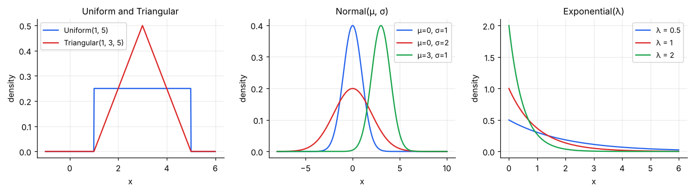
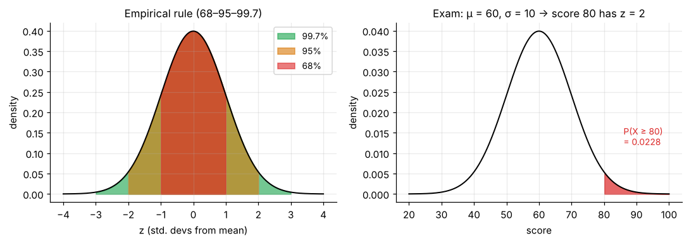
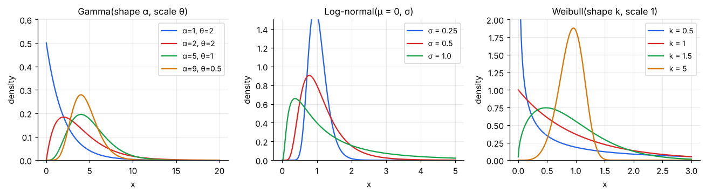
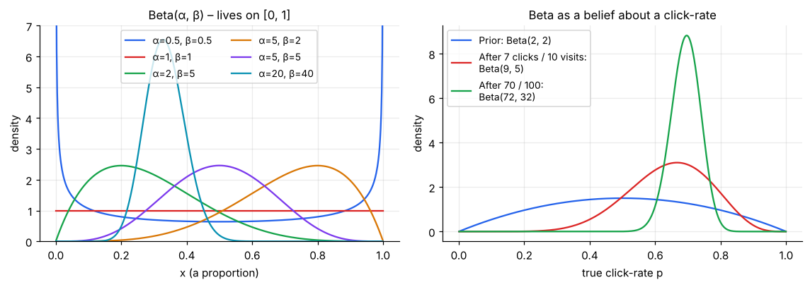
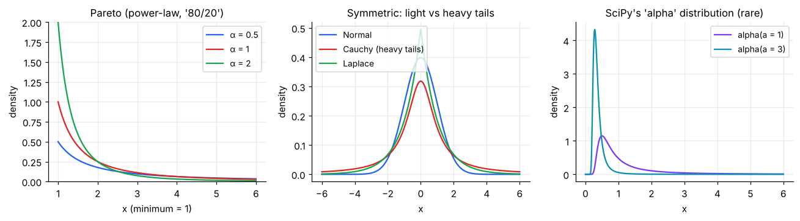

# Continuous Distributions

> **Continuous distributions answer "how much?" or "how long?"**: a time, an amount, a proportion. Probabilities are *areas under a curve*, and the choice of curve comes from the story behind the data (sum of many effects → normal, waiting time → exponential/gamma, unknown proportion → beta, product of effects → log-normal).

**Contents**

1. [Quick chooser](#1-quick-chooser)
2. [Uniform and triangular](#2-uniform-and-triangular)
3. [Normal](#3-normal)
4. [Log-normal](#4-log-normal)
5. [Gamma (and what α means)](#5-gamma-and-what-α-means)
6. [Exponential](#6-exponential)
7. [Beta (α and β)](#7-beta-α-and-β)
8. [Weibull](#8-weibull)
9. [Heavy tails: Pareto, Cauchy, Laplace, and SciPy's "alpha"](#9-heavy-tails-pareto-cauchy-laplace-and-scipys-alpha)
10. [Relationships between distributions](#10-relationships-between-distributions)
11. [Cheat sheet](#11-cheat-sheet)
12. [Code snippets](#12-code-snippets)

---

## 1. Quick chooser

| The data looks like… | Try |
|---|---|
| Anything between a min and max is equally likely | Uniform |
| Only min, most-likely, max are known (project estimates) | Triangular |
| Symmetric bell; sum or average of many small effects (heights, errors, averages) | **Normal** |
| Positive, right-skewed, multiplicative effects (income, prices, sales) | **Log-normal** |
| Positive, skewed; total waiting time for k events | **Gamma** |
| Time between random events; "memoryless" | **Exponential** |
| A probability/proportion between 0 and 1 | **Beta** |
| Lifetime where failure rate rises or falls with age | Weibull |
| Extreme outliers common; "80/20" patterns | Pareto, Cauchy |

---

## 2. Uniform and triangular



**Uniform(a, b):** flat density 1/(b − a) on [a, b]. Mean (a + b)/2, variance (b − a)²/12.
*Example:* a bus comes uniformly within a 10-minute window → P(wait ≤ 3) = 3/10.

**Triangular(min, mode, max):** a pragmatic model when you only have expert guesses ("best case, most likely, worst case"). Common in project-duration and revenue simulations.

---

## 3. Normal

The famous bell curve, symmetric around μ. Written **N(μ, σ)**: μ shifts the curve left/right, σ stretches it.

- PDF: f(x) = (1 / σ√(2π)) · exp(−(x − μ)² / 2σ²)
- **Mean = median = mode = μ**, **Variance = σ²**
- **Why it is everywhere:** the Central Limit Theorem says sums and averages of many independent effects become normal, whatever the underlying shape. Measurement errors, averages, and regression residuals are often close to normal.
- Closed under addition: if X ~ N(μ₁, σ₁) and Y ~ N(μ₂, σ₂) are independent, X + Y ~ N(μ₁ + μ₂, √(σ₁² + σ₂²)).



### The empirical (68–95–99.7) rule

| Range | Share of data |
|---|---|
| μ ± 1σ | ≈ 68% |
| μ ± 2σ | ≈ 95% (more exactly ±1.96σ) |
| μ ± 3σ | ≈ 99.7% |

### Standard normal and z-scores

Z = (X − μ)/σ turns any normal into **N(0, 1)**, so a single table (or `norm.cdf`) serves all normals. z = 2 means "2 SDs above average".

**Worked example.** Exam marks ~ N(60, 10).

- Score 80 → z = (80 − 60)/10 = **2**; P(X ≥ 80) = **0.0228** (about 2.3% of students).
- P(50 < X < 70) = P(−1 < Z < 1) = **0.683**.
- 90th percentile = 60 + 1.2816 × 10 ≈ **72.8**.

**When *not* to use it:** counts near zero, strictly positive skewed amounts (money, times), proportions near 0 or 1, and data with frequent extreme outliers. Check with a histogram or Q–Q plot first.

---

## 4. Log-normal

X is log-normal if **ln X is normal**. This happens when effects *multiply* (growth rates, price changes) the way normals arise when effects *add*.

- Strictly positive and right-skewed; the tail can be long.
- If ln X ~ N(μ, σ): **median = eᵘ**, **mean = eᵘ⁺ˢ²ᐟ²** (mean > median, increasingly so as σ grows).



*Examples:* income and house prices, stock prices (over time), file sizes, time to complete tasks. **Tip:** if a variable is skewed, taking logs often makes it approximately normal, which then lets you apply normal-based methods.

---

## 5. Gamma (and what α means)

A flexible family for **positive, right-skewed** quantities. It has a **shape α** (sometimes written k) and a **scale θ** (or rate λ = 1/θ).

- PDF: f(x) = xᵅ⁻¹ e⁻ˣᐟᶿ / (Γ(α) θᵅ),  x > 0
- **Mean = αθ**, **Variance = αθ²**
- **Story:** the total waiting time until the **α-th event** of a Poisson process (when α is a whole number it is also called the **Erlang** distribution).
- α = 1 gives the exponential; large α looks nearly normal; small α piles up near 0. (The first panel above shows these shapes.)
- Chi-square is a special case: χ²(ν) = Gamma(α = ν/2, θ = 2).

**Worked example.** Customer arrivals have an average gap of 5 minutes (exponential, θ = 5). The time for **3 arrivals** is Gamma(α = 3, θ = 5): mean = 15 minutes, and P(finished within 15 min) ≈ **0.577**. This is above 50% because the distribution is right-skewed: its mean (15) sits above its median, so more than half the probability lies below the mean.

*Uses:* insurance claim sizes, rainfall, service times, waiting times, and as a prior for rates in Bayesian models.

> **Naming note.** In many books "α" is just the *shape parameter* of the gamma (as here) or one of the two shape parameters of the beta (next section). SciPy also has a separate, rarely used distribution literally named `alpha`; see [section 9](#9-heavy-tails-pareto-cauchy-laplace-and-scipys-alpha).

---

## 6. Exponential

**Story:** the time between events in a Poisson process (arrivals, failures, calls). It is Gamma with α = 1.

- PDF: f(x) = λ e⁻ˡˣ, x ≥ 0 (λ = rate per unit time)
- **Mean = 1/λ**, **Variance = 1/λ²**, **P(X > x) = e⁻ˡˣ**
- **Memoryless:** P(X > s + t | X > s) = P(X > t). If you've already waited 10 minutes, the *remaining* wait has the same distribution as when you started. (It's the continuous twin of the geometric.)
- Monotonically decreasing: short waits are most likely, but long waits happen.

**Worked example.** A service desk gets customers at λ = 0.2 per minute (average gap 5 minutes).

- P(gap > 10 min) = e⁻² = **0.135**
- P(gap ≤ 3 min) = 1 − e⁻⁰·⁶ = **0.451**
- Even if nobody has come for 10 minutes, the expected *additional* wait is still 5 minutes.

**Connection:** counts in a window → Poisson(λt); time between events → Exponential(λ).

*Uses:* inter-arrival times, time to failure of components with no wear-out, queueing and simulation.

---

## 7. Beta (α and β)

**The distribution for a quantity that lives between 0 and 1:** a proportion, rate, or probability that is *itself uncertain*.

- Two shape parameters, **α > 0 and β > 0**: PDF f(x) ∝ xᵅ⁻¹(1 − x)ᵝ⁻¹ on 0 ≤ x ≤ 1
- **Mean = α/(α + β)**
- **Variance = αβ / [(α + β)²(α + β + 1)]**
- **Mode** (for α, β > 1) = (α − 1)/(α + β − 2)

### How to read α and β

Think of α as "**successes + 1**" and β as "**failures + 1**" worth of evidence. Beta(α, β) is your belief about a success rate after seeing α − 1 successes and β − 1 failures (starting from complete ignorance).



| Parameters | Shape (see left panel) | Meaning |
|---|---|---|
| α = β = 1 | Flat (uniform on [0, 1]) | No idea what the rate is |
| α = β > 1 | Symmetric hump at 0.5 | Believe the rate is near 50% |
| α > β | Skewed toward 1 | Believe rate is high |
| α < β | Skewed toward 0 | Believe rate is low |
| α, β < 1 | U-shaped | Rate is probably near 0 or near 1 |
| Larger α + β | Narrower | More certainty (more data) |

### Why the beta is special: Bayesian updating for a rate

If your prior for an unknown success rate p is Beta(α, β) and you observe **s successes and f failures**, the updated belief is exactly **Beta(α + s, β + f)**. The right panel shows the idea.

**Worked example (click-through rate).** Start with a mild prior Beta(2, 2) (mean 0.5). An ad gets **7 clicks in 10 views**.

- Posterior = Beta(2 + 7, 2 + 3) = **Beta(9, 5)**, mean 9/14 ≈ **0.643**, 95% credible interval ≈ **(0.39, 0.86)**: wide, since only 10 views.
- After **70 clicks in 100 views**: Beta(72, 32), mean ≈ **0.692**, interval ≈ **(0.60, 0.78)**. More data gives a narrower curve.

*Uses:* A/B testing (Bayesian), conversion and defect rates, modelling variation in proportions across customers/stores, project completion fractions (PERT uses a scaled beta).

> **Related:** the **Dirichlet distribution** generalises the beta to *several* proportions that add to 1 (e.g. market shares, topic mixtures).

---

## 8. Weibull

Models **time to failure** when the failure rate can change with age.

- Shape **k**, scale λ. **k < 1:** failure rate *falls* with age (early-life failures); **k = 1:** constant rate (exponential); **k > 1:** rate *rises* (wear-out).
- Used in reliability, warranty analysis, and survival analysis.

---

## 9. Heavy tails: Pareto, Cauchy, Laplace, and SciPy's "alpha"



**Pareto(α, x_min):** the "80/20" power law. A small number of items account for most of the total (wealth, city sizes, file sizes, customer revenue). The smaller α is, the heavier the tail. For α ≤ 1 the mean doesn't exist; for α ≤ 2 the variance doesn't exist.

**Cauchy:** looks bell-shaped but its tails are so heavy that **the mean and variance do not exist**, and averaging more data does *not* settle down. It is the cautionary tale: the CLT requires finite variance.

**Laplace:** a "pointier" symmetric distribution with fatter tails than the normal; behind the L1 (absolute error) loss and lasso regression.

**SciPy's `alpha` distribution:** a rarely used right-skewed positive distribution (shape *a*) that appears mostly in specialised reliability or extreme-value settings. Unless you meet it in a specific course or paper, the **gamma** and **beta** (which use α as a parameter) are the "alpha" distributions you will actually need.

> **Practical lesson:** if a dataset has a few huge outliers (revenue per customer, claim sizes), averages and normal-based tests can mislead. Consider medians, log transforms, or heavy-tailed models.

---

## 10. Relationships between distributions

| From | To | How |
|---|---|---|
| Uniform(0, 1) | Any distribution | Apply the inverse CDF (the basis of simulation) |
| Exponential(λ) | Gamma(α, θ) | Sum of α independent exponentials |
| Gamma | Chi-square | χ²(ν) = Gamma(ν/2, scale 2) |
| Normal | Log-normal | X = eᶻ |
| Normal | Chi-square | χ²(ν) = sum of ν squared standard normals |
| Poisson counts | Exponential gaps | Same process, two views |
| Beta(1, 1) | Uniform(0, 1) | α = β = 1 |
| Gamma, Gamma | Beta | If X ~ Gamma(α), Y ~ Gamma(β) (same scale), then X/(X + Y) ~ Beta(α, β) |
| Binomial / Poisson | Normal | Large n / large λ (CLT) |

Here is the same story at a glance:

| "Counting" view (discrete) | "Waiting / amount" view (continuous) |
|---|---|
| Binomial: successes in n trials | Beta: the unknown success rate |
| Poisson: events in a time window | Exponential: gap to next event |
| Negative binomial: trials to r-th success | Gamma: time to α-th event |

---

## 11. Cheat sheet

| Distribution | Parameters | Support | Mean | Variance |
|---|---|---|---|---|
| Uniform | a, b | [a, b] | (a + b)/2 | (b − a)²/12 |
| Normal | μ, σ | ℝ | μ | σ² |
| Log-normal | μ, σ (of ln X) | (0, ∞) | eᵘ⁺ˢ²ᐟ² | (eˢ² − 1)e²ᵘ⁺ˢ² |
| Exponential | λ (rate) | [0, ∞) | 1/λ | 1/λ² |
| Gamma | α (shape), θ (scale) | (0, ∞) | αθ | αθ² |
| Beta | α, β | [0, 1] | α/(α + β) | αβ/[(α + β)²(α + β + 1)] |
| Weibull | k (shape), λ (scale) | [0, ∞) | λΓ(1 + 1/k) | λ²[Γ(1 + 2/k) − Γ²(1 + 1/k)] |
| Pareto | α, x_min | [x_min, ∞) | αx_min/(α − 1) if α > 1 | exists only if α > 2 |

---

## 12. Code snippets

```python
import numpy as np
from scipy import stats

# Normal: exam marks N(60, 10)
n = stats.norm(60, 10)
n.sf(80)                       # P(X >= 80) = 0.0228
n.cdf(70) - n.cdf(50)          # 0.683
n.ppf(0.90)                    # 72.8

# Exponential: mean gap 5 min  → scipy uses scale = 1/rate = mean
e = stats.expon(scale=5)
e.sf(10)                       # P(gap > 10) = 0.135
e.cdf(3)                       # 0.451

# Gamma: time for 3 arrivals, scale 5
g = stats.gamma(a=3, scale=5)  # a = shape α
g.cdf(15)                      # 0.577

# Beta: click-rate after 7 clicks / 10 views with Beta(2,2) prior
b = stats.beta(2 + 7, 2 + 3)
b.mean()                       # 0.643
b.interval(0.95)               # (0.386, 0.861)  95% credible interval

# Log-normal: SciPy's s = σ, scale = e^μ
stats.lognorm(s=0.5, scale=np.exp(0)).mean()   # 1.133

# Weibull (shape k) and Pareto (shape α)
stats.weibull_min(c=1.5, scale=1).mean()       # 0.903
stats.pareto(b=2).mean()                       # 2.0

# Fitting a distribution to data and checking fit
data = stats.lognorm(0.6, scale=50).rvs(1000, random_state=1)
shape, loc, scale = stats.lognorm.fit(data, floc=0)
print(stats.kstest(data, 'lognorm', args=(shape, loc, scale)))   # Kolmogorov–Smirnov test
```
