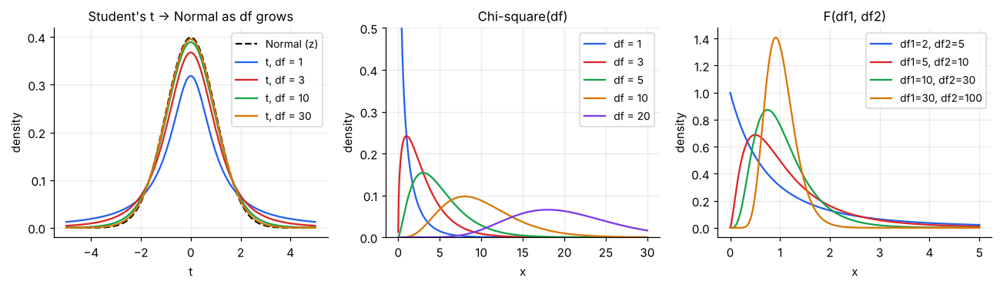
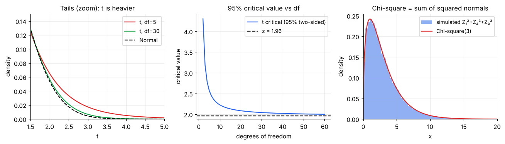

# Distributions Behind Statistical Tests: t, Chi-square, F

> **These three are not models of raw data.** They are the distributions of *test statistics*, quantities computed from a sample. They exist because we have to estimate σ from the data, and that extra uncertainty changes the shape of the curve.

**Contents**

1. [Why we need them](#1-why-we-need-them)
2. [Student's t](#2-students-t)
3. [Chi-square](#3-chi-square)
4. [F distribution](#4-f-distribution)
5. [How they connect](#5-how-they-connect)
6. [Where each one is used](#6-where-each-one-is-used)
7. [Reading a critical value](#7-reading-a-critical-value)
8. [Code snippets](#8-code-snippets)

---

## 1. Why we need them

If you *knew* the population σ, the standardised sample mean (X̄ − μ)/(σ/√n) would follow a normal distribution. In practice σ is unknown and we replace it with the sample SD *s*. That substitution adds randomness, so the standardised value is more spread out than a normal, especially for small samples. The t, chi-square and F distributions describe this exactly (assuming the underlying data are roughly normal).

**Degrees of freedom (df)** is the single parameter controlling these shapes. Informally: the number of independent pieces of information left after you've estimated something. A sample of n values has **n − 1** df for its variance because the deviations from the sample mean must add to zero, so only n − 1 are free.



---

## 2. Student's t

Used when testing/estimating a **mean** and σ is unknown.

T = (X̄ − μ) / (s/√n)  ~ **t with n − 1 df**

- Symmetric and bell-shaped around 0, like the standard normal, but with **heavier tails**: extreme values are more likely, so you must be more cautious with small samples.
- **df → ∞:** it converges to the standard normal (by df ≈ 30 the two are close).
- Mean 0 (df > 1), variance df/(df − 2) (df > 2). With df = 1 it is the Cauchy distribution.



**Worked example.** A sample of n = 11 delivery times (df = 10). The 95% two-sided confidence interval multiplier is **t\* = 2.228**, not the normal's 1.96, so the interval is about 14% wider. With a sample of 61 (df = 60) it is 2.000, nearly 1.96.

**Tail comparison:** for df = 5, P(T > 2.5) = 0.027, whereas for a normal P(Z > 2.5) = 0.006. Using a normal here would claim "rare" for something that happens over four times as often.

---

## 3. Chi-square

If Z₁, …, Z_ν are independent standard normals, then

**χ² = Z₁² + Z₂² + … + Z_ν²  ~ chi-square with ν df**

(The right panel of the figure above confirms this by simulation for ν = 3.)

- Always **≥ 0** and **right-skewed**; the skew fades as df grows.
- **Mean = ν**, **Variance = 2ν**.
- It is a gamma: Gamma(α = ν/2, scale 2).

**Two big uses:**

1. **Variance of a sample from a normal population:** (n − 1)s²/σ² ~ χ²(n − 1). Gives a confidence interval for σ².
2. **Counts in categories** (goodness-of-fit and independence tests): χ² = Σ (Observed − Expected)² / Expected. Large values mean the data are far from what the null hypothesis predicts. These tests are always **right-tailed**.

**Worked example.** Testing independence in a 2 × 2 table has df = (2 − 1)(2 − 1) = 1; the 5% critical value is **3.841**. A computed χ² = 5.2 exceeds it, so reject independence at 5%. For a goodness-of-fit test across 5 categories, df = 4, critical value **9.488**.

---

## 4. F distribution

The ratio of two independent chi-squares, each divided by its df:

**F = (χ²₁/d₁) / (χ²₂/d₂)  ~ F(d₁, d₂)**

- Takes only positive values and is right-skewed.
- Two df values: numerator d₁ and denominator d₂. **Order matters**: F(5, 10) ≠ F(10, 5).
- A ratio near **1** is what you expect when two variances (or a "between" and a "within" variance) are equal; large F suggests they are not.

**Uses:**

- **ANOVA:** F = (variance *between* groups)/(variance *within* groups). A large F means the group means differ more than random scatter would explain.
- **Comparing two variances:** F = s₁²/s₂².
- **Overall significance in regression:** whether the model explains more than noise.

**Worked example.** One-way ANOVA with 3 groups and 30 observations: df = (2, 27); the 5% critical value is **3.354**. An F of 6.1 is beyond it, so at least one group mean differs.

---

## 5. How they connect

| Relationship | Statement |
|---|---|
| Normal → chi-square | χ²(ν) = sum of ν squared standard normals |
| Normal + chi-square → t | T = Z / √(χ²(ν)/ν) |
| Chi-square + chi-square → F | F = (χ²₁/d₁)/(χ²₂/d₂) |
| t → F | If T ~ t(ν), then T² ~ F(1, ν) |
| Large df | t → Normal; χ²(ν) ≈ Normal(ν, √(2ν)); F(d₁, ∞) = χ²(d₁)/d₁ |
| Chi-square → gamma | χ²(ν) = Gamma(ν/2, scale 2) |

Everything starts with the normal distribution: this is why checking approximate normality of your data (or having a large sample so the CLT helps) matters before using t, chi-square or F tests.

---

## 6. Where each one is used

| Test / task | Distribution | Statistic |
|---|---|---|
| CI and test for one mean (σ unknown) | t(n − 1) | (X̄ − μ₀)/(s/√n) |
| Two-sample or paired comparison of means | t | difference / standard error |
| Test for regression slope | t(n − 2) | b/SE(b) |
| Test for proportions (large n) | Normal (z) | (p̂ − p₀)/√(p₀(1 − p₀)/n) |
| Goodness-of-fit, independence | Chi-square | Σ(O − E)²/E |
| CI / test for a variance | Chi-square | (n − 1)s²/σ₀² |
| ANOVA, regression overall test, equal-variance test | F | ratio of variances |

---

## 7. Reading a critical value

A **critical value** cuts off the stated tail area, e.g. the point beyond which only 5% of the distribution lies.

| Distribution | Setting | 5% critical value |
|---|---|---|
| Normal | two-sided | ±1.960 |
| t, df = 10 | two-sided | ±2.228 |
| t, df = 30 | two-sided | ±2.042 |
| Chi-square, df = 1 | right tail | 3.841 |
| Chi-square, df = 4 | right tail | 9.488 |
| F(5, 10) | right tail | 3.326 |
| F(2, 27) | right tail | 3.354 |

Modern practice computes a **p-value** (tail area beyond the observed statistic) instead of looking up tables, but the logic is the same.

---

## 8. Code snippets

```python
from scipy import stats

# Critical values (ppf = inverse CDF)
stats.t.ppf(0.975, df=10)        # 2.228  (two-sided 95%: use 0.975)
stats.chi2.ppf(0.95, df=4)       # 9.488  (right tail 5%)
stats.f.ppf(0.95, dfn=5, dfd=10) # 3.326

# p-values (sf = survival function = tail area to the right)
stats.t.sf(2.5, df=5) * 2        # two-sided p
stats.chi2.sf(5.2, df=1)         # p for chi-square = 5.2, df = 1
stats.f.sf(6.1, dfn=2, dfd=27)   # p for the ANOVA example

# Heavier tails: t vs normal
stats.t.sf(2.5, 5), stats.norm.sf(2.5)   # 0.0272 vs 0.0062

# Simulation check: chi-square = sum of squared normals
import numpy as np
z = np.random.default_rng(0).standard_normal((100_000, 3))
print(((z**2).sum(axis=1)).mean())       # ≈ 3 (= df)
```
